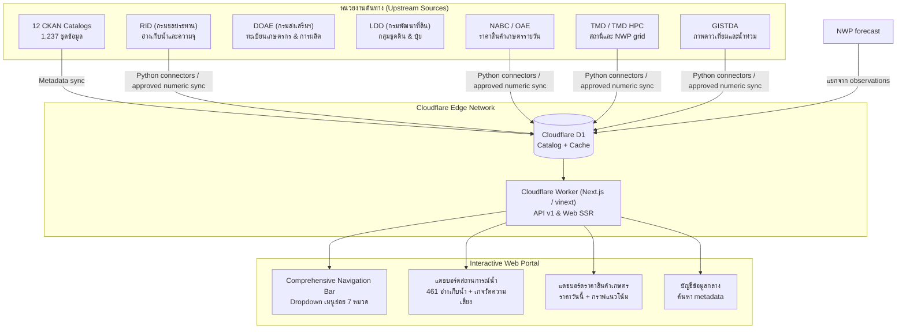

# Thailand Agricultural Data Hub — System Design

สถานะปัจจุบันอ้างอิง `main` commit `14026f0` และ working tree ณ 27 ตุลาคม 2569. ระบบใช้ Next.js/vinext บน Cloudflare Workers, Cloudflare D1 เป็น catalog และ numeric store, และ Python connectors สำหรับ ingest. Handoff ล่าสุดบันทึก 9,923 numeric observations, NWP run `tmd_hpc_d02_2026102606` (220 snapshots, 8,657 ค่ารายจังหวัด), ราคา NABC จริง และสัญญาณเตือนภัยจาก RID/GISTDA/TMD. Preview deployment ล่าสุดผ่าน API smoke checks; สถานะ NWP และ CI ที่ยังค้างระบุใน [HANDOFF.md](HANDOFF.md). ส่วนรายละเอียดแผน M1–M6 และผล audit บางรายการด้านล่างเป็นบันทึกก่อน 27 ตุลาคม; ให้ยึด [HANDOFF.md](HANDOFF.md) กับ [docs/progress.md](docs/progress.md) สำหรับสถานะล่าสุด

## 1. เป้าหมายและขอบเขต

ศูนย์นี้ช่วยเจ้าหน้าที่ส่งเสริมการเกษตร ผู้บริหาร และหน่วยงานอื่นค้นว่ามีข้อมูลเรื่องใดจากใคร ครอบคลุมพื้นที่และเวลาใด แล้วนำข้อมูลที่ตรวจสอบย้อนกลับได้ไปเลือกพื้นที่/ปัญหา วางโครงการ และติดตามผล เป้าหมายระยะยาวคือเข้าถึงแหล่งข้อมูลเกษตรของประเทศให้มากที่สุดเท่าที่ต้นทางและสิทธิ์อนุญาต แต่เว็บรุ่นแรกต้องใช้งานได้ก่อนที่ทุกแหล่งจะเชื่อมครบ

**นิยาม “รวมข้อมูล”:** ดึงบัญชีชุดข้อมูลจากทุกระบบที่อ่านได้ แล้วเลือก resource จริงมาเชื่อมตามความพร้อมของ API, นิยาม, พื้นที่, เวลา, คุณภาพ และสิทธิ์ บัญชีข้อมูล 2,387 รายการที่เคยค้นพบหรือดัชนีกลาง 44,383 รายการเป็นรายการค้นพบ ไม่ใช่จำนวนชุดตัวเลขที่ใช้งานได้หรือข้อมูลที่ครอบคลุมทุกจังหวัด ตัวเลขนี้เป็นผลสำรวจเดิมใน [แผนที่แหล่งข้อมูล](docs/accessible-data-map.md) ต้องตรวจรอบใหม่ก่อนแสดงเป็นสถานะปัจจุบัน

### สิ่งที่ผู้ใช้ทำได้ในรุ่นแรก

1. ค้นชื่อเรื่อง แหล่งข้อมูล พืช พื้นที่ และช่วงเวลาใน catalog รวมหลายหน่วยงาน เห็นลิงก์ต้นทาง ระดับข้อมูล หน่วย เวลาอัปเดต สถานะการเชื่อม และข้อจำกัด
2. เปิดตาราง/กราฟจาก resource ตัวเลขที่เชื่อมแล้วอย่างน้อยหนึ่งชุด กรองและแชร์ URL ได้ เห็นค่าขาดเป็น “ไม่ทราบ” พร้อมที่มาและเวลาที่ดึง
3. เปิดหน้าจังหวัดเพื่อดูว่าเรื่องใดมีหลักฐานจริง เรื่องใดยังขาด โดยไม่แต่งยอดจังหวัดจากข้อมูลประเทศ/สถานี/จุดกริด
4. เห็นสถานะ connector ว่าครั้งล่าสุดสำเร็จ เมื่อใด และข้อมูลเก่าแค่ไหน หากต้นทางล่มให้ใช้ชุดที่ดึงสำเร็จล่าสุดพร้อมป้ายเตือน
5. ไปยังหน้าโครงการเพื่อดูหลักฐาน/ประกาศทางการที่ตรวจแล้ว; ยังไม่คำนวณผลสัมฤทธิ์หากเป้าหมาย พื้นที่ ฤดู หรือหน่วยเทียบกันไม่ได้

งานภายหลัง: บัญชีผู้ใช้ภายใน, การแก้ไขข้อมูลโดยหน่วยงาน, แผนที่เชิงพื้นที่ละเอียด, คำแนะนำโครงการอัตโนมัติ, public download ทุกชุด, AI chatbot และพยากรณ์ การมีชื่อแหล่งข้อมูลใน catalog ไม่เปิดสิทธิ์ดาวน์โหลดค่าของแหล่งนั้น

### สมมติฐานเพื่อออกแบบ

| เรื่อง | ค่าเริ่มต้นที่เลือก | จุดตรวจเมื่อใช้งานจริง |
|---|---|---|
| ทีมและเวลา | ทีมเล็ก หลาย AI ช่วยงานขนาน ต้องมีขอบเขตไฟล์และสัญญาข้อมูลกลาง | ปรับลำดับเมื่อเจ้าของงานเลือกกรณีใช้จริงเพิ่ม |
| ปริมาณเริ่มต้น | catalog ระดับหมื่นรายการ, ข้อมูลตัวเลขระดับไม่เกินหนึ่งล้านแถว, ผู้ใช้พร้อมกันหลักสิบ | วัด query และค่าใช้จ่ายก่อนเพิ่มระบบใหม่ |
| ประสบการณ์ใช้ | ตารางค้นหา/กรอง/แชร์ URL ตอบภายในราว 2 วินาทีเมื่อฐานพร้อม; หน้าแรกใช้ได้บนมือถือ | วัดกับ preview และข้อมูลจริง ไม่รับรองจาก design |
| ความสด | catalog ตรวจวันละครั้ง; ข้อมูลแต่ละ resource ใช้รอบต้นทางของตน | เวลาที่ “ดึงได้ล่าสุด” แยกจากวันที่ข้อมูลกล่าวถึง |
| บัญชีผู้ใช้ | รุ่นสาธารณะอ่านได้เฉพาะข้อมูลที่เผยแพร่ได้; ฟังก์ชันภายในยังไม่เปิด | เพิ่มการยืนยันตัวตนเมื่อมี use case ภายในจริง |
| ผู้ให้บริการ | Cloudflare Workers ผ่าน vinext สำหรับเว็บ, D1 สำหรับ catalog/ข้อมูลที่อนุมัติ, GitHub Actions สำหรับ Python sync | vinext ยังเป็น beta; D1 มีโควตา Free รวม 5 GB, อ่าน 5 ล้านแถว/วัน, เขียน 100,000 แถว/วัน; วัด usage ก่อนเพิ่มข้อมูลตัวเลข |

## 2. สิ่งที่มีอยู่และนำมาต่อยอด

- `web/` เป็น Next.js 16.4.3, React 19.3.1, TypeScript 5.9.3 มี shell ภาษาไทย, catalog, ตาราง, ราคา, หน้าจังหวัดและโครงการแล้ว เก็บโครงหน้า สี ตัวกรองและกราฟ SVG ที่ใช้ได้
- `src/tadih/` มี Python connectors, parser, คุณภาพข้อมูล, geography, price history, water/weather/satellite และ DuckDB สำหรับงานเตรียม/ตรวจข้อมูล เก็บตรรกะที่ผ่านตรวจ ไม่ย้ายทั้งหมดไป TypeScript
- `config/sources.json` มี 23 source entries; D1 catalog ที่ตรวจไว้มี 12 CKAN sources, 1,237 datasets และ 3,777 resources. `config/resource_licenses.json` มี 89 resources (10 `approved_public`, 79 `pending`); `config/provinces.csv` เป็นแกนรหัสจังหวัด ไม่ใช่หลักฐาน coverage
- `web/app/api/v1/` มี read routes สำหรับ sources, datasets, records, series, observations, area evidence และ source status; `data_contracts/hub-api.schema.json` เป็นสัญญาร่วมของเว็บและผู้เชื่อมต่อ
- `web/lib/hub/` มี D1 repositories สำหรับ catalog และข้อมูลตัวเลข พร้อม fallback/legacy code ที่บางส่วนยังเหลือ; ตัวเลขล่าสุดใน handoff คือ 9,923 observations. ตัวเลข catalog 1,237 datasets เป็นผล audit ก่อนหน้าและเป็น metadata เท่านั้น; ไม่ใช่จำนวน numeric datasets ที่พร้อมใช้งาน
- หน้า catalog, explorer, ราคา และจังหวัดเรียก `/api/v1`; เส้นทาง `/api/local-data`, `/api/local-session` และ snapshot catalog ถูกถอดจากเว็บแล้ว `config/provinces.csv` คงไว้เป็นรหัสอ้างอิงสาธารณะ
- Python sync scripts เขียน catalog และ approved numeric batches ลง D1; Git ติดตาม workflow `ci.yml`, `discover-sources.yml`, `sync-hub-catalog.yml` และ `sync-hub-numeric.yml`. ไฟล์ workflow มีอยู่ไม่ได้ยืนยันว่า secrets ครบหรือ GitHub Actions รอบล่าสุดสำเร็จ

ข้อมูลเก่าใน `data/local/`, `exports/private/` และ Power BI เป็นหลักฐาน/งานวิจัยเดิม เก็บไว้เพื่อเทียบค่าหรือย้ายสูตรตามจำเป็น เว็บใหม่ไม่เปิดไฟล์เหล่านี้ระหว่าง request และ connector ใหม่ไม่สะสม raw ลงเครื่องเจ้าของงาน

## 3. โครงระบบที่เลือก (Active Agri-Intelligence Portal)



**เป้าหมายของระบบ:**
1. **Catalog path:** sync metadata จาก CKAN เข้า D1 เพื่อค้นหาแหล่ง ชุดข้อมูล และ resource. จำนวน 1,237 datasets เป็นผล audit ล่าสุดที่บันทึกไว้ ไม่ใช่ตัวเลขวิเคราะห์
2. **Numeric path:** Python connectors ดึง ตรวจ และ normalize ข้อมูลจริงที่เปิดใช้ แล้วเผยแพร่เป็น active run ใน D1; หน้าเว็บอ่านผ่าน repository/API เดียวกัน พร้อม source, grain, unit, run และวันข้อมูล
3. **Forecast path:** NWP จาก TMD HPC เก็บในตาราง `nwp_*` แยกจาก `observations`; API และหน้า `/nwp` แสดงค่ากริด/ค่าที่สรุปในรัศมีจังหวัดตามวิธีที่ระบุ


### ทำไมใช้ชุดนี้

| ทางเลือก | เหตุผลที่เลือก/ไม่เลือกในรุ่นแรก |
|---|---|
| Next.js เดิม + vinext/Cloudflare Workers + D1 + Python jobs | ใช้ UI/parser เดิมต่อ, มี serverless hosting และจุดเก็บ metadata กลาง; D1 ใช้ SQLite จึงต้องแปลง query จาก PostgreSQL และจำกัด batch/usage |
| Next.js อ่าน raw ใน repo หรือบนเครื่อง | ติดเครื่องเดียว อัปเดตยาก และทำให้ไฟล์ภายในกลายเป็นข้อมูลเว็บ |
| Browser เรียก API หน่วยงานทุกแห่งโดยตรง | CORS, API key, quota และรูปแบบผลลัพธ์ต่างกัน ทำให้หน้าไม่เสถียร |
| API service/queue/Redis แยกหลายระบบ | ยังไม่จำเป็นต่อปริมาณเริ่มต้น เพิ่มภาระ deploy และดูแล |

Cloudflare แนะนำ vinext สำหรับ Next.js บน Workers แต่ยังอยู่ใน beta จึงต้องตรวจ build และ deployed preview แยกจาก compatibility scan ([คู่มือ Cloudflare](https://developers.cloudflare.com/workers/framework-guides/web-apps/nextjs/)). D1 ใช้ผ่าน binding และ prepared statement ใน Worker ([D1 Worker API](https://developers.cloudflare.com/d1/worker-api/)); ห้ามเอา `pg.Pool` หรือ SQL PostgreSQL ไปใช้กับ D1 โดยตรง

## 4. ขอบเขตข้อมูลและความหมาย

ใช้ `sourceId + sourceDatasetId + sourceResourceId` เป็นตัวตนจากต้นทาง ไม่ใช้ชื่อชุดข้อมูลเป็นกุญแจเดียว `dataset` คือคำอธิบายของผู้ให้บริการ; `resource` คือไฟล์/API/ตารางที่มี grain และสิทธิ์เฉพาะตัว; `record` คือแถวที่ผ่าน parser แล้ว; `series` คือค่าตัวเลขที่เทียบข้ามเวลาได้เฉพาะเมื่อสินค้า เกรด หน่วย ตลาด ตำแหน่ง และวิธีวัดตรงกัน

| ตารางหลักใน D1 (ไม่มี schema namespace `hub`) | หน้าที่/ข้อบังคับ |
|---|---|
| `sources` | เจ้าของ ระบบ ชนิด connector, URL ที่อนุญาต, รอบตรวจ; ไม่เก็บ secret |
| `datasets` | ชื่อ คำอธิบาย เจ้าของ หน้าต้นทาง หมวด วันที่ metadata เปลี่ยน สถานะค้นพบ |
| `resources` | source resource ID, format, URL, grain, สิทธิ์, `active_run_id`, สิทธิ์แจกจ่ายข้อมูลตัวเลข |
| `sync_runs` | เวลาเริ่ม/จบ, status, จำนวนอ่าน/ผ่าน/กักกัน, hash, error code, รุ่น adapter |
| `locations` | ชนิดพื้นที่ `country/province/district/subdistrict/station/reservoir/grid`, native ID, รหัส DOPA เฉพาะที่ยืนยันได้, รุ่น crosswalk |
| `observations` | ค่าที่ normalize แล้วต่อ resource/batch มี `row_key`, `series_key`, วันที่/พื้นที่/พืช/metric/unit/value nullable และมิติ/คุณภาพที่รับรอง; ไม่เก็บ raw payload |

ข้อมูลที่ API เรียกว่า records และ series อ่านจาก `observations`; `series_key` ระบุกลุ่มมิติที่เทียบกันได้เพื่อไม่ต้องทำตาราง series ซ้ำในรุ่นแรก ทุกแถวผูก `run_id`; query สาธารณะเลือกเฉพาะ `resources.active_run_id` ของ batch ที่พร้อมและมีสิทธิ์ `row_key` ต้องคงที่ตามตัวระบุต้นทาง ไม่ผูกกับค่าตัวเลขที่อาจถูกแก้ภายหลัง hash ของ batch ช่วยตรวจว่า sync รอบใหม่เท่ารอบก่อนหรือไม่ เก็บอย่างน้อย batch ปัจจุบันและก่อนหน้าไว้ rollback; ระยะเก็บจริงต้องดูขนาดและเงื่อนไขต้นทาง

**กฎที่ต้องรักษา:** ค่าไม่พบเป็น `null`; ไม่มีข้อมูลกับศูนย์เป็นคนละสถานะ; ราคาประเทศไม่กลายเป็นราคาจังหวัด; จุดกริด/สถานี/อ่างไม่กลายเป็นค่าเฉลี่ยจังหวัด; ไม่บวกรายอำเภอซ้ำยอดจังหวัด; ไม่รวมราคาต่างสินค้า/เกรด/หน่วย/ตลาด; ปี พ.ศ./ค.ศ., ปีเพาะปลูก ฤดูและเดือนต้นทางเก็บแยกจน mapping ยืนยันแล้ว โดยเฉพาะ DOAE รต.01 ที่ยังมี [นิยามค้างตรวจ](docs/doae-production-semantics.md) ถ้าแผน/ผลไม่ตรง grain ให้ตอบ `INCOMPARABLE`

สิทธิ์มี 3 ค่าแยกจากสถานะการเชื่อม: `approved_public`, `metadata_only`, `internal` ค่า pending/restricted ในทะเบียนเดิมแสดง metadata และลิงก์ต้นทางได้ตามสิทธิ์หน้าเว็บ แต่ไม่ส่งตัวเลขผ่าน public API การยืนยันสิทธิ์ราย resource เป็นงานสั้นของผู้รับผิดชอบ connector ไม่ต้องรอสำรวจทุกหน่วยงานเสร็จ

## 5. แหล่งข้อมูลและลำดับเชื่อม

บัญชีเจ้าของที่สำรวจได้ 14 แห่งต่อไปนี้เป็น **metadata discovery** ณ รอบสำรวจเดิม ไม่รับรองว่าทุก resource มี API ตัวเลข:

| กลุ่มต้นทาง | รายการ catalog เดิม | แนวเชื่อมรุ่นแรก |
|---|---:|---|
| DOAE | 201 | CKAN; คัดชุดจริงจากชุดทดสอบ/ว่างและชุดจำกัดสิทธิ์ |
| OAE | 202 | CKAN; เชื่อม NABC ราคาเป็น resource แยก |
| LDD / DLD / DOF | 30 / 36 / 72 | CKAN metadata ก่อน; parser ดิน/สัตว์/ประมงตาม resource |
| HII / OPS MoAC / NSO | 36 / 78 / 914 | catalog น้ำ/โครงการ/สำมะโนก่อน แล้วเลือกตารางที่ใช้ได้ |
| NABC Catalog / CAD / ALRO | 591 / 49 / 50 | เก็บ owner/harvest lineage และตรวจชุดซ้ำ |
| ACFS / Royal Rain / THAGRI | 26 / 28 / 74 | metadata และ API ราย resource ที่ตรวจ endpoint ได้ |

แหล่งที่ลงทะเบียนรวมถึง OpenD/data.go.th, GISTDA, Meteostat, DWR, RID, TMD/TMD HPC, NABC และ Open-Meteo/ERA5. ตาม [AGENTS.md](AGENTS.md) ผู้ดูแลยืนยันสิทธิ์และ credentials สำหรับข้อมูลจริง; ให้คง source grain และใช้ null เมื่อหน่วยหรือค่าที่จำเป็นไม่ทราบ. ทะเบียน resource ปัจจุบันมี 89 รายการ โดย 10 `approved_public` และ 79 `pending`. NWP API อ่านสิทธิ์เผยแพร่จาก exact-resource registry จึงตอบ `access=approved_public`; D1 run row เดิมยัง pending เพราะยังไม่ได้ migrate. หน่วยยัง `pending_official_confirmation`, API unit เป็น null และ risk level ไม่จัดจนมีหลักฐานหน่วย. บันทึกในส่วนนี้ที่ลงวันที่ 25 ต.ค. และ [M3 API audit](docs/m3-api-candidate-audit-2026-10-25.md) เป็นผลสำรวจในอดีต ไม่ใช่สถานะปัจจุบัน

**ลำดับตัวเลขที่แนะนำ:** 1) หนึ่ง resource ราคา OAE/NABC หรืออากาศจาก API ที่เงื่อนไขการใช้ผ่าน เพื่อให้มีกราฟจริงและ lineage, 2) พืช/แผน DOAE หลังยืนยันความหมายปี/รอบและสิทธิ์, 3) RID/DWR น้ำ, 4) GISTDA/อากาศ/ดิน, 5) โครงการหลายหน่วยงาน แต่ละตัวเชื่อมมีงานแยกใน implementation plan การค้น catalog ทุกเจ้าของเดินขนานกับตัวเลข ไม่ผูกกัน

## 6. สัญญา API สำหรับเว็บและหน่วยงานอื่น

ทุก endpoint รุ่นแรกเป็นอ่านอย่างเดียว อยู่ใต้ `/api/v1` และคืนรูปแบบเดียวกันตาม `data_contracts/hub-api.schema.json`; อย่าเปลี่ยน field โดยไม่แก้ contract และแจ้งทีมอื่นก่อน Routes ของ Next.js เป็น API สำหรับ browser/partner ในขณะที่ Server Components ใช้ repository เดียวกัน ไม่เรียก HTTP กลับเข้าเว็บตัวเอง ปัจจุบัน fallback มี metadata จาก 12 CKAN sources ส่วนเส้นทางตัวเลขต้องอ่าน active approved batch จากฐานเท่านั้น

| Endpoint | คำถามที่ตอบ | ตัวกรองหลัก |
|---|---|---|
| `GET /api/v1/sources` | มีหน่วยงานใดเชื่อมแล้วและล่าสุดเมื่อไร | `status, page, pageSize` |
| `GET /api/v1/datasets` | มีชุดอะไร ค้นได้ที่ไหน | `q, sourceId, category, provinceCode, page, pageSize` |
| `GET /api/v1/datasets/:id` | นิยาม สิทธิ์ เวลา หน่วย และ resources | `id` |
| `GET /api/v1/datasets/:id/records` | แถวต้นทางที่ normalize แล้ว | filter ที่ dataset นั้นประกาศ, `page, pageSize` |
| `GET /api/v1/datasets/:id/series` | เลือก metric/สินค้า/เกรด/ตลาด/หน่วย | `metric, product, page, pageSize` |
| `GET /api/v1/series/:id/observations` | ตารางและกราฟย้อนหลัง | `from, to, page, pageSize` |
| `GET /api/v1/areas/:provinceCode` | resource ที่มีหลักฐานจริง/ช่องว่างในจังหวัด | `provinceCode, category` |
| `GET /api/v1/sources/:id/status` | sync ล่าสุด สำเร็จ/เก่า/ล้มเหลว | `id` |

ตัวกรองทั้งหมดมี allowlist, ความยาวและช่วงจำกัด `pageSize` เริ่ม 25 สูงสุด 100; pagination ต้องคืน `total` ที่อ้าง batch เดียวกันและเรียงด้วย key คงที่ ไม่ให้ผู้ใช้ส่ง URL/SQL ต้นทางเอง รหัสจังหวัดต้องใช้ชุดอ้างอิง 77 รหัสและไม่ตีว่ามี coverage 77 จังหวัด

```json
{
  "data": [],
  "meta": {
    "availability": "empty",
    "freshness": "unknown",
    "completeness": "unknown",
    "access": "approved_public",
    "sourceIds": ["doae"],
    "grain": "subdistrict x crop x planting_round",
    "retrievedAt": null,
    "dataAsOf": null,
    "sourceUpdatedAt": null,
    "datasetVersion": null,
    "warnings": [],
    "runtimeMode": "database"
  },
  "pagination": { "page": 1, "pageSize": 25, "total": 0 }
}
```

ตัวอย่างนี้เป็น **รูปแบบสัญญา** ไม่ใช่ผลข้อมูลจริง `availability` = `ready/empty/metadata_only/unavailable`; `freshness` = `fresh/stale/unknown`; `completeness` = `complete/partial/unknown` สามแกนไม่ยุบเป็น flag เดียว `empty` ใช้เมื่อ query ที่ถูกต้องไม่พบแถวจาก batch ที่พร้อม; ถ้าแหล่งล่มและไม่มี batch ให้ error 503; ถ้ามี batch เก่าให้ 200 พร้อม `stale` และเวลาที่ดึงจริง

คำขอผิด 400, dataset/series ไม่พบ 404, rate limit 429, upstream/cache unavailable 503 รูป error เดียว: `{"error":{"code":"SOURCE_UNAVAILABLE","message":"ยังอ่านข้อมูลนี้ไม่ได้","requestId":"..."}}` ห้ามคืน trace/credential/SQL สู่ผู้ใช้ การเพิ่ม field เป็น optional และคงชื่อเดิมเพื่อให้ AI หลายทีมทำหน้า/API โดยไม่แตกสัญญา

## 7. การอัปเดต ความล้มเหลว และต้นทุน

- เริ่ม sync catalog วันละครั้ง และ API ตัวเลขตามรอบจริงของต้นทาง ใช้ GitHub Actions schedule + manual dispatch; schedule อาจมาช้า จึงใช้ `lastSuccessAt` ไม่อ้างเวลา cron ว่าเป็นเวลาข้อมูลจริง ([GitHub Actions schedule](https://docs.github.com/en/actions/reference/workflows-and-actions/events-that-trigger-workflows#schedule))
- จำกัดขนาด/หน้า/เวลาของแต่ละ connector, หน่วงตาม quota, retry เฉพาะ 429/5xx จำนวนต่ำและเคารพ Retry-After; source ล้มเหลวคง batch ก่อนหน้า แสดงวันเก่าและ error code
- Worker อ่าน D1 ผ่าน binding/prepared statements; Python jobs ใช้ D1 sink สำหรับ sync. เมื่อ publish batch ใหม่ให้เปลี่ยน `datasetVersion` เพื่อ invalidate cache; browser ไม่ใช้ค่าจากหนึ่ง batch ไปผสมอีก batch ในหน้ากราฟเดียว
- D1 Free Tier มี daily write cap 100,000 rows; handoff ล่าสุดระบุว่ารอบ NWP ชนเพดานและจะรีเซ็ต 07:00 ICT. รักษา idempotent reruns, แบ่ง batch และเรียงเวลางานเพื่อไม่ให้ sync งานอื่นเขียนซ้ำโดยไม่จำเป็น
- เริ่มด้วย index ตาม `source_id, dataset_id, province_code, period, series_id, active_run_id` ใช้ query plan จริงก่อนเพิ่ม partition/Redis/PostGIS/queue; บันทึกเวลาตอบของหน้าค้นหาและจำนวน sync fail แบบย่อ
- backup ของฐาน managed เปิดใช้งานตามผู้ให้บริการ และลอง restore ใน preview ก่อนถือว่า recoverable; ประวัติ DuckDB ในเครื่องไม่ใช่ backup ของฐานใหม่นี้

ความปลอดภัยขั้นต่ำ: secret อยู่ใน Cloudflare Worker/GitHub Actions secret เท่านั้น, D1 เข้าถึงผ่าน binding ฝั่ง Worker, ใช้ prepared statements, ไม่เปิด internal sync endpoint แบบสาธารณะโดยไม่มี token, ไม่ส่งชื่อ/ที่อยู่/เบอร์/แปลงเกษตรกรสู่ public API รุ่นแรก. ยังไม่มีระบบ login; ข้อมูลภายในไม่เปิดผ่าน public API

## 8. หน้าตาและประสบการณ์ใช้งาน

คงสีเขียวเข้ม พื้นกระดาษอ่อนและตัวอักษรไทยจาก [DESIGN.md](DESIGN.md) ทำหน้าแรกเป็น “ค้นข้อมูลที่ใช้ได้” พร้อมหัวข้อยอดนิยมและสถานะข้อมูลล่าสุด หน้า catalog เน้นผลค้นจริงกับตัวกรอง; รายละเอียด dataset วางนิยาม/พื้นที่/ช่วงเวลา/หน่วย/สิทธิ์ก่อนตาราง; หน้า area ใช้รายการหลักฐาน/ช่องว่างเป็นแกน แผนที่เพิ่มเมื่อ polygon/การจับพื้นที่ได้รับการตรวจ

ทุกหน้ามี loading/empty/error/stale ที่อธิบายเป็นภาษาไทย พร้อมลิงก์ต้นทางและวันที่ ปุ่มและตัวกรองใช้คีย์บอร์ดได้ ตารางเลื่อนแนวนอนบนมือถือ กราฟราคาย้อนหลัง SVG ที่มีอยู่ต่อยอดได้ ตัวเลขสรุปใน `/projects` ปัจจุบันเขียนไว้ใน JSX ต้องย้ายมาจาก API หรือเอาออกจากหน้าที่อ้างว่าเป็นข้อมูลล่าสุด

## 9. เกณฑ์เปิดเว็บรุ่นแรกและจุดทบทวน

**Catalog preview** เปิดให้ลองได้ก่อนมีตัวเลข เมื่อ catalog มาจาก API ต้นทางจริง, หน้า search/detail/mobile ใช้ได้, ระบุชัดว่าเป็น metadata-only และไม่มี local/private data ใน response. **รุ่นเปิดใช้ที่แสดงตัวเลข** ต้องเพิ่มฐานกลางที่ sync แล้วและ resource อย่างน้อยหนึ่งชุดที่มีหลักฐานสิทธิ์ พร้อมตาราง/กราฟที่เทียบกับต้นทางได้. Production ตรวจแยกหลัง preview

สถานะที่ตรวจ ณ 27 ต.ค. 2569: D1 มี 9,923 numeric observations; NWP run `tmd_hpc_d02_2026102606` มี 220/220 snapshots และ 8,657 province values; `/water`, `/weather/observations`, `/satellite`, `/prices` และ `/early-warning` มีเส้นทางข้อมูลจริงตามขอบเขตใน [HANDOFF](HANDOFF.md). ทะเบียนมี 89 resources (10 approved, 79 pending). Preview deployment `761a2138-5608-46c9-affa-de32cafab964` ผ่าน API smoke checks; NWP API ใช้สิทธิ์จาก registry เป็น `approved_public`, แต่หน่วยเป็น null และยังไม่จัด risk level ส่วน D1 run row เดิมยัง pending. Web typecheck, tests 163/163 และ Preview build ผ่าน; GitHub Actions ยังไม่ rerun หลัง RID fix และ catalog sync ขาด repository secrets. D1 counts อ้าง run snapshots ไม่ใช่ live audit.

ทบทวนแบบเมื่อข้อมูลตัวเลขเกินหลายล้านแถว, sync ใช้เวลาหรือ quota สูง, มีผู้ใช้พร้อมกันมากกว่าที่ฐานรับได้, ต้องให้เจ้าหน้าที่แก้ข้อมูล, ต้องเชื่อม geometry/raster มาก หรือมีคำขอข้อมูลภายในหลายหน่วยงาน ขณะนั้นค่อยพิจารณา partition, queue, PostGIS, search engine หรือ auth

## เอกสารตั้งต้นและวิธีใช้สกิล

แบบนี้ใช้โครง requirements → components/data flow → model/API → reliability/trade-offs ของ [system-design](https://github.com/anthropics/knowledge-work-plugins/blob/33d3dea41a341b341d4f5da2e8801ae0c89be2b8/engineering/skills/system-design/SKILL.md), หลัก contract/validation/pagination ของ [api-and-interface-design](https://github.com/addyosmani/agent-skills/blob/aeac41d4d005999432bb7312f7ff06383a91d59d/skills/api-and-interface-design/SKILL.md) และการแบ่งงานให้ agent ทำต่อได้ของ [Superpowers](https://github.com/obra/superpowers/tree/2ce8aa15d05bd57213e6f746f953aafb7ded7a8b/skills) คำสั่งเจ้าของงานเรื่องความเร็วและการตรวจแบบพอเหมาะเป็นเกณฑ์หลัก; ไม่มีการติดตั้ง plugin จากลิงก์เหล่านี้
