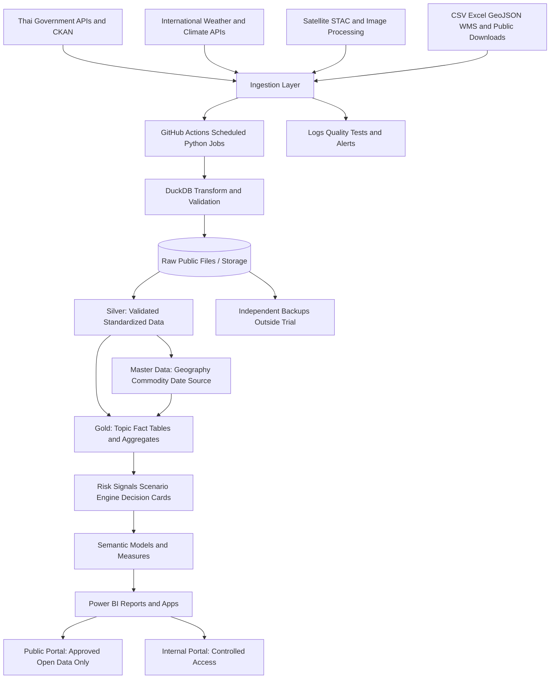
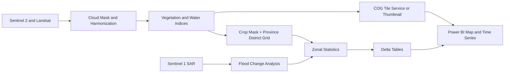
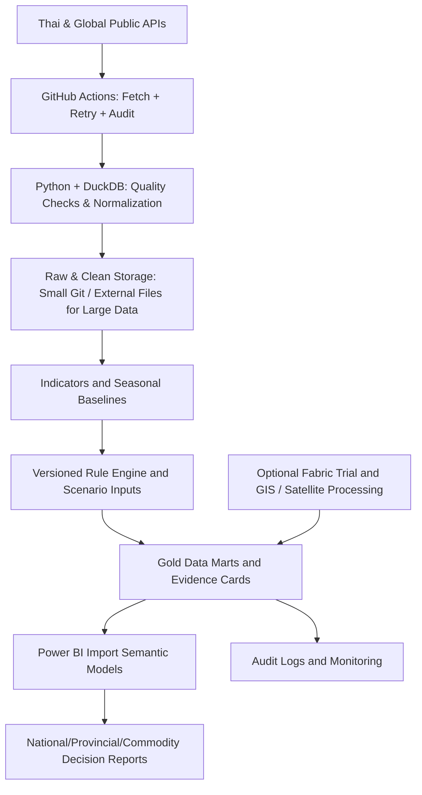

# Thailand Agricultural Decision Intelligence Hub (TADIH)

**Version 1.4 — Thailand First: Nationwide Decision Intelligence, Historical Archive & Forecasting (22 ตุลาคม 2569)**

> **โครงการศูนย์กลางข้อมูล วิเคราะห์สถานการณ์ และสนับสนุนการตัดสินใจด้านการเกษตรเฉพาะประเทศไทยทั้ง 77 จังหวัดในระยะแรก**  
> **สถาปัตยกรรมหลัก:** GitHub Actions (Public) + Python + DuckDB + ที่เก็บข้อมูลเหมาะสม + Power BI Import; **Fabric/OneLake เป็นตัวเลือกทดลอง ไม่ใช่องค์ประกอบบังคับ**  
> **เป้าหมายระยะปัจจุบัน:** เชื่อมโยงข้อมูลพืช ประมง ปศุสัตว์ ราคา ตลาด ภูมิอากาศ น้ำ ดิน ดาวเทียม ภัยพิบัติ ปัจจัยการผลิต การค้า และเศรษฐกิจ **ที่อธิบายสถานการณ์ภายในประเทศไทย** โดยเก็บแหล่งอ้างอิงและตรวจสอบคุณภาพข้อมูลได้; **ยังไม่ทำ Dashboard เปรียบเทียบการเกษตรทั่วโลก**  
> **ฉบับ:** 1.4 (Thailand-First Scope Revision) | **วันที่ตรวจค้นข้อมูล:** 22 ตุลาคม 2569 (2026-10-22)  
> **สถานะ:** Blueprint เพื่อพิสูจน์แนวคิด (PoC) และขยายผล ไม่ใช่การรับรองว่า API ทุกแห่งเปิดให้ใช้งานโดยไม่มีเงื่อนไข

---

## นโยบายขอบเขตที่มีผลล่าสุด: Thailand First (v1.4)

> **หลักการตัดสินใจ:** ระยะปัจจุบันรวบรวม วิเคราะห์ และพยากรณ์เฉพาะพื้นที่ประเทศไทย รวม 77 จังหวัด กรุงเทพมหานคร อำเภอ/เขต ตำบล/แขวง และระดับพื้นที่อื่นที่ข้อมูลรองรับ ส่วนการขยายไปวิเคราะห์ประเทศอื่นหรือเปรียบเทียบข้ามประเทศให้เป็น **Roadmap ระยะถัดไป** โดยไม่มีงานสะสมข้อมูลทั่วโลกเป็นภารกิจใน 59 วันทดลอง
>
> **แยกให้ชัด:** “ข้อมูลจากผู้ให้บริการต่างประเทศ” ไม่เท่ากับ “ข้อมูลเกี่ยวกับต่างประเทศ” เช่น Sentinel, Landsat, ERA5, CHIRPS, NASA POWER, Open-Meteo สามารถใช้ในระยะแรกได้ **เฉพาะข้อมูลที่ครอบคลุมประเทศไทย** เพื่อวิเคราะห์สภาพอากาศ ดิน น้ำ ภัย และพืชของไทย
>
> **ลำดับอ้างอิง:** ส่วน *Thailand First (v1.4)* ตอนต้นนี้ และ **PART IV** ตอนท้าย เป็นข้อกำหนดขอบเขตปัจจุบันที่มีผลเหนือขอบเขตที่กว้างกว่าใน PART I–III ซึ่งเก็บไว้เป็นเอกสารอ้างอิงและแนวทางขยายงานในอนาคต

**สิ่งที่ทำตอนนี้ (IN SCOPE):**

- ข้อมูลจริงและข้อมูลย้อนหลังของ **พืช ปศุสัตว์ ประมง ราคาสินค้า ต้นทุน การผลิต ภัยพิบัติ น้ำ ดิน อุตุนิยมวิทยา ภาพดาวเทียม** ที่มีความหมายต่อประเทศไทย
- ข้อมูลพยากรณ์อากาศสำหรับพิกัด/กริดในประเทศไทย และแบบจำลองทำนายราคา/ผลผลิต/ความเสี่ยงที่ฝึกกับข้อมูลไทยและผ่าน backtest
- เครือข่ายการค้าระหว่างประเทศ **เฉพาะข้อมูลที่จำเป็นต่อการอธิบายการนำเข้า–ส่งออกของไทย** เมื่อพร้อมหลังฐานข้อมูลในประเทศ
- Power BI สำหรับวิเคราะห์เหตุการณ์ สาเหตุที่เป็นไปได้ แนวโน้ม ทางเลือก และข้อจำกัด ไม่ใช่เพียงโชว์ตัวเลข

**สิ่งที่ยังไม่ทำ (OUT OF SCOPE ระยะแรก):**

- ดึงชุดข้อมูลเกษตรของทุกประเทศเพื่อสร้างรายงานของประเทศอื่น
- สร้างแผนที่ผลผลิต/ราคา/NDVI ครอบคลุมทั่วโลก หรือเปรียบเทียบทุกประเทศ
- โมเดลราคาสินค้าโลกหลายตลาดที่ยังไม่มีหลักฐานว่าช่วยตัดสินใจเรื่องไทย
- ดาวน์โหลดภาพดาวเทียมทั่วโลก หรือฝึกโมเดลด้วยข้อมูลต่างประเทศจำนวนมากโดยยังไม่มีคำถามการตัดสินใจในไทย

**เกณฑ์ยอมรับระยะแรก:** ต้องมีฐานรหัสพื้นที่ครบ 77 จังหวัด, Coverage Matrix ระบุว่าชุดไหนมี/ไม่มีข้อมูลรายจังหวัดจริง, อย่างน้อยหนึ่ง Decision Workflow จากข้อมูลหลายแหล่งที่ตรวจสอบย้อนหลังได้ และข้อมูล/โค้ดยังใช้ได้เมื่อหมด Fabric Trial

---


> **ข้อกำหนดใหม่ในฉบับ 1.2:** รายงานนี้ต้องเป็น **Decision Support System** ผู้ใช้ต้องทราบว่าเกิดอะไรขึ้น ผิดปกติอย่างไร ข้อมูลใดรองรับการวิเคราะห์ ควรพิจารณาดำเนินการอะไร และควรติดตามผลเมื่อไร โดยข้อเสนอที่กระทบเกษตรกร/งบประมาณต้องผ่านการพิจารณาของผู้รับผิดชอบ
>
> **สถานะเครื่องมือ:** GitHub Public + GitHub Actions เป็นแกนรวบรวมข้อมูลฟรี; Power BI เป็นชั้นใช้งาน; Fabric Trial ใช้ทดลองแต่ไม่เป็นจุดพึ่งพาบังคับ; งานภาพดาวเทียมประมวลผลที่ต้นทางหรือ GIS แล้วนำสถิติสรุปเข้ารายงาน
>
> **อ่านส่วนเพิ่มเติมก่อน:** [ข้อ 22–36: Decision Intelligence Specification](#22-หลักคิดใหม่-decision-first-architecture) เป็นข้อกำหนดหลักล่าสุด ส่วนข้อ 0–21 คือรายการแหล่งข้อมูลและโครงสร้างพื้นฐานจากฉบับ 1.1 (บางตัวอย่าง OneLake ยังคงไว้ในฐานะทางเลือก ไม่ใช่องค์ประกอบจำเป็น)

---

## 0. ข้อสรุปสำหรับตัดสินใจ

สร้างโครงการนี้ได้ แต่ **ไม่ควรรวมทุกข้อมูลเป็นตารางเดียวหรือรายงาน Power BI ไฟล์เดียว** ให้สร้าง **ศูนย์กลางข้อมูลระดับประเทศที่มีแบบจำลองข้อมูลร่วมกัน** และแยกรายงานตามเรื่อง ผู้ใช้งานเลือกจังหวัด อำเภอ ตำบล สินค้า และช่วงเวลา แล้วข้ามจากเรื่องหนึ่งไปอีกเรื่องหนึ่งได้

**ภาพปลายทางที่ต้องการ**

- เลือก `จังหวัดนครปฐม > อำเภอพุทธมณฑล > ข้าว` แล้วดูพื้นที่เพาะปลูก ผลผลิต ราคาข้าว ต้นทุน ฝนสะสม น้ำในคลอง ความเสี่ยงน้ำท่วม และ NDVI ของบริเวณเดียวกัน
- เลือก `ทุเรียน > ทุกจังหวัด` แล้วเปรียบเทียบพื้นที่ให้ผลผลิต ปริมาณผลิตตามฤดู ราคาในประเทศ ส่งออกไปแต่ละประเทศ สภาพอากาศ และพื้นที่เสี่ยงภัย
- เลือก `กุ้งขาว > จังหวัดชายฝั่ง` แล้วดูพื้นที่เพาะเลี้ยง ผลผลิต ราคา สภาพอากาศ คุณภาพน้ำในพื้นที่ที่มีข้อมูล และมูลค่าส่งออก
- เลือก `โคเนื้อ > ภาคตะวันออกเฉียงเหนือ` แล้วดูจำนวนสัตว์ ผลผลิต ราคาอาหารสัตว์ ภัยแล้ง ความเหมาะสมของพื้นที่ และราคาในตลาด
- เปรียบเทียบทุกจังหวัดหรือเลือกทั่วประเทศได้ โดยกรณีข้อมูลมีเพียงระดับจังหวัด ระบบต้อง **ไม่แสดงตัวเลขอำเภอ/ตำบลเสมือนมีข้อมูลจริง**

**สิ่งที่ตรวจพบจากเอกสารผู้ให้บริการ:** มี API ที่ระบุชัด เช่น CKAN ของ DOAE/OAE, กระทรวงพาณิชย์, SWOC กรมชลประทาน, NABC, Copernicus, NASA POWER, Open-Meteo, World Bank, UN Comtrade และ BOT ส่วนหลายแหล่งเป็นเพียงระบบบัญชีข้อมูลหรือดาวน์โหลดไฟล์ จึงต้องตรวจสอบทรัพยากรจริงเป็นรายชุดก่อนพัฒนา [S01][S02][S03][S04][S05][S06][S07][S08][S09]

### 0.1 สิ่งที่ควรทำในช่วงทดลอง

1. สร้างฐานข้อมูลกลางพื้นที่และสินค้าเกษตร (Master Data) **ทั่วประเทศครบ 77 จังหวัดตั้งแต่วันแรก**
2. เชื่อม **10 ถึง 15 แหล่งที่สำคัญและเข้าถึงได้จริง** ก่อน ไม่เร่งต่อ 80 แหล่งพร้อมกัน
3. ทำข้อมูลราคา + ผลผลิต + ฝน + น้ำ + NDVI ระดับประเทศ โดยใช้สินค้า 3 กลุ่มเป็นชุดตรวจสอบวิธีเชื่อมข้อมูล ไม่จำกัดการรวบรวมข้อมูลอยู่ที่ 3 สินค้า
4. ทำ Dashboard แผนที่ประเทศไทยครบ 77 จังหวัด พร้อม drill-down ตามความละเอียดจริงของแต่ละแหล่ง และหน้าตรวจสอบพื้นที่/ข้อมูลที่ยังขาด
5. ทดสอบการทำงานอัตโนมัติ 14 วันติดต่อกัน พร้อมระบบแจ้งเตือนเมื่อดึงข้อมูลไม่สำเร็จ
6. ส่งออกข้อมูลและโค้ดสำรองก่อนหมดสิทธิ์ทดลอง Fabric


### 0.2 ยืนยันขอบเขตระดับประเทศ (National-First)

**ข้อกำหนดที่ต้องถือเป็นมาตรฐาน:** ระบบนี้เป็นศูนย์กลางข้อมูลด้านการเกษตรสำหรับ **77 จังหวัดทั่วประเทศไทยรวมกรุงเทพมหานคร**; ครอบคลุมอำเภอ/เขต ตำบล/แขวง ทุกแห่งตามรุ่นรหัสพื้นที่ที่ได้รับการตรวจสอบ ทั้งพืช ปศุสัตว์ ประมงทะเล ประมงน้ำจืด เพาะเลี้ยงสัตว์น้ำ รวมถึงปัจจัยการเกษตร อุตุนิยมวิทยา ทรัพยากรน้ำ เศรษฐกิจ การค้า และภาพดาวเทียมจากผู้ให้บริการไทยและต่างประเทศ

- **ขอบเขตเชิงพื้นที่ (Geographic scope):** ทั่วประเทศตั้งแต่วันแรก ไม่กรอง API ให้เหลือเฉพาะจังหวัดที่ผู้พัฒนาทำงานอยู่
- **ขอบเขตเชิงสินค้า (Commodity scope):** นำรหัส/รายการสินค้าทั้งหมดที่ผู้ให้บริการแต่ละรายเปิดเผยได้ เข้าสู่ staging ก่อน จัดหมวดเป็น taxonomy กลางโดยไม่กำหนดว่ามีได้เฉพาะ 3 หรือ 20 ชนิด
- **ขอบเขตเชิงเวลา (Temporal scope):** เก็บทุกช่วงย้อนหลังที่ใช้ได้ตามเงื่อนไข provider; มี incremental ingest สำหรับรายการใหม่และ revised history
- **ขอบเขตเชิงภาพดาวเทียม (EO scope):** แสดง NDVI ระดับประเทศจากผลิตภัณฑ์ที่ประมวลผลไว้แล้ว และเพิ่ม Sentinel-2 10 เมตรเป็นชั้นลงลึก ไม่บังคับประมวลผลความละเอียดสูงทุกพิกเซลทั้งประเทศใน Trial
- **ขอบเขตเชิงการเข้าถึง:** เปิดข้อมูลสาธารณะได้เท่าที่ได้รับอนุญาตจากต้นทางเท่านั้น โดยแยกจากข้อมูลทะเบียน/พิกัดแปลงรายบุคคล

> **ข้อแยกความหมายที่สำคัญ:** `รองรับ 77 จังหวัด` หมายถึงระบบมีพื้นที่ให้แสดงและค้นครบ ส่วน `มีข้อมูลจริงครบ 77 จังหวัด` ต้องพิสูจน์เป็นรายชุดข้อมูลและช่วงเวลา ห้ามเติม 0 หรือประมาณจังหวัดที่ไม่มีข้อมูลแล้วแสดงเสมือนเป็นสถิติทางการ

---

## 1. ขอบเขตและหลักการออกแบบ

### 1.1 ประเภทข้อมูลทั้งหมดที่ระบบควรครอบคลุม

| รหัส | กลุ่มข้อมูล | ตัวอย่างข้อมูล | ระดับพื้นที่ที่คาดหวัง | เวลาอัปเดตเป้าหมาย |
|---|---|---|---|---|
| AG01 | ทะเบียนและโครงสร้างภาคเกษตร | จำนวนครัวเรือนเกษตรกร ชนิดพืช พื้นที่ขึ้นทะเบียน | จังหวัด/อำเภอ/ตำบลตามข้อมูลเปิด | รายเดือน/ฤดู |
| AG02 | พืช | พื้นที่ปลูก เก็บเกี่ยว ผลผลิตต่อไร่ ผลผลิตรวม | จังหวัด/อำเภอเมื่อมี | รายปี/ฤดู/เดือน |
| AG03 | ราคาพืช | ราคาที่เกษตรกรขายได้ ตลาดกลาง ขายส่ง ขายปลีก | ตลาด/จังหวัด/ภาค/ประเทศ | รายวัน/สัปดาห์ |
| AG04 | ปศุสัตว์ | จำนวนสัตว์ ผลผลิต เนื้อ นม ไข่ โรคสัตว์ | จังหวัด/ประเทศ | รายเดือน/ปี/ประกาศ |
| AG05 | ประมง | ปริมาณจับสัตว์น้ำ เพาะเลี้ยง ราคา ออกเรือ | จังหวัด/ท่าเรือ/เขตประมง | รายเดือน/ปี |
| AG06 | ปัจจัยการผลิต | ปุ๋ย เมล็ดพันธุ์ สารเคมี อาหารสัตว์ ค่าแรง น้ำมัน | จังหวัด/ตลาด/ประเทศ | รายวัน/เดือน |
| AG07 | ภูมิอากาศ | ฝน อุณหภูมิ ความชื้น ลม รังสี อัตราระเหย | สถานี/จุดพิกัด/กริด | รายชั่วโมง/วัน |
| AG08 | น้ำ | ระดับน้ำ น้ำท่า ปริมาณเก็บกัก น้ำชลประทาน | สถานี/อ่าง/ลุ่มน้ำ | นาที/ชั่วโมง/วัน |
| AG09 | ภัยพิบัติ | น้ำท่วม แล้ง พายุ ไฟป่า ความเสี่ยงและพื้นที่เสียหาย | จุด/พื้นที่/จังหวัด | ตามเหตุการณ์ |
| AG10 | ภาพดาวเทียม | Sentinel-1/2, Landsat, MODIS, VIIRS | กริด/พื้นที่ขอบเขต | ตามรอบดาวเทียม |
| AG11 | ดัชนีจากดาวเทียม | NDVI EVI NDWI NDMI NDRE LST | กริด/แปลงที่ได้รับอนุญาต | 5 ถึง 16 วันตามแหล่ง |
| AG12 | ดินและการใช้ที่ดิน | เนื้อดิน pH คาร์บอน ความเหมาะสม พื้นที่เกษตร | จุด/ชั้นข้อมูลแผนที่ | ปี/รอบสำรวจ |
| AG13 | ศัตรูพืชและโรค | พื้นที่ระบาด ข่าวเตือน โรคพืชและสัตว์ | พื้นที่ที่เผยแพร่ | รายสัปดาห์/เหตุการณ์ |
| AG14 | การค้าระหว่างประเทศ | ส่งออก นำเข้า มูลค่า ปริมาณ HS code ตลาดปลายทาง | ประเทศ/คู่ค้า/HS | รายเดือน/ปี |
| AG15 | เศรษฐกิจ | GDP เกษตร เงินเฟ้อ ค่าเงิน ดอกเบี้ย ภาระต้นทุน | ประเทศ/ภูมิภาค | รายวัน/เดือน/ไตรมาส |
| AG16 | โลจิสติกส์และตลาด | ด่าน ท่าเรือ จุดรับซื้อ โรงสี โรงงาน ตลาด | พิกัด/จังหวัด | ตามการเผยแพร่ |
| AG17 | ทรัพยากรและสิ่งแวดล้อม | PM2.5 คุณภาพน้ำ ป่า การเผา จุดความร้อน | สถานี/กริด/จุด | ชั่วโมง/วัน |
| AG18 | นโยบายและงบประมาณ | มาตรการช่วยเหลือ โครงการ งบประมาณ กฎเกณฑ์ | ระดับหน่วยงาน/จังหวัด | ตามประกาศ |
| AG19 | วิจัยและคำแนะนำ | งานวิจัย คำแนะนำรายพืช ปฏิทินเพาะปลูก | รายสินค้า/พื้นที่ | ตามการเผยแพร่ |
| AG20 | การวิเคราะห์ | แนวโน้ม ความเสี่ยง ความผิดปกติ และแบบจำลองคาดการณ์ | ตามคุณภาพแหล่ง | ตามรอบคำนวณ |

**หลักคิด:** ทุกหน้าใช้พจนานุกรมสินค้าและพื้นที่ชุดเดียวกัน แต่เก็บข้อมูลจริงในระดับความละเอียดที่ต้นทางมีเท่านั้น ไม่บังคับให้ทุกแหล่งมีข้อมูลรายตำบล/รายวัน

### 1.2 กลุ่มผู้ใช้

| ผู้ใช้ | สิ่งที่ต้องการ | หน้าเริ่มต้น |
|---|---|---|
| เกษตรกร | ราคาวันนี้ ฝนล่วงหน้า ความเสี่ยง แนวโน้มฤดูผลิต | Farmer View |
| นักวิชาการส่งเสริมการเกษตร | ทะเบียน พื้นที่ปลูก รายงานรายพื้นที่ ภัยและแผนที่ | Field Officer View |
| ผู้บริหารอำเภอ/จังหวัด | ภาพรวม การเปลี่ยนแปลง ความเสี่ยง พื้นที่สำคัญ | Provincial Command View |
| ผู้วางแผนนโยบาย | สินค้า ยุทธศาสตร์ ผลผลิต การค้า ภัย และเศรษฐกิจ | National Policy View |
| นักวิเคราะห์/นักวิจัย | ชุดข้อมูลที่มีที่มา ประวัติย้อนหลัง API และการดาวน์โหลด | Research/Data Explorer |
| หน่วยงานเจ้าของข้อมูล | คุณภาพข้อมูล ความสำเร็จในการเชื่อม และการใช้ข้อมูล | Data Operations View |


### 1.3 Coverage Matrix: ทำอย่างไรให้ตรวจได้ว่ารองรับทั่วประเทศจริง

สร้าง `coverage_dataset_geo_period` เป็นตารางมาตรฐาน ขนาดข้อมูล 1 แถวต่อ `source_dataset_id × geo_id × period × metric_type` พร้อมคอลัมน์ `expected`, `observed`, `latest_publication_date`, `freshness_status`, `data_grain`, `coverage_note`, `license_status` และ `missing_reason`

กำหนดสถานะพื้นที่ **4 ประเภท** ที่ต่างกันชัดเจน:

1. `AVAILABLE` มีข้อมูลจริงสำหรับพื้นที่/ช่วงนั้น
2. `NOT_PUBLISHED` ต้นทางไม่ได้เผยแพร่ข้อมูลพื้นที่/ช่วงนั้น
3. `NOT_APPLICABLE` ตัวชี้วัดไม่เกี่ยวข้องเชิงภูมิศาสตร์ เช่น ประมงทะเลในพื้นที่ที่ไม่มีทะเล
4. `PIPELINE_ERROR` มีข้อมูลหรือคาดว่าควรมี แต่ดึงไม่สำเร็จ

หน้ารายงาน `Coverage Monitor` แสดงแผนที่ 77 จังหวัดและเมทริกซ์ 77 จังหวัด × หมวดข้อมูล โดยให้เลือก dataset/year ได้ และมี KPI **ความครบถ้วนเทียบเฉพาะพื้นที่ที่ควรมี** ไม่ถือ `NOT_APPLICABLE` เป็นความล้มเหลว

#### ระดับพื้นที่ของข้อมูลที่ไม่เหมือนกัน

- ข้อมูลที่ต้นทางเป็น **ระดับประเทศ** แสดงผลที่ระดับประเทศ ไม่กระจายลง 77 จังหวัด
- ข้อมูลที่ต้นทางเป็น **ระดับจังหวัด** แสดงครบเท่าที่มีการเผยแพร่ และ drill down ต่ำกว่านั้นไม่ได้หากไม่มีหลักฐานเพิ่มเติม
- ข้อมูลที่เป็น **สถานีตรวจวัด** เชื่อมพิกัดสถานี/ระยะทาง/ลุ่มน้ำตามวิธีที่ระบุ ไม่ถือว่าสถานีนั้นแทนทั้งจังหวัดโดยอัตโนมัติ
- ข้อมูลที่เป็น **กริด** ให้คำนวณ zonal statistics ตาม polygon ที่ตรวจสอบและบันทึกเวอร์ชัน
- ข้อมูล **ประมงทะเล** อาจอิงเขตประมง/ท่าเรือ/แหล่งทำประมงแทนเขตจังหวัด ต้องมีตาราง mapping ตามนิยามของต้นทางและไม่บังคับ join ข้ามกัน
- พื้นที่ประมงน้ำจืด/เพาะเลี้ยง และฟาร์มปศุสัตว์บางระบบอาจมีพิกัดส่วนบุคคล ให้เผยแพร่เฉพาะตัวเลขรวมที่ผ่านเกณฑ์ความเป็นส่วนตัว

อ้างอิงกรอบจังหวัด 77 จังหวัด: [S43]; แหล่งค้นรหัสและข้อมูลพื้นที่ระดับย่อย: [S44]

---

## 2. สถาปัตยกรรมข้อมูล (Architecture)



### 2.1 บทบาทของเครื่องมือ

- **GitHub Actions (ฟรีใน Public Repository สำหรับ Standard Runner):** ตั้งเวลาและจัดลำดับการดึง API, HTTP, ไฟล์ พร้อม log และ retry; งานที่หนักมากแยกออกจาก Runner
- **Python + DuckDB:** ทำความสะอาด ตรวจคุณภาพ รวมข้อมูล สร้างชุดข้อมูลการวิเคราะห์และไฟล์ Parquet โดยไม่ต้องใช้ Fabric; ใช้ Fabric Notebook เพื่อทดลองเมื่อมีความจำเป็น
- **GitHub (เฉพาะโค้ด/ไฟล์สาธารณะขนาดเล็ก) + พื้นที่เก็บไฟล์ภายนอกตามขนาดงาน:** เก็บ CSV/Parquet/ข้อมูลย้อนหลัง; **OneLake/Lakehouse เป็นทางเลือกในช่วงทดลอง**
- **DuckDB SQL / Gold Tables / การส่งออก CSV และ Parquet:** จัดตารางข้อมูลปลายทาง; SQL Warehouse เป็นทางเลือกเมื่อระบบใหญ่ขึ้น
- **Power BI Semantic Model (Import):** ตัวชี้วัด DAX ความสัมพันธ์ การกรอง และสิทธิ์เข้าถึง; คำนวณความเสี่ยงและข้อเสนอแนะที่ตรวจสอบย้อนหลังได้ก่อนนำเสนอ
- **Power BI Reports/App:** หน้าใช้งานจริง แผนที่ กราฟ ตาราง และ Drill-through
- **GitHub:** เก็บ SQL, Notebook, Pipeline definition, เอกสาร data contract, ไฟล์ Power BI Project เมื่อรองรับ
- **พื้นที่สำรองอิสระ:** Object storage/เครื่ององค์กรที่อนุญาต/Git สำหรับโค้ด และแบ็กอัปตามรอบ เพื่อไม่ผูกข้อมูลไว้กับ Fabric Trial เพียงที่เดียว

Microsoft แนะนำ Medallion Architecture ที่ประกอบด้วย Bronze, Silver, Gold โดยให้เก็บข้อมูลดิบก่อน แปลงมาตรฐานใน Silver และจัดโมเดลรายงานใน Gold [S10]

### 2.2 โครงสร้างระบบที่เสนอ

```text
TAIH/
  README.md
  docs/
    source-registry.md
    source-license-register.md
    data-dictionary.md
    geography-standard.md
    commodity-crosswalk.md
    runbook.md
  config/
    sources.yaml
    commodities.yaml
    pipelines.yaml
  ingestion/
    ckan/
    moc/
    oae/
    climate/
    trade/
    finance/
    water/
  geo/
    boundary/
    raster-stac/
    satellite-indices/
    zonal-statistics/
  transform/
    silver/
    gold/
    quality-tests/
  powerbi/
    national/
    markets/
    crops/
    livestock/
    fisheries/
    water-climate/
    satellite/
    data-quality/
  exports/
  infrastructure/
```

### 2.3 การจัดเก็บข้อมูล

```text
OneLake
  lakehouse_bronze/
    Files/source=doae/dataset=.../ingest_date=YYYY-MM-DD/
    Files/source=moc/dataset=gis-product-price/ingest_date=YYYY-MM-DD/
    Files/source=sentinel2/scene_metadata/ingest_date=YYYY-MM-DD/
  lakehouse_silver/
    Tables/dim_geography/
    Tables/dim_commodity/
    Tables/dim_station/
    Tables/dim_market/
    Tables/price_observation_clean/
    Tables/production_clean/
    Tables/weather_station_clean/
    Tables/weather_grid_clean/
    Tables/satellite_index_clean/
  lakehouse_gold/
    Tables/fact_market_price/
    Tables/fact_agri_production/
    Tables/fact_weather_daily/
    Tables/fact_water_observation/
    Tables/fact_livestock/
    Tables/fact_fisheries/
    Tables/fact_satellite_index_area/
    Tables/fact_agri_trade/
    Tables/agg_province_day_commodity/
    Tables/agg_district_month_commodity/
```

**สำคัญ:** ภาพดาวเทียมความละเอียด 10 เมตรทั่วประเทศทุกวันมีขนาดใหญ่มาก ไม่ควรดึงทั้งประเทศมาเก็บใน Power BI หรือ OneLake ทั้งหมด ให้ทำงานบนผู้ให้บริการภาพ/ระบบ GIS ก่อน และนำค่าเฉลี่ยหรือสถิติเชิงพื้นที่ (zonal statistics) ที่ได้มาเข้า Gold แทน เก็บเฉพาะ thumbnail/COG URL/ขอบเขตและ scene ID ตามสิทธิ์การใช้ข้อมูล

---

## 3. ทะเบียนแหล่งข้อมูลไทย (Thai Data Source Registry)

**ความหมายสถานะ**

- **A = มีหน้าเอกสารบริการ API หรือ endpoint ระบุชัด** แต่ยังต้องทดสอบการตอบกลับจริงและเงื่อนไขสิทธิ์
- **B = ยืนยันว่ามี Data Catalog/ไฟล์/ระบุว่าเรียกผ่าน API ได้** แต่ยังต้องตรวจสอบทรัพยากรแต่ละชุด
- **C = ต้องสมัคร/ขออนุมัติ/ตรวจสอบสิทธิ์ก่อน**
- **D = แหล่งข้อมูลน่าติดตาม ยังไม่ยืนยัน public API สำหรับชุดที่ต้องการ**
- **Key:** `ไม่ระบุ` = เอกสารที่ตรวจยังไม่ได้ยืนยันว่าต้องใช้หรือไม่ **ห้ามตีความว่าไม่ต้องใช้**

### 3.1 หน่วยงานด้านการเกษตร ผลผลิต และทะเบียน

| ID | เจ้าของ / ระบบ | กลุ่มข้อมูล | ช่องทาง | การเข้าถึง | สถานะ | ระยะเริ่มต้น |
|---|---|---|---|---|---|---|
| TH01 | DOAE Open Data | พื้นที่ปลูก ครัวเรือน ข้อมูลส่งเสริม | https://ckan.doae.go.th/ | CKAN API v3; public metadata; ตรวจสิทธิ์ resource | A | P0 |
| TH02 | DOAE Decision Support | การผลิต ตลาด ทรัพยากร ภัย เอกสาร | https://app.doae.go.th/ | Open Data/ไฟล์/API บางชุด ต้องค้นแยก | B | P1 |
| TH03 | OAE Catalog | ราคา ผลผลิต ครัวเรือน นำเข้า-ส่งออก | https://catalog.oae.go.th/ | CKAN API v3; ตรวจ resource | A | P0 |
| TH04 | NABC Agricultural Data Service | การผลิต ราคาสินค้าเกษตร ดัชนี | https://agriapi.nabc.go.th/ | API service; ต้องตรวจคู่มือและ Key รายบริการ | A/C | P0 |
| TH05 | NABC Catalog | ชุดข้อมูลการเกษตรหลายหน่วยงาน | https://nabc-catalog1.oae.go.th/ | CKAN API; ตรวจ resource | A | P1 |
| TH06 | MOAC agency catalog index | รายชื่อแคตตาล็อกหน่วยงานในกระทรวง | https://moac.go.th/about-data_catalog | Portal discovery | B | P0 |
| TH07 | DOF กรมประมง | สถิติประมงทะเล น้ำจืด สัตว์น้ำ เพาะเลี้ยง | https://catalog.fisheries.go.th/ | CKAN catalog; CSV/XLSX/API บาง resource | B | P0 |
| TH08 | DLD กรมปศุสัตว์ | ปริมาณสัตว์ เนื้อ ไข่ นม อาหารสัตว์ การค้า | https://dld.gdcatalog.go.th/ | Catalog; ตรวจไฟล์และ API รายชุด | B | P0 |
| TH09 | DOA กรมวิชาการเกษตร | พันธุ์พืช ปัจจัยการผลิต งานวิชาการ | https://datacatalog.doa.go.th/ | Catalog; ตรวจทรัพยากร | B | P1 |
| TH10 | Rice Department Catalog | สถิติและชุดข้อมูลข้าว | https://catalog.ricethailand.go.th/ | Catalog/ไฟล์ | B | P1 |
| TH11 | Rice Department API Portal | เมล็ดพันธุ์ ราคา จุดจำหน่าย และชุด API อื่น | https://interchange.ricethailand.go.th/ | สมัครบัญชี ยื่นคำขอ ผ่านอนุมัติจึงรับ API Key | C | P1 |
| TH12 | LDD กรมพัฒนาที่ดิน | ชนิดดิน การใช้ที่ดิน พื้นที่เสี่ยง น้ำ | https://lddcatalog.ldd.go.th/ | CKAN/ไฟล์/แผนที่ | B | P0 |
| TH13 | RID Open Data | ชลประทาน แหล่งน้ำ อ่าง และโครงการ | https://opendata.rid.go.th/ | Catalog/ไฟล์ ตรวจ resource | B | P0 |
| TH14 | สำนักงานปลัด MOAC | นโยบาย โครงการ หน่วยงาน งบประมาณ | https://datacatalog.opsmoac.go.th/ | Catalog/ไฟล์ | B | P2 |
| TH15 | กรมตรวจบัญชีสหกรณ์ | ต้นทุน บัญชีสหกรณ์และการเงินตามชุดเปิด | https://cadckan.cad.go.th/ | Catalog/ไฟล์ | B | P2 |
| TH16 | กรมส่งเสริมสหกรณ์ | สหกรณ์ การรวมกลุ่ม | https://catalog-cpd.data.go.th/ | Catalog/ไฟล์ | B | P2 |
| TH17 | ส.ป.ก. | เขตปฏิรูปที่ดินตามชุดข้อมูลเปิด | https://opendata.alro.go.th/ | Catalog/แผนที่/ไฟล์ | B | P2 |
| TH18 | มกอช. | มาตรฐานสินค้าเกษตรและอาหาร | https://catalog-acfs.data.go.th/ | Catalog/เอกสาร | B | P1 |
| TH19 | กรมหม่อนไหม | ข้อมูลหม่อนและไหม | https://catalog.qsds.go.th/ | Catalog/ไฟล์ | B | P2 |
| TH20 | กรมฝนหลวงฯ | การปฏิบัติการและข้อมูลฝนที่เผยแพร่ | https://catalog.royalrain.go.th/ | Catalog/ไฟล์ | B | P2 |
| TH21 | ARDA | ข้อมูลงานวิจัยการเกษตร | https://opendata.arda.or.th/ | Catalog/ไฟล์ | B | P2 |
| TH22 | THAGRI / Agri-Map API Catalog | พื้นที่ปลูก ความเหมาะสม ดิน น้ำ ประมง ปศุสัตว์ | https://catalog.thagri.in.th/dataset/ | OpenAPI JSON หลายรายการ; ตรวจสิทธิ์และ endpoint resource | A/C | P0 |

**เหตุผลที่เลือกชุดแรก:** TH01, TH03, TH04, TH07, TH08, TH12 และ TH22 เชื่อมข้อมูลด้านพืช ประมง ปศุสัตว์ และภูมิสารสนเทศได้ครอบคลุมกว้าง รายชื่อแคตตาล็อกของหน่วยงาน MOAC ยืนยันได้จากหน้ารวมของกระทรวง [S01][S02][S11][S12][S13][S14][S15]

### 3.2 ราคา การค้า การเงิน และข้อมูลข้ามกระทรวง

| ID | เจ้าของ / ระบบ | ข้อมูล | ช่องทาง/Endpoint | Key / สิทธิ์ | สถานะ | ระยะ |
|---|---|---|---|---|---|---|
| TH23 | MOC Agricultural Products | รายการสินค้าเกษตร/รหัสสินค้า/ประเภทขาย | `https://dataapi.moc.go.th/gis-products` | เอกสารไม่แสดง Key; ทดสอบจริง | A | P0 |
| TH24 | MOC Agricultural Price | ราคาสินค้าเกษตรช่วงวันที่ตามรหัสสินค้า | `https://dataapi.moc.go.th/gis-product-price` | เอกสารไม่แสดง Key; ทดสอบจริง | A | P0 |
| TH25 | MOC Open Data Portal | ชุดข้อมูลค้าในประเทศ/ระหว่างประเทศ | https://data.moc.go.th/developer | ตรวจบริการราย endpoint | A/B | P1 |
| TH26 | DGA Open Data | ข้อมูลเปิดหน่วยงานทั่วประเทศ | https://data.go.th/ | API แต่ละชนิดต่างกัน | B/C | P0 |
| TH27 | DGA API Registration | บริการ API ที่ต้องรับ Token | https://opend.data.go.th/register_api/ | ลงทะเบียน รับ Token; มี 2FA ของพอร์ทัล | C | P1 |
| TH28 | Bank of Thailand (BOT) API | ค่าเงิน ดอกเบี้ย สถิติการเงิน | https://portal.api.bot.or.th/ | สมัครและรับ `Authorization` API token | A/C | P0 |
| TH29 | Thai Customs | มูลค่านำเข้า-ส่งออกราย HS และประเทศ | https://www.customs.go.th/statistic_report.php?lang=en | ยืนยัน CSV; public API ยังต้องตรวจ | B | P1 |
| TH30 | สำนักงานสถิติแห่งชาติ (NSO) | สำมะโนการเกษตร ประชากร แรงงาน | https://data.go.th/ | ค้นชุดจาก data.go.th/NSO | B | P1 |
| TH31 | สภาพัฒน์/NESDC | GDP เกษตร เศรษฐกิจมหภาค | https://www.nesdc.go.th/ | ดาวน์โหลด/API ต้องตรวจชุด | D | P1 |
| TH32 | DIT ราคาปัจจัยการผลิต | ราคาปุ๋ย/อาหารสัตว์/สินค้าอุปโภคที่เผยแพร่ | https://www.dit.go.th/ | ยังไม่ยืนยัน API สำหรับทุกชนิด | D | P1 |
| TH33 | Rubber Authority / RAOT | ราคายาง ปริมาณผลิต ตลาดยาง | https://www.raot.co.th/ | ยังไม่ยืนยัน public API | D | P1 |
| TH34 | Office of Cane and Sugar Board | อ้อย น้ำตาล โรงงาน ฤดูหีบ | https://www.ocsb.go.th/ | ยังไม่ยืนยัน public API | D | P2 |

**ตัวอย่าง API ของกระทรวงพาณิชย์ (เอกสารเจ้าของข้อมูลระบุ):**

```http
GET https://dataapi.moc.go.th/gis-products?keyword=มะพร้าว&sell_type=wholesale
GET https://dataapi.moc.go.th/gis-product-price?product_id=P11001&from_date=2018-01-01&to_date=2018-02-28
```

ข้อควรระวัง: `price_min`/`price_max` เป็นราคาจากตัวอย่างสำรวจของกรมการค้าภายใน **อย่าเรียกว่า “ราคาที่เกษตรกรขายได้” โดยอัตโนมัติ** เพราะเป็นคนละนิยามกับราคา ณ ไร่นาของ OAE [S03]

### 3.3 อากาศ น้ำ ภัย และแผนที่ในประเทศไทย

| ID | เจ้าของ / ระบบ | ข้อมูล | URL | Key / สิทธิ์ | สถานะ | ระยะ |
|---|---|---|---|---|---|---|
| TH35 | TMD Official Services | พยากรณ์อากาศ ตรวจอากาศและข้อมูลภูมิอากาศ | https://www.tmd.go.th/service/tmdData | API มีให้บริการ; รายละเอียดแต่ละ API ต้องตรวจ | A/C | P0 |
| TH36 | TMD GTS API | ข่าว Synoptic, METAR, Warning, UpperAir | https://telecom.tmd.go.th/api-docs | มี endpoint เอกสาร; auth ต้องทดสอบ | A | P1 |
| TH37 | TMD NWP Data Download | Grid พยากรณ์ CSV/NetCDF | https://hpc.tmd.go.th/download | ดาวน์โหลด/Automated Query; ตรวจรอบข้อมูลและสิทธิ์ | A | P1 |
| TH38 | RID SWOC REST | ฝน 1/24 ชม. น้ำท่า และ proxy จาก HII | https://swoc-api-service.rid.go.th/api/docs/ | เอกสารระบุ JWT login support; ตรวจ endpoint | A/C | P0 |
| TH39 | ThaiWater/HII | ฝน ระดับน้ำ แหล่งน้ำ คุณภาพน้ำ | https://standard.thaiwater.net/docs/ | มีมาตรฐาน API; การเข้าถึงต้องประสาน | A/C | P0 |
| TH40 | ThaiWater public portal | แผนที่สถานการณ์น้ำและข้อมูลข่าวเตือน | https://www.thaiwater.net/ | เว็บสาธารณะ ไม่ยืนยันทุก layer ว่าเปิด API | B | P1 |
| TH41 | THAGRI Water and Climate API | ฝน อ่างเก็บน้ำ คาดการณ์แล้ง/น้ำท่วม | https://catalog.thagri.in.th/en/group/about/water_and_climate_api | OpenAPI catalog; ตรวจสิทธิ์จริง | A/C | P0 |
| TH42 | Air4Thai/กรมควบคุมมลพิษ | PM2.5 และคุณภาพอากาศ | https://www.air4thai.com/ | Public endpoint/สิทธิ์ต้องตรวจอย่างเป็นทางการ | D | P1 |
| TH43 | GISTDA | ภาพและชั้นข้อมูลอวกาศไทย/ภัยและพื้นที่เกษตร | https://www.gistda.or.th/ | ต้องตรวจผลิตภัณฑ์และข้อตกลง API เป็นรายระบบ | D/C | P1 |
| TH44 | DOAE pest surveillance | ศัตรูพืชและเฝ้าระวัง | https://ppsf.doae.go.th/ | พบเว็บใช้งาน แต่ยังไม่ยืนยัน public API | D | P2 |
| TH45 | Agri-Map layer catalog | พื้นที่ปลูก ป่า ประมง ปศุสัตว์ ความเหมาะสม | https://catalog.thagri.in.th/group/map_api | OpenAPI resources; บางชุดอาจจำกัดสิทธิ์ | A/C | P0 |

**เรื่องข้อมูลอากาศย้อนหลัง:** กรมอุตุนิยมวิทยาระบุว่าพยากรณ์/ข้อมูลปัจจุบันบางบริการไม่มีค่าบริการ แต่สถิติอากาศย้อนหลังในบางบริการมีค่าบริการ จึงไม่ควรเหมารวมว่า “TMD ฟรีทั้งหมด” [S16]

### 3.4 เช็กลิสต์หน่วยงานที่ยังควรสำรวจในระยะขยาย

หน่วยงานและระบบที่อาจมีข้อมูลเกี่ยวข้อง แต่ **ไม่ได้ยืนยันว่ามี public API** ได้แก่ กรมทรัพยากรน้ำ กรมทรัพยากรน้ำบาดาล สำนักงานทรัพยากรน้ำแห่งชาติ กรมเจ้าท่า กรมป้องกันและบรรเทาสาธารณภัย กรมอุทยานฯ กรมป่าไม้ กรมพัฒนาพลังงานทดแทนฯ กระทรวงพลังงาน การไฟฟ้า สำนักงานประกันสังคม กรมการปกครอง ศูนย์การแพทย์ด้านสัตว์ และตลาดกลางสินค้าเกษตรเอกชน

สำหรับแหล่งเหล่านี้ ให้ลงทะเบียนใน **Source Discovery Backlog** ก่อน และตรวจสอบหน้าข้อมูลเปิด เอกสารสิทธิ์ API ค่าใช้จ่าย ความถี่ และความแม่นยำ แล้วค่อยเลื่อนเข้าสู่ Production Registry

---

## 4. แหล่งบริการต่างประเทศที่นำข้อมูลมาวิเคราะห์ประเทศไทย และรายการขยายในอนาคต

> **อ่านร่วมกับขอบเขต v1.4:** บริการอากาศ/ดาวเทียมต่างประเทศที่ดึงเฉพาะประเทศไทยอยู่ในระยะ 1 ส่วนตลาดต่างประเทศ การเปรียบเทียบผลผลิตข้ามประเทศ และข้อมูลประเทศอื่นอยู่ในระยะ 2–3 ตาม PART IV; รายการเดิมในตารางนี้เป็นทะเบียนทางเลือก ไม่ใช่รายการที่จะดึงทุกแหล่งทันที

> API จากต่างประเทศควรใช้กับพื้นที่ประเทศไทยเฉพาะที่ครอบคลุม และใช้เป็น **ข้อมูลเสริม/ข้อมูลเปรียบเทียบ** ข้อมูลจากสถานีไทยอาจเหมาะกับบางคำถามมากกว่าโมเดลภูมิอากาศโลก

### 4.1 ภูมิอากาศ อากาศ น้ำ และสิ่งแวดล้อม (ใช้ระยะแรกเฉพาะกริด/พิกัดไทย)

| ID | ผู้ให้บริการ | สิ่งที่จะใช้ | API / เอกสาร | Key / บัญชี | ระยะ |
|---|---|---|---|---|---|
| GL01 | Open-Meteo Forecast | อุณหภูมิ ฝน ลม ความชื้น พยากรณ์รายจุด | https://open-meteo.com/en/docs | **ไม่มี Key** สำหรับ non-commercial; โควตา/เงื่อนไข | P0 |
| GL02 | Open-Meteo Historical | สภาพอากาศย้อนหลังจาก reanalysis | https://open-meteo.com/en/docs/historical-weather-api | ไม่มี Key ในบริการ non-commercial | P0 |
| GL03 | Open-Meteo Marine | อุณหภูมิน้ำทะเล คลื่น ลมทะเล | https://open-meteo.com/en/docs/marine-weather-api | เงื่อนไขเดียวกับผู้ให้บริการ | P1 |
| GL04 | Open-Meteo Flood | คาดการณ์อุทกวิทยาตามโมเดลที่มี | https://open-meteo.com/en/docs/flood-api | เงื่อนไขเดียวกับผู้ให้บริการ | P1 |
| GL05 | Open-Meteo Air Quality | PM2.5 และมลพิษจากโมเดล | https://open-meteo.com/en/docs/air-quality-api | เงื่อนไขเดียวกับผู้ให้บริการ | P1 |
| GL06 | NASA POWER | ฝน อุณหภูมิ ลม รังสี เหมาะกับสถิติเกษตรรายจุด | https://power.larc.nasa.gov/docs/services/api/ | REST point API; ตรวจ rate/ข้อตกลง | P0 |
| GL07 | Copernicus Climate Data Store | ERA5 reanalysis และสภาพอากาศย้อนหลัง | https://cds.climate.copernicus.eu/en/how-to-api | **ต้องมีบัญชีและ Personal Access Token** | P1 |
| GL08 | CHIRPS | ฝนสะสมรายวัน/ย้อนหลังแบบ gridded | https://www.chc.ucsb.edu/data/chirps | ไฟล์/แคตตาล็อกผ่าน GEE ได้; ไม่ใช่ REST API อิสระทั้งหมด | P1 |
| GL09 | NASA GPM/IMERG | ฝนจากดาวเทียม | https://gpm.nasa.gov/data | เลือกช่องทาง Earthdata/GES DISC และตรวจสิทธิ์ | P1 |
| GL10 | NOAA NCEI | สถานีอากาศและบันทึกประวัติ | https://www.ncei.noaa.gov/support/access-data-service-api-user-documentation | แต่ละ endpoint ต่างกัน; ตรวจ Key | P2 |
| GL11 | ECMWF Open Data | แบบจำลองพยากรณ์โลก | https://www.ecmwf.int/en/forecasts/datasets/open-data | เปิดบางชุด; format GRIB; ตรวจเงื่อนไข | P2 |
| GL12 | OpenAQ v3 | ฝุ่นและการตรวจวัดอากาศรายสถานี | https://docs.openaq.org/ | **ต้องรับ API Key** และส่ง `X-API-Key` | P1 |
| GL13 | NASA FIRMS | จุดความร้อนและไฟป่า | https://firms.modaps.eosdis.nasa.gov/api/ | **ต้องมี MAP_KEY** | P1 |
| GL14 | ISRIC SoilGrids | pH คาร์บอน เนื้อดิน และสมบัติดินโดยประมาณ | https://rest.isric.org/soilgrids/v2.0/docs | REST public beta; fair use **5 calls/min** ณ วันตรวจ | P1 |
| GL15 | WorldPop | ประชากร ความหนาแน่นเชิงพื้นที่ | https://www.worldpop.org/ | ข้อมูลดาวน์โหลด/การเข้าถึง API ต้องตรวจ | P2 |

**ข้อควรระวัง Open-Meteo:** หน้าเจ้าของบริการระบุ non-commercial API ไม่ต้องสมัคร/Key และฟรีสูงสุด 10,000 calls/day พร้อมเงื่อนไขอ้างอิงข้อมูล หากกลายเป็นบริการเชิงพาณิชย์ต้องตรวจแพ็กเกจใหม่ [S17]

### 4.2 ดาวเทียม ภาพ และแผนที่ (ใช้ระยะแรกเฉพาะขอบเขตประเทศไทย)

| ID | ผู้ให้บริการ | ใช้ทำอะไร | ทางเข้า | Key / บัญชี | ระยะ |
|---|---|---|---|---|---|
| RS01 | Copernicus Data Space STAC/OData | ค้นหา Sentinel-1/2/3 และดาวน์โหลด scene | https://dataspace.copernicus.eu/analyse/apis | Catalog บางเส้นทาง public; download/processing ต้องตรวจสิทธิ์ | P0 |
| RS02 | Copernicus Sentinel Hub Process/Statistics | NDVI NDWI NDMI และค่ารายพื้นที่จาก Sentinel | https://documentation.dataspace.copernicus.eu/APIs/SentinelHub/Overview/Authentication.html | **OAuth2 Client ID + Client Secret / Token** | P0 |
| RS03 | Copernicus openEO | วิเคราะห์ชุดภาพบนคลาวด์ | https://dataspace.copernicus.eu/analyse/apis | สมัครและตรวจ quota/เครดิต | P1 |
| RS04 | Microsoft Planetary Computer STAC | ค้นหา Landsat, Sentinel-2 และ raster | https://planetarycomputer.microsoft.com/docs/ | STAC metadata public; asset download อาจต้อง signed URL / ถูก throttle | P0 |
| RS05 | Element84 Earth Search STAC | ค้นหา Sentinel-2, Landsat ตาม catalog ที่มี | https://earth-search.aws.element84.com/v1 | ตรวจสิทธิ์ asset/ข้อจำกัด | P1 |
| RS06 | Google Earth Engine | NDVI EVI NDWI LST ฝน และข้อมูล GIS จำนวนมาก | https://developers.google.com/earth-engine/guides/access | **Google Cloud Project + เปิด Earth Engine API + ยืนยันสิทธิ์** | P1 |
| RS07 | USGS Landsat M2M | ค้นหาและเข้าถึง Landsat ตามบัญชี | https://m2m.cr.usgs.gov/ | **USGS Account + Application Token** | P1 |
| RS08 | NASA Earthdata / AppEEARS | สถิติและ subset ของ MODIS/VIIRS | https://appeears.earthdatacloud.nasa.gov/ | **NASA Earthdata Login/Token ตามบริการ** | P1 |
| RS09 | NASA GIBS | แผนที่ภาพดาวเทียม WMS/WMTS | https://www.earthdata.nasa.gov/data/tools/gibs | ตรวจ service/terms | P2 |
| RS10 | Copernicus Land Monitoring | Land cover, vegetation, burned area | https://land.copernicus.eu/ | ดาวน์โหลด/บริการ GIS แล้วแต่ชุด | P1 |
| RS11 | OpenStreetMap / Overpass | ถนน คลอง แหล่งรับซื้อ/ตลาดที่มีใน OSM | https://wiki.openstreetmap.org/wiki/Overpass_API | public endpoint มี fair use; ไม่เหมาะ scrape หนัก | P2 |
| RS12 | ESA WorldCover | Land cover สำหรับ mask พื้นที่เกษตร | https://worldcover2021.esa.int/ | ไฟล์/แผนที่; ตรวจเวอร์ชัน | P1 |
| RS13 | GISTDA Thai imagery | เพิ่มข้อมูลภาพ/ผลวิเคราะห์เฉพาะไทย | https://www.gistda.or.th/ | **รอตรวจสิทธิ์ API/การใช้งาน/ค่าบริการ** | P1 |
| RS14 | Planet commercial imagery | ภาพละเอียดสูงเชิงพาณิชย์เฉพาะพื้นที่ | https://www.planet.com/ | **มีค่าใช้จ่ายและสัญญาสิทธิ์** | P3 |

**เรื่อง Google Earth Engine ณ ปี 2026:** ตั้งแต่ปี 2025 ต้องใช้ Cloud Project และยืนยันว่าเป็น non-commercial หรือ commercial สำหรับโครงการ non-commercial มี quota แบบ tier ที่เริ่มเปิดใช้ปี 2026 หากเป็นการใช้งานปฏิบัติการของหน่วยงานภาครัฐหรือใช้เชิงธุรกิจ ต้องตรวจเกณฑ์การใช้งานแบบเสียเงินอย่างระมัดระวัง ไม่ควรถือว่าใช้ฟรีเพียงเพราะผู้พัฒนาเป็นข้าราชการ [S18][S19]

### 4.3 ราคาโลก การค้า และข้อมูลมาตรฐาน (ระยะหลัง ยกเว้นตัวแปรที่พิสูจน์ว่าสัมพันธ์กับไทย)

| ID | แหล่ง | ข้อมูล | API / ช่องทาง | Key / สิทธิ์ | ระยะ |
|---|---|---|---|---|---|
| GL16 | FAOSTAT | ผลิตพืช ปศุสัตว์ ที่ดิน ปุ๋ย ราคา สถิติอาหาร | https://www.fao.org/faostat/en/ | มี API Developer Portal/Download; ตรวจแต่ละ endpoint | P0 |
| GL17 | UN Comtrade | ส่งออก/นำเข้าสินค้า HS รายประเทศคู่ค้า | https://uncomtrade.org/docs/un-comtrade-api/ | Preview ไม่ต้อง Key; ใช้จริงควรสมัคร **Free API Key** | P0 |
| GL18 | World Bank Indicators API | GDP เกษตร แรงงาน น้ำ เกษตรโลก | https://datahelpdesk.worldbank.org/knowledgebase/articles/889392 | **ไม่มี API Key** | P0 |
| GL19 | USDA NASS Quick Stats | สถิติผลผลิตสินค้าเกษตรสหรัฐฯ เพื่อเปรียบเทียบ | https://quickstats.nass.usda.gov/api | **API Key** | P2 |
| GL20 | USDA PSD / FAS | ผลิต ใช้ และการค้าสินค้าสำคัญโลก | https://apps.fas.usda.gov/psdonline/ | ตรวจช่องทาง API/ดาวน์โหลด ณ วันใช้ | P1 |
| GL21 | FAO FPMA | ราคาสินค้าอาหารรายตลาดในโลก | https://fpma.apps.fao.org/ | ตรวจวิธีดาวน์โหลด/สิทธิ์ API | P1 |
| GL22 | OECD SDMX API | ตัวชี้วัดเกษตร/เศรษฐกิจและนโยบาย | https://sdmx.oecd.org/ | ตรวจ API และข้อจำกัด dataset | P2 |
| GL23 | UNdata / SDG API | ดัชนีการพัฒนา น้ำ ที่ดิน อาหาร | https://unstats.un.org/SDGAPI/swagger/ | REST/ตรวจ rate | P2 |
| GL24 | GBIF Occurrence API | พิกัดการพบพืช สัตว์ ความหลากหลายทางชีวภาพ | https://www.gbif.org/developer/summary | public query; download ขนาดใหญ่มีบัญชี/กติกา | P2 |
| GL25 | OBIS Marine Biodiversity | ข้อมูลการพบชนิดสิ่งมีชีวิตทะเล | https://obis.org/manual/api/ | public service; ตรวจเงื่อนไข | P2 |

UN Comtrade ระบุแพ็กเกจ Free Basic มี API Key และขีดจำกัด ณ วันที่ตรวจที่ 500 calls/day, 1 call/second และ 100,000 records/call สำหรับความสามารถที่กำหนดไว้ อย่าใช้วิธีดึงหน้าเว็บซ้ำ ๆ แทน API [S20]

### 4.4 แหล่งเพิ่มเติมที่ควรติดตามใน Roadmap หลังระยะประเทศไทย

- Global commodity futures: CME, ICE, Euronext, ตลาดซื้อขายล่วงหน้าที่เกี่ยวข้อง มีสัญญาข้อมูลและค่าบริการแตกต่างกัน
- ตลาดในประเทศ/ผลไม้/ค้าส่งเอกชน: ตลาดไท ตลาดสี่มุมเมือง ตลาดกลางยาง โรงสี โรงงานน้ำตาล โรงงานอาหารสัตว์ ต้องตรวจว่ามีช่องทาง API ทางการหรือข้อตกลงแบ่งปันข้อมูลหรือไม่
- EFSA/WOAH/FAO EMPRES: ข่าวระบาดและโรคสัตว์ในระดับประเทศ
- NASA SMAP, MODIS, VIIRS, Sentinel-3: ความชื้นดิน อุณหภูมิพื้นผิว การเปลี่ยนแปลงพืชพรรณ
- Global Surface Water, JRC, Global Flood Awareness System: การเปลี่ยนแปลงผิวน้ำและข้อมูลน้ำท่วม
- แหล่งข้อมูลเฉพาะเมล็ดพันธุ์ เครื่องจักร ปุ๋ย สารเคมี: ใช้ข้อมูลเปิดและข้อมูลที่ผู้ประกอบการยินยอมให้เผยแพร่เท่านั้น

---

## 5. รายการ API Key / Token ที่ต้องจัดการ

| ระบบ | ต้องทำอะไร | รูปแบบสิทธิ์ / หมายเหตุ | ลำดับ |
|---|---|---|---|
| MOC dataapi | ทดลองยิง endpoint สาธารณะที่ระบุในเอกสาร | เอกสารที่ตรวจไม่แสดง Key; **ยังไม่ยืนยันว่าใช้งานโดยไม่ต้อง Key** | เริ่มเลย |
| DOAE CKAN | เรียก `package_search` และตรวจทรัพยากร | การอ่าน metadata สาธารณะไม่เท่ากับสิทธิ์อ่านทุก resource | เริ่มเลย |
| OAE CKAN | ค้นหาข้อมูลและทดสอบ resource | ตรวจ resource access | เริ่มเลย |
| NABC Agricultural API | อ่าน API docs/ทดลองแหล่งที่เปิดจริง | ตรวจขั้นตอนขอใช้และ Key | สัปดาห์ 1 |
| Agri-Map/THAGRI | เปิดรายละเอียด OpenAPI ที่ต้องใช้ | ตรวจ auth/resource และการใช้พื้นที่เกษตรกร | สัปดาห์ 1 |
| TMD | ตรวจคู่มือบริการ API สภาพอากาศ | แยก public/current กับ historical paid | สัปดาห์ 1 |
| RID SWOC | สำรวจ Swagger และติดต่อขอสิทธิ์ถ้าต้องใช้ | JWT/สิทธิ์ราย endpoint | สัปดาห์ 2 |
| ThaiWater/HII | ติดต่อขอใช้บริการหรือใช้ไฟล์สาธารณะ | บริการออนไลน์และข้อกำหนด API | สัปดาห์ 2 |
| DGA API | ลงทะเบียน developer หากใช้บริการที่ต้อง Token | API Token; พอร์ทัลเปิดใช้ 2FA | สัปดาห์ 2 |
| Rice Department API | สมัครเข้าสู่ระบบ ยื่นคำขอ | API Key เมื่ออนุมัติ | สัปดาห์ 3 |
| BOT API | สมัครบัญชีและ Subscribe Product | **Authorization header** (ระบบใหม่) | สัปดาห์ 2 |
| Open-Meteo non-commercial | เริ่มใช้งานได้โดยไม่ต้องสมัคร | No Key; noncommercial fair use | เริ่มเลย |
| NASA POWER | ตรวจ endpoint/อัตราการเรียก | ในคู่มือ REST ที่อ้างอิงไม่พบขั้นตอนขอ Key สำหรับตัวอย่าง | เริ่มเลย |
| Copernicus Data Space | สมัคร account; เลือก STAC/Process API | Sentinel Hub OAuth2 client และ token สำหรับ processing | สัปดาห์ 2 |
| Google Earth Engine | ตั้ง Google Cloud Project/ยืนยันสิทธิ์ | OAuth/service account และ quota | สัปดาห์ 3 |
| Microsoft Planetary Computer | STAC request และการอ่าน signed asset | Metadata anonymous, asset signing ตามชุด | เริ่มเลย |
| UN Comtrade | สมัคร Free และสร้าง Subscription Key | Free API Key; preview no Key แต่จำกัด | สัปดาห์ 2 |
| World Bank API | เรียก JSON endpoint | No Key | เริ่มเลย |
| Copernicus Climate Data Store | สมัครและรับ Personal Access Token | `.cdsapirc` / cdsapi | สัปดาห์ 3 |
| OpenAQ | สมัครและรับ API Key | `X-API-Key` | สัปดาห์ 3 |
| NASA FIRMS | สมัครรับ MAP_KEY | MAP_KEY ในคำขอ | สัปดาห์ 3 |
| USGS M2M | สมัครบัญชีและสร้าง application token | M2M `login-token` | สัปดาห์ 4 |
| NASA Earthdata | สร้าง Earthdata Login | การพิสูจน์ตัวตนตามแต่ละ API | สัปดาห์ 4 |
| SoilGrids | ลอง REST จุดตัวอย่าง | Public beta, จำกัดการเรียก | สัปดาห์ 3 |

**การเก็บความลับ:** จัดเก็บ Key/Secret ใน secret store หรือ credential manager ขององค์กร/บริการที่ใช้อย่างเหมาะสม ห้ามใส่ในไฟล์ `.pbix`, M-code ที่เผยแพร่, repo สาธารณะ, URL ฝั่ง Browser หรือเอกสารแนะนำ API เก็บเฉพาะชื่อ environment variable เช่น `MOC_API_KEY`, `BOT_API_TOKEN`, `SENTINEL_CLIENT_ID`, `SENTINEL_CLIENT_SECRET`, `OPENAQ_API_KEY`, `COMTRADE_KEY` โดยสร้างเฉพาะตัวที่มีใช้จริง

---

## 6. การออกแบบฐานข้อมูลกลางให้ “สัมพันธ์กันจริง”

### 6.1 มิติหลัก (Conformed Dimensions)

| ตาราง | Primary Key | ฟิลด์สำคัญ | หมายเหตุ |
|---|---|---|---|
| `dim_geo` | `geo_id` | `country_code`, `province_code`, `district_code`, `subdistrict_code`, `geo_level`, `geometry_version` | จังหวัดไทย 77 หน่วยระดับจังหวัดรวมกรุงเทพมหานคร |
| `dim_commodity` | `commodity_id` | `category`, `species`, `variety`, `processing_stage`, `standard_unit` | รวมพืช ปศุสัตว์ ประมง วัตถุดิบและผลิตภัณฑ์ |
| `map_source_commodity` | composite | `source_id`, `source_product_code`, `commodity_id`, `valid_from`, `valid_to` | รองรับรหัสสินค้าคนละระบบ |
| `dim_date` | `date_id` | `date_iso`, `date_th`, `crop_year`, `season`, `month`, `fiscal_year` | คงวันที่ ISO เป็นคีย์ ไม่ใช้ พ.ศ. ในระบบคำนวณ |
| `dim_source` | `source_id` | `agency`, `dataset`, `url`, `license`, `refresh_target`, `time_lag` | เก็บแหล่งอ้างอิงทุกรายการ |
| `dim_market` | `market_id` | `name`, `market_type`, `geo_id`, `lat`, `lon` | แยกตลาดขายส่ง/ขายปลีก/หน้าไร่ |
| `dim_station` | `station_id` | `provider_station_code`, `provider`, `lat`, `lon`, `station_type` | สถานีหลายผู้ให้บริการอาจเป็นคนละสถานี |
| `dim_area_grid` | `grid_id` | `h3_id`, `resolution`, `geometry`, `land_mask_version` | ใช้เชื่อมกับข้อมูล raster แบบสรุปพื้นที่ |
| `dim_unit` | `unit_id` | `unit`, `dimension`, `to_standard_factor` | ตัน/กิโลกรัม/ไร่/เฮกตาร์/บาท/กก. |
| `dim_time_basis` | `time_basis_id` | `observation_type`, `valid_from`, `valid_to`, `published_at`, `ingested_at` | กันข้อมูลพยากรณ์ปะปนข้อมูลตรวจวัด |

**ภูมิศาสตร์:** ใช้รหัสจังหวัด/อำเภอ/ตำบลของหน่วยงานอ้างอิงที่ตรวจสอบได้ มีตาราง crosswalk สำหรับรหัสเก่า/ใหม่ และ version ของ polygon สำหรับพื้นที่เปลี่ยนเขต ชื่อภาษาไทยใช้แสดงผล ไม่ใช้เป็น join key เพราะสะกดต่างกันได้

**สินค้า:** อย่า join คำว่า “ข้าว” ตรงกับทุกผลิตภัณฑ์ เพราะข้าวเปลือก ข้าวสาร ข้าวหอมมะลิ 105 ข้าวเหนียว และข้าวส่งออกมีมาตรฐาน/ราคาคนละชนิด ต้องทำ commodity hierarchy และตาราง mapping ระหว่างรหัส OAE, MOC, DOAE, DLD, DOF, HS code และชื่อสามัญ

### 6.2 Fact Tables และหน่วยนับ

| Fact table | ระดับข้อมูลต่อ 1 แถว (Grain) | Metric | ห้ามทำ |
|---|---|---|---|
| `fact_market_price` | source + product + market + date + price_type | ราคา บาท/กก. หรือหน่วยต้นทาง | เฉลี่ยราคาคนละชนิด/หน่วยโดยไม่มีน้ำหนัก |
| `fact_agri_production` | source + commodity + geo + crop_season/year | พื้นที่ไร่ ผลผลิตตัน ผลผลิตต่อไร่ | บวกยอดตำบลรวมกับจังหวัดซ้ำ |
| `fact_livestock` | source + species + geo + period + metric_type | จำนวนตัว/ผลผลิตตัน/ลิตร/ฟอง | เอาจำนวนตัวเทียบจำนวนครัวเรือน |
| `fact_fisheries` | source + species + capture_or_aquaculture + geo + period | ปริมาณ มูลค่า จำนวนฟาร์ม | รวม catch กับ aquaculture ซ้ำ |
| `fact_weather_obs` | source + station/grid + variable + timestamp | ฝน อุณหภูมิ ลม ฯลฯ | เทียบ station กับ grid เป็นค่าชนิดเดียวกันโดยไม่บอก |
| `fact_weather_forecast` | model + issued_at + valid_at + grid + variable | พยากรณ์ | ผสม forecast รอบเก่ากับ observation |
| `fact_water_obs` | source + station/reservoir + timestamp + variable | ระดับน้ำ ปริมาณน้ำ | เปรียบเทียบต่าง datum |
| `fact_satellite_index_area` | satellite + scene/composite + grid/area + date + index | NDVI/NDWI/NDMI + pixel_valid_count | แปล NDVI ต่ำ = เสียหายทันที |
| `fact_trade` | source + period + reporter + partner + HS + flow | มูลค่า ปริมาณ | เทียบมูลค่า USD กับ THB โดยไม่แปลง |
| `fact_input_cost` | source + item + market/geo + date | ต้นทุน/ราคาปัจจัยการผลิต | อ้างว่าต้นทุนการผลิตจริงจากราคาสินค้า 1 ตัว |
| `fact_risk_event` | event + geo/geometry + period + category | ความรุนแรง/พื้นที่เสี่ยง | ใช้ความเสี่ยงเป็นหลักฐานความเสียหายจริง |

### 6.3 คีย์เชื่อม 4 ชั้น

```text
พื้นที่ (geo_id / grid_id / point geometry)
      +
สินค้า (commodity_id / HS crosswalk)
      +
เวลา (date_id / season / issued_at)
      +
ที่มาและนิยาม (source_id / metric_type / unit_id)
      =
ชุดข้อมูลที่เปรียบเทียบกันได้อย่างมีความหมาย
```

### 6.4 กฎป้องกันผลลัพธ์ผิด

1. **ห้ามกระจายค่าเฉลี่ยจังหวัดเป็นค่ารายตำบล** เมื่อไม่ใช่การประมาณที่ผ่านแบบจำลองและระบุชัด
2. **ราคา 3 ประเภทต้องแยกกัน:** ราคา ณ ไร่นา, ราคาตลาดค้าส่ง, ราคาค้าปลีก
3. **เวลาข้อมูล:** `observation_date`, `publication_date`, `ingestion_time`, `forecast_issue_time`, `forecast_valid_time` ต้องแยก
4. **ขนาดพื้นที่:** จังหวัด/อำเภอ/ตำบล/สถานี/กริด/แปลง ห้ามบวกซ้ำระดับ
5. **ค่า NDVI:** ต้องเก็บ sensor, composite period, cloud mask, valid pixel %, crop mask version และพื้นที่ที่ใช้คำนวณ
6. **การแปลงหน่วย:** `ตัน -> กก.`, `เฮกตาร์ -> ไร่`, `บาท/กก.` กับ `บาท/ตัน` ต้องมี log และทดสอบ
7. **ข้อมูลประมาณ:** แสดงป้าย `Estimated/Modelled` แยกจาก `Official Observed` และ `Survey` อย่างชัดเจน
8. **ข้อมูลไม่ครบ:** แสดง NA/ไม่มีข้อมูล ไม่แทน 0 โดยไม่ตรวจความหมาย
9. **ห้ามใช้ข้อมูลทะเบียนรายบุคคลใน public view** ให้ใช้ข้อมูลรวมที่หน่วยงานอนุญาตเผยแพร่
10. **ตรวจฉบับแก้ไข:** ราคาหรือผลผลิตทางการสามารถแก้ย้อนหลังได้ ต้องรองรับ upsert และ version

---

## 7. ระบบดาวเทียมและ NDVI ที่เหมาะกับประเทศไทย

### 7.1 ออกแบบแยกงานประมวลผลจาก Power BI



### 7.2 ดัชนีที่ควรทำ

| Index | สูตรหรือหลักการ | ใช้ติดตาม | ข้อจำกัด |
|---|---|---|---|
| NDVI | `(NIR - Red) / (NIR + Red)` | ความเขียวและการเปลี่ยนแปลงพืช | น้ำ เมฆ ดินเปล่า และฤดูมีผล |
| EVI | ใช้ NIR, Red, Blue และสัมประสิทธิ์ปรับแก้ | พื้นที่พืชหนาแน่น | ต้องรักษาสเกล reflectance ให้ถูก |
| NDWI (McFeeters) | `(Green - NIR)/(Green + NIR)` | น้ำผิวดิน | ชื่อ NDWI ถูกใช้กับหลายสูตร |
| NDMI | `(NIR - SWIR)/(NIR + SWIR)` | ความชื้นเรือนยอดโดยประมาณ | แปลเป็นค่าความชื้นดินโดยตรงไม่ได้ |
| NDRE | `(NIR - RedEdge)/(NIR + RedEdge)` | การเปลี่ยนแปลงเรือนยอด/พืชบางชนิด | ต้องเลือก band และ resampling ถูก |
| LST | ข้อมูล thermal เช่น Landsat/MODIS | อุณหภูมิพื้นผิว | ไม่เท่ากับอุณหภูมิอากาศ |
| SAR backscatter / flood | Sentinel-1 ก่อน-หลังเหตุการณ์ | พื้นที่น้ำท่วมแม้มีเมฆ | น้ำใต้พืช/ลักษณะผิวและเรขาคณิตมีผล |

**Sentinel-2 ตัวอย่างสำหรับ NDVI:** Level-2A Surface Reflectance ใช้แถบ `B8` (NIR) กับ `B4` (Red) และใช้ `SCL`/cloud probability ช่วยกรองเมฆ โดยตรวจนิยาม band และ resolution ในเอกสาร collection ทุกครั้ง [S21]

### 7.3 ระดับการให้บริการ

- **Level 1:** ค่าเฉลี่ย NDVI รายจังหวัดและรายเดือนจาก crop mask / พื้นที่เปรียบเทียบที่ระบุชัด
- **Level 2:** ค่ารายอำเภอ/ตำบลตาม polygon ที่ตรวจสอบแล้ว พร้อมจำนวน valid pixels
- **Level 3:** เทียบช่วงเดียวกันของปีก่อน (anomaly) และความผิดปกติสัมพันธ์กับฝน
- **Level 4:** พื้นที่แปลงรายเกษตรกรเมื่อมีพิกัด/ขอบเขตที่ได้มาอย่างถูกต้องและสิทธิ์เหมาะสม

**ความสำคัญ:** ประเทศไทยมีเมฆมากในฤดูฝน ต้องทำ composite 10 วัน/รายเดือน พร้อม `coverage_percent` ไม่รายงานว่า “พืชแย่ลง” เพราะภาพมีเมฆหรือมีข้อมูลพิกเซลใช้ได้ต่ำ

### 7.4 อัลกอริทึมตัวอย่าง

```python
# Pseudocode: สาธิตแนวทาง ไม่ใช่โค้ดพร้อมใช้กับผู้ให้บริการทุกแห่ง
images = search_stac(collection="sentinel-2-l2a", bbox=province_bbox, date_range=period)
clear = cloud_mask_and_rescale(images)
ndvi = (clear["nir"] - clear["red"]) / (clear["nir"] + clear["red"])
summary = zonal_stats(ndvi, boundaries, crop_mask=crop_mask, min_valid_coverage=0.70)
write_delta("fact_satellite_index_area", summary)
```

ควรกำหนดเกณฑ์ coverage 70% เป็น **ค่าตั้งต้นทดลอง** ไม่ใช่มาตรฐานสากล ต้องปรับตามพืช ฤดู พื้นที่ และการทดสอบภาคสนาม

---

## 8. การออกแบบ Power BI: หน้ารายงานที่ควรมี

> ให้ทำ **หนึ่งหน้า Landing Hub** กับ **หลายรายงานหรือหลาย Semantic Model** ไม่ใช้โมเดลเดียวสำหรับข้อมูลทั้งหมด

| หน้า | ชื่อ | องค์ประกอบหลัก | ตัวกรองร่วม |
|---|---|---|---|
| 00 | National Agricultural Overview | KPI พื้นที่ ผลผลิต ราคา ความเสี่ยง แผนที่ประเทศไทย | ปี/เดือน จังหวัด สินค้า |
| 01 | Crop Production Atlas | พื้นที่ปลูก เก็บเกี่ยว ผลผลิต ผลผลิตต่อไร่ | ชนิดพืช ฤดู ปี พื้นที่ |
| 02 | Daily Commodity Price Center | ราคา ณ ไร่นา/ขายส่ง/ขายปลีก ประวัติ ราคาเทียบปีก่อน | สินค้า ตลาด วันที่ |
| 03 | Livestock Intelligence | จำนวนสัตว์ ผลผลิต ราคาอาหารสัตว์ ภูมิภาค | ชนิดสัตว์ ปี/พื้นที่ |
| 04 | Fisheries Intelligence | จับสัตว์น้ำและเพาะเลี้ยง ราคาสัตว์น้ำ ส่งออก | ชนิดสัตว์น้ำ พื้นที่/เวลา |
| 05 | Water and Reservoir | ฝน อ่าง ระดับน้ำ น้ำท่า แผนที่สถานี | ลุ่มน้ำ สถานี จังหวัด |
| 06 | Weather and Agroclimate | ฝนจริง/ฝนคาดการณ์ อุณหภูมิ ความชื้น สะสมรายฤดู | จังหวัด จุดกริด วัน |
| 07 | Satellite Vegetation Monitor | NDVI NDWI anomaly ค่า valid coverage และภาพตัวอย่าง | index sensor period crop area |
| 08 | Drought and Flood Risk | ฝนผิดปกติ น้ำท่า NDVI ความเสี่ยงแบบหลายปัจจัย | พื้นที่/ช่วงเวลา |
| 09 | Soil and Land Suitability | pH ชนิดดิน ความเหมาะสม และการใช้ที่ดิน | พืช พื้นที่ ชั้นข้อมูล |
| 10 | Input Cost Monitor | ปุ๋ย น้ำมัน อาหารสัตว์ ค่าเงิน และตัวชี้วัดต้นทุน | ชนิดต้นทุน เดือน |
| 11 | Trade and Export | ส่งออก-นำเข้า HS ตลาดต่างประเทศ ค่าเงิน | HS คู่ค้า ช่วงเวลา |
| 12 | Global Benchmark | เปรียบเทียบผลผลิต ราคา สัดส่วนการค้าไทยและประเทศอื่น | ประเทศ สินค้า ปี |
| 13 | Provincial Profile | โปรไฟล์จังหวัดเดียวรวมทุกเรื่อง พร้อมลิงก์เจาะลึก | จังหวัด |
| 14 | Farmer View | เฉพาะข้อมูลอ่านง่าย ราคาวันนี้ พยากรณ์ เตือนภัย | จังหวัด สินค้า |
| 15 | Data Catalog & Reliability | แหล่งที่มา อัปเดตล่าสุด ความครบถ้วน ความถี่ และ error | แหล่งข้อมูล dataset |

### 8.1 หน้าตา Landing Hub

```text
┌─────────────────────────────────────────────────────────────┐
│ Thailand Agricultural Intelligence Hub                      │
│ จังหวัด [ทั่วประเทศ▼]  สินค้า [ทั้งหมด▼]  ช่วงเวลา [▼]      │
├─────────────────────────────────────────────────────────────┤
│ พื้นที่ปลูก | ผลผลิต | ราคาล่าสุด | ความเสี่ยง | แหล่งข้อมูล │
├────────────────────────────┬────────────────────────────────┤
│ แผนที่ประเทศไทย            │ ราคาสำคัญและการเปลี่ยนแปลง     │
│ เลือกจังหวัดได้            │                                │
├────────────────────────────┼────────────────────────────────┤
│ ฝน / น้ำ / สถานการณ์       │ NDVI / แนวโน้มพืชพรรณ          │
├────────────────────────────┴────────────────────────────────┤
│ พืช | ปศุสัตว์ | ประมง | ตลาด | ดาวเทียม | รายจังหวัด       │
├─────────────────────────────────────────────────────────────┤
│ Updated: ... | Source Coverage: ... | Quality: ...           │
└─────────────────────────────────────────────────────────────┘
```

### 8.2 การทำให้รายงานเชื่อมโยงกัน

- ใช้ `dim_geo` และ `dim_commodity` ชุดเดียวกันทาง semantic-layer และมาตรฐาน crosswalk
- ใช้ **Drill-through** ไปหน้ารายจังหวัด/รายสินค้า
- ใช้ **Sync Slicers** สำหรับหน้าภายในรายงานเดียวกัน; ระหว่างคนละ report ใช้ navigation URL parameters หรือแอป/พอร์ทัลควบคุม state ตามข้อจำกัด Power BI
- มีส่วนแสดง `Data Source`, `As of Date`, `Unit`, `Spatial Coverage`, `Methodology` ในทุกหน้า
- แสดงตัวกรองสินค้าที่ใช้ร่วมได้จริง ถ้าหน้าอากาศไม่มี commodity ให้ใช้การกรองพื้นที่และเวลาแทน ไม่สร้างความสัมพันธ์ลวง
- วางแผนแยก **Public Semantic Models** ออกจาก **Internal Models** เพื่อลดความเสี่ยงข้อมูลเปิดเกินสิทธิ์

### 8.3 DAX แนวทาง

```DAX
-- สมมติว่า fact_agri_production มีเพียง grain ที่เลือกและไม่รวม subtotal ซ้ำ
Total Production Tons = SUM ( fact_agri_production[production_tons] )

Total Harvested Area Rai = SUM ( fact_agri_production[harvested_area_rai] )

Yield Kg Per Rai =
DIVIDE ( [Total Production Tons] * 1000, [Total Harvested Area Rai] )

-- ราคาเฉลี่ยที่มีความหมายต้องพิจารณา price_type, market และการถ่วงน้ำหนัก
-- ไม่แนะนำ AVERAGE ของทุก observation รวมกันโดยไม่เลือกนิยาม
```

---

## 9. ตัวอย่าง Use Case ที่สร้างคุณค่าจริง

### 9.1 Rice Intelligence

**ตัวแปร:** พื้นที่เพาะปลูกข้าวนาปี/นาปรัง, พื้นที่เก็บเกี่ยว, ปริมาณผลิต, ราคาข้าวเปลือก ณ ไร่นา, ราคาข้าวส่งออก, ฝน, ระดับน้ำ, NDVI

**คำถาม:** จังหวัดที่มีพื้นที่ปลูกมากและฝนสะสมผิดปกติ มีพื้นที่ใดที่พืชพรรณเปลี่ยนแปลงตามข้อมูลดาวเทียมบ้าง

**ข้อควรระวัง:** NDVI และน้ำท่วมจากดาวเทียมเป็นข้อมูลประกอบสถานการณ์ **ไม่ใช่ข้อสรุปการเสียหายตามหลักเกณฑ์ราชการโดยอัตโนมัติ**

### 9.2 Durian Market & Climate

**ตัวแปร:** พื้นที่ให้ผล ปริมาณออกสู่ตลาด รายเดือน ราคาขาย ภูมิอากาศรายวัน มูลค่าส่งออกไปจีน สินค้าตาม HS

**คำถาม:** ผลผลิตออกมากช่วงใด ราคาเปลี่ยนตาม supply และการส่งออกมากน้อยเพียงใด

**ข้อควรระวัง:** ราคา ณ ไร่นาไม่เท่าราคาขายปลีก; ค่าการส่งออกเป็นมูลค่าที่ด่านและใช้รหัสสินค้า/หน่วยต่างกัน

### 9.3 Shrimp Aquaculture Risk

**ตัวแปร:** จำนวนพื้นที่เพาะเลี้ยง/ผลผลิตกุ้ง ราคากุ้ง คุณภาพน้ำจากสถานีใกล้เคียง อุณหภูมิอากาศ คลื่นลม และส่งออก

**คำถาม:** การเปลี่ยนแปลงสภาพอากาศสัมพันธ์กับปริมาณและราคาหรือไม่

**ข้อควรระวัง:** ไม่มีข้อมูลคุณภาพน้ำระดับฟาร์มครอบคลุมประเทศจากแหล่งเปิดทุกแห่ง การใช้ข้อมูลสถานีใกล้เคียงเป็นเพียงตัวบ่งชี้บริบท

### 9.4 Livestock Feed-Cost Pressure

**ตัวแปร:** จำนวนสุกร/โค/ไก่ ราคาเนื้อสัตว์และไข่ ราคาข้าวโพดเลี้ยงสัตว์ กากถั่วเหลือง ค่าเงิน การค้า

**คำถาม:** ต้นทุนอาหารสัตว์จากวัตถุดิบสำคัญเปลี่ยนอย่างไรเทียบกับราคาสินค้า

**ข้อควรระวัง:** เป็นดัชนีต้นทุนตัวแทน (proxy) ไม่ใช่ต้นทุนจริงทุกฟาร์ม

---

## 10. ตัวชี้วัดและการประเมินความน่าเชื่อถือ

### 10.1 Source Health Score

| ตัวชี้วัด | วิธีคิด | เป้าทดลอง |
|---|---|---|
| Pipeline Success Rate | งานดึงข้อมูลสำเร็จ / งานที่ถึงกำหนด | >= 95% |
| Freshness Compliance | แหล่งที่อัปเดตไม่เกิน SLA / แหล่งที่ควรอัปเดต | >= 90% |
| Required Field Completeness | ฟิลด์บังคับที่มีค่า / ฟิลด์บังคับทั้งหมด | >= 98% |
| Geography Mapping Rate | แถวที่ map รหัสพื้นที่ได้ / แถวที่มีพื้นที่ | >= 98% |
| Commodity Mapping Rate | แถวที่ map สินค้าได้ / แถวสินค้า | >= 95% |
| Duplicate Rate | แถวซ้ำตาม business key / แถวทั้งหมด | < 1% |
| Source Citation Coverage | metric ที่มี metadata แหล่งและนิยาม / metric ทั้งหมด | 100% |

> ค่าเป้าข้างต้นเป็น **เป้าพัฒนาโครงการที่เสนอ** ไม่ใช่คุณภาพข้อมูลที่ตรวจพบแล้ว

### 10.2 สถานะข้อมูลที่ควรให้ผู้ใช้เห็น

- `Official`: อ้างอิงจากหน่วยงานเจ้าของข้อมูลโดยตรง
- `Open Government Dataset`: ชุดข้อมูลเปิดที่มี metadata
- `Modelled / Estimated`: ค่าจากแบบจำลองหรือการประมาณ
- `Satellite Derived`: ค่าที่คำนวณจากภาพดาวเทียม
- `Community / Third Party`: ข้อมูลผู้ให้บริการอื่น ต้องดูวิธีเก็บและใบอนุญาต
- `Stale`: เกินความถี่ที่คาดไว้
- `Incomplete`: ขาดฟิลด์/พื้นที่/ช่วงเวลา
- `Unavailable`: API ไม่ตอบหรือสิทธิ์ไม่เพียงพอ

---

## 11. ตารางเวลาการรีเฟรชแบบแยกภาระงาน

| ข้อมูล | Ingest ตั้งต้น | Transform / Aggregate | Refresh Report |
|---|---|---|---|
| ราคาในประเทศ | ทุกวันตามเวลาที่ต้นทางเผยแพร่ | หลัง Ingest | ทุกวัน |
| อากาศรายจุดและพยากรณ์ | ทุก 3 ถึง 6 ชั่วโมงเฉพาะจุด/กริดตัวอย่าง | หลัง Ingest | 3 ถึง 6 ชั่วโมง |
| น้ำและฝนโทรมาตร | ทุก 1 ถึง 3 ชั่วโมงเมื่อได้รับสิทธิ์ | หลัง Ingest | ทุก 1 ถึง 3 ชั่วโมง |
| ผลผลิต OAE/DOAE | รายสัปดาห์ตรวจ metadata; ปรับเมื่อมีรุ่นใหม่ | ตามข้อมูลใหม่ | รายสัปดาห์ |
| ประมง/ปศุสัตว์ | รายสัปดาห์/เดือนตามชุดข้อมูล | ตามข้อมูลใหม่ | รายสัปดาห์/เดือน |
| ค่าเงิน BOT | รายวันทำการ | หลัง Ingest | รายวัน |
| UN Comtrade | รายเดือนและวันที่มี release | รายเดือน | รายเดือน |
| NDVI ทั่วประเทศ | ภาพที่มีคุณภาพตามรอบดาวเทียม | composite 10 วัน/เดือน | ราย 10 วัน/เดือน |
| ดิน/ขอบเขต | ตรวจรุ่นทุก 3 ถึง 6 เดือน | เมื่อ version เปลี่ยน | ตามรุ่น |
| Data Catalog / Source Health | ทุกวัน | ทุกวัน | ทุกวัน |

Power BI Pro รองรับ scheduled refresh สูงสุด 8 ครั้ง/วัน ส่วน Premium/PPU/Fabric capacity รองรับได้สูงสุด 48 ครั้ง/วันสำหรับกรณีที่เอกสารระบุ แต่การรีเฟรชรายงาน **ไม่ใช่การจำกัดความถี่ ingest ของทุก API** ควรใช้ Pipeline/Notebook orchestration แยกต่างหาก [S22]

---


## 11.1 แนวทางประมวลผลรายประเทศโดยไม่ทำให้ Fabric Trial รับภาระเกิน

**เหตุผล:** การมีข้อมูลครบทุกจังหวัดต่างจากการส่ง HTTP 77 ครั้งต่อฟิลด์ในทุกชั่วโมง หรือการอัปโหลดภาพ 10 เมตรทุกวันทั้งประเทศ จะเกิดค่าใช้งานและเวลาประมวลผลสูงโดยไม่จำเป็น

| ลำดับ | งานระดับประเทศ | กลยุทธ์ที่เสนอ | ความถี่ทดลอง |
|---|---|---|---|
| 1 | ขอบเขตและรหัสพื้นที่ | โหลดตารางรหัส 77 จังหวัด + hierarchy + polygon (versioned) เพียงครั้งแรก | ตรวจรุ่นรายเดือน |
| 2 | พื้นที่ปลูก ผลผลิต สถิติ | ใช้ query ที่ครอบคลุมทั้งประเทศ ถ้า API ให้ pagination ให้แบ่ง page/period ไม่แบ่งจังหวัดโดยไม่จำเป็น | เมื่อมีประกาศรุ่นใหม่ |
| 3 | รายการสินค้าและราคา | ดึง master รายการสินค้าทั้งหมดก่อน แล้ว incremental ตามสินค้า/วัน/ชนิดราคา | รายวันตามต้นทาง |
| 4 | สภาพอากาศ | ใช้สถานีไทยและ weather grid แบบสุ่มตัวอย่างมีแบบแผน; batch หลายพิกัดตามข้อกำหนด API แล้วคำนวณพื้นที่ | 3–24 ชั่วโมงตามข้อมูล |
| 5 | ดาวเทียม NDVI ระดับประเทศ | ใช้ **Copernicus Land Monitoring NDVI 300m 10-daily v3** เป็น baseline แล้วคำนวณสรุปราย 77 จังหวัด | 10 วัน/เดือน |
| 6 | ดาวเทียมรายละเอียดสูง | Sentinel-2 L2A 10m, SAR Sentinel-1, Landsat ตามชนิดโจทย์ เฉพาะ tile/period ที่สนใจ | On-demand หรือเป็นรอบ |
| 7 | ข้อมูลทะเล | กำหนดทะเล/ชายฝั่ง/ท่าเรือ/เขตประมงแยกจากพื้นที่ปกครอง | ตามแหล่งข้อมูล |
| 8 | Power BI | ส่งเฉพาะ fact ที่ตรวจแล้วและ aggregate; raster อยู่ที่ GIS/object storage ไม่อยู่ใน semantic model | ตาม dataset freshness |

**ข้อมูลดาวเทียมแนะนำใหม่:** Copernicus Land Monitoring Service เผยแพร่ NDVI Global 300m 10-daily **Version 3** ครอบคลุมปี 2014–ปัจจุบัน, ใช้ COG ผ่าน Copernicus Data Space/STAC/openEO ตามวิธีที่รองรับ การนำเข้า 77 จังหวัดควรเริ่มจากข้อมูลนี้แทน V2 ที่สิ้นสุดปี 2025 ดู [S45] และ [S46] และอย่าสับสน **ความละเอียด 300 เมตร** กับความละเอียด Sentinel-2 10 เมตร

**API อากาศ:** Open-Meteo รองรับหลายพิกัดในหนึ่ง request แต่ต้องเคารพขนาด batch, rate limit และข้อกำหนด non-commercial หากมีการเผยแพร่หรือใช้เชิงพาณิชย์ให้ตรวจบริการที่เหมาะสม [S47]

**Capacity:** ทดลองด้วย CU ที่ระบบจัดสรรจริง (`F4` หรือ `F64` ตาม tenant) ตรวจการใช้ด้วย Fabric Capacity Metrics App อย่าตั้งสมมติฐานว่า F64 อัตโนมัติ ถ้าเกิด throttling ให้ลด concurrency, แบ่งช่วงเวลา, cache และทำ aggregation ก่อนพิจารณาเพิ่มกำลังประมวลผล [S48][S49]

### 11.2 ชุดรายงานหลักสำหรับประเทศ (National Product Requirements)

```text
National Hub  (พื้นที่: ทั่วประเทศ / 77 จังหวัด)
├── ภาพรวมพืชและผลผลิตทุกชนิดที่มีข้อมูล
├── ราคาทุกสินค้าที่ตรวจพบบน API (แยกหน้าฟาร์ม / ขายส่ง / ขายปลีก)
├── ปศุสัตว์ (สัตว์เศรษฐกิจ ผลิตภัณฑ์ ปัจจัยอาหารสัตว์)
├── ประมง (ทะเล / น้ำจืด / เพาะเลี้ยง / ส่งออก)
├── น้ำ อ่างเก็บน้ำ ลุ่มน้ำ และชลประทาน
├── ฝน อุณหภูมิ อากาศย้อนหลัง/พยากรณ์ และเตือนภัย
├── แผนที่ดิน/ความเหมาะสม/การใช้ประโยชน์ที่ดิน
├── Satellite Atlas: NDVI 300m ระดับประเทศ + Sentinel-2 เจาะพื้นที่
├── เศรษฐกิจ การค้าต่างประเทศ ต้นทุน การขนส่ง
├── Provincial Explorer: 77 จังหวัดและ drill down ตามข้อมูลจริง
└── Coverage Monitor: พื้นที่ที่มีข้อมูล / ไม่มี / ไม่มีความเกี่ยวข้อง
```

**เกณฑ์ของการเรียกว่าทั่วประเทศ:** อย่างน้อย Province Explorer และ Coverage Monitor ต้องมีครบ 77 จังหวัด ไม่ว่าจะมีค่าตัวชี้วัดหรือไม่ ส่วนข้อมูลรายด้านต้องแสดงสัดส่วนและข้อจำกัดของพื้นที่จริงในรายงาน

---

## 12. แผนทดลอง Fabric + Power BI (บัญชีในภาพเหลือ 59 วัน)

**หมายเหตุ:** ให้เริ่มนับจากวันเปิดสิทธิ์จริงของบัญชี ไม่สมมติว่าเริ่ม 22 ตุลาคม 2569

| วันของการทดลอง | ระยะ | ขอบเขตงานทั่วประเทศ | ผลลัพธ์ที่ตรวจรับได้ |
|---|---|---|---|
| 1–4 | Workspace + Registry | ตั้ง Fabric workspace, Git, Bronze/Silver/Gold, API source registry; ตรวจ SKU F4/F64 และสิทธิ์ tenant | Workspace + config + API ตัวอย่างและ backup ภายนอก |
| 5–9 | Geography National Master | โหลดรหัส 77 จังหวัด รวมกรุงเทพฯ; อำเภอ/เขต ตำบล/แขวง polygon ตามที่ตรวจสอบ; ตรวจรหัสเก่า/ใหม่ | เลือกจังหวัดครบ 77 และตรวจ uniqueness, hierarchy ได้ |
| 10–15 | Nationwide Thai Statistics | นำ DOAE/OAE/NABC/MOC และแหล่งสถิติที่เข้าถึงได้มาโดยไม่กรองจังหวัด | Fact ครอบคลุมพื้นที่เท่าที่ต้นทางมี พร้อม Coverage Matrix 77 จังหวัด |
| 16–20 | Crops, Livestock, Fisheries | นำรายการสินค้าจากต้นทางเข้าหมวดกลาง; ดึงสถิติ DLD/DOF/ผลผลิตและราคา | 3 กลุ่มสินค้าหลักมี profile และข้อมูลแหล่งที่มา |
| 21–27 | Weather + Water | ตั้ง station master, weather grid land mask, น้ำ/ลุ่มน้ำและอ่างจากไทย/โลก | แผนที่สภาพอากาศและน้ำของประเทศไทย พร้อม freshness |
| 28–34 | Nationwide NDVI | ประมวลผล Copernicus CLMS NDVI 300m v3 ตามขอบเขตไทย เป็นค่าเฉลี่ยและช่วงความเชื่อมั่น/คุณภาพตามจังหวัด | มีตัวชี้วัดภาพรวม NDVI 77 จังหวัดสำหรับช่วงเวลาที่มีข้อมูลใช้ได้จริง |
| 35–40 | High-resolution + Trade | Sentinel-2/Landsat ใน tile ตัวอย่างเพื่อทดสอบ; เพิ่ม BOT/Comtrade/FAOSTAT ตามสิทธิ์ | Deep-dive 10m แบบเลือกพื้นที่ + มุมมองเศรษฐกิจประเทศ |
| 41–47 | Power BI National Hub | Landing, Province Explorer, Crops, Price, Livestock, Fisheries, Weather/Water, NDVI, Coverage | ผู้ใช้เลือกทั่วประเทศ/จังหวัดและ drill-through ได้ |
| 48–52 | Validation | เทียบยอดรวมแหล่งทางการ ตรวจ NA/0/Not applicable หน่วย พิกัด การอัปเดตและ license; ตรวจ 3 พื้นที่ตัวอย่างเชิงลึก | Checklist ผ่าน + source lineage + QA สำหรับ 77 จังหวัด |
| 53–56 | Load Test + Budget | ทดลอง refresh หลายแหล่ง, วัด CU, pipeline success, cache, aggregation, throttling | มีรายงานต้นทุนที่ประมาณจาก usage จริง และแผน fallback |
| 57–59 | Export + Handover | ส่งออกข้อมูล/โค้ด/config/source metadata นอก Trial และทดลองกู้คืน | ระบบสร้างกลับใหม่จาก backup ได้และมีแผนหลังสิทธิ์หมด |

**สามสินค้าทดลองที่เสนอ:** ข้าว, ทุเรียน, กุ้งขาว หรือปรับเป็น ข้าว, สุกร, กุ้งขาว เพื่อให้ครอบคลุม **พืช ปศุสัตว์ และประมง** ในรอบแรก

**สามพื้นที่ทดสอบความถูกต้องเชิงลึก:** เลือกจังหวัดที่เป็นตัวแทนพืช ปศุสัตว์ และประมงจากข้อมูลที่มีจริง โดยทดสอบเฉพาะความถูกต้องของระบบ ไม่ใช่ขอบเขตโครงการ ข้อมูลที่มีครอบคลุมประเทศต้องนำเข้าทั้ง 77 จังหวัดตั้งแต่ต้น

### 12.1 เกณฑ์ผ่าน PoC

- ข้อมูลจากแหล่งหลักอย่างน้อย 10 แหล่งเข้าสู่ Bronze ได้จริง และมีตารางประเมินความครอบคลุมข้อมูลของทั้ง 77 จังหวัด
- ได้ข้อมูลสะอาดอย่างน้อย 8 fact tables
- รายงานหลัก 7 หน้าเปิดใช้งานและกรองข้อมูลได้
- มี NDVI รายพื้นที่อย่างน้อย 1 จังหวัดและผลสรุประดับประเทศในช่วงเวลาตัวอย่างที่ประมวลผลได้
- มี Data Lineage: กดดูข้อมูลที่มาของตัวชี้วัดหลักทั้งหมดได้
- ทุก pipeline มี retry, log และ error handling
- สำรองข้อมูลออกนอก Trial และทดสอบกู้กลับ 1 รอบ

---

## 13. ข้อจำกัด Fabric Trial และทางเลือกหลัง 60 วัน

### 13.1 สิทธิ์ทดลองที่ต้องตรวจใน Tenant

ตามเอกสาร Microsoft ณ วันที่ตรวจ Trial มีระยะเวลา 60 วัน และในบางบัญชีอาจได้รับความจุ **F4 หรือ F64**; ถ้าได้ F4 อาจมีสิทธิ์ขอเพิ่ม F64 โดยขึ้นอยู่กับคุณสมบัติและความพร้อมให้บริการ สามารถทดลอง Data Factory, Notebook, Lakehouse และ Power BI โดยระบุพื้นที่ OneLake สูงสุด 1 TB สำหรับ trial แต่ **ไม่รองรับทุกฟีเจอร์** เช่น Copilot/AI Experiences บางรายการ, Private Link และ Trusted Workspace Access [S23]

**อย่าเข้าใจว่า Power BI Pro Trial กับ Fabric Capacity Trial เป็นอย่างเดียวกัน** ต้องตรวจเมนู Account/Capacity และ workspace assignment จริง

### 13.2 สิทธิ์เมื่อหมด Trial

- Workspace ที่ผูก Trial ถูกปรับตามข้อกำหนดการสิ้นสุดสิทธิ์
- รายการ Fabric เช่น Pipeline/Notebook/Lakehouse ใช้งานต่อไม่ได้หากไม่ได้เปลี่ยนไป capacity ที่รองรับ
- Microsoft ระบุหน้าต่างระยะเวลาสำหรับรักษา non-Power BI items เมื่อ Trial หมดอายุ **7 วัน** ไม่ควรใช้เป็นกลยุทธ์ backup
- Power BI items อาจอยู่ต่อภายใต้ข้อกำหนด license ของ workspace ใหม่ แต่ไม่รับประกันว่ากระบวนการต้นน้ำยังทำงาน
- ต้องประเมิน License ผู้สร้าง/ผู้ชม แยกจากค่า Capacity

รายละเอียดอ้างอิงเอกสารทางการ [S23][S24]

### 13.3 ทางเลือกหลังทดลอง

| ทางเลือก | โครงสร้าง | จุดเด่น | ข้อจำกัด |
|---|---|---|---|
| A. จ่าย Fabric ต่อ | Fabric F SKU + Power BI | ต่อเนื่องที่สุด; Lakehouse/Notebook/Direct Lake | ต้องจ่ายรายเดือนตาม SKU และการใช้ทรัพยากร |
| B. ประหยัดที่สุด | Python + PostgreSQL/PostGIS (เช่น Supabase) + Object Storage + GitHub Actions/Cron + Power BI Desktop/Pro | คุมค่าใช้จ่ายและย้ายระบบง่าย | Scheduled refresh/sharing ต้องคิดค่า License และ Gateway |
| C. Hybrid | Ingestion/Geo processing บน Python server หรือ Netlify-compatible backend + PostgreSQL + OneLake/Power BI ตามงบ | ลดการพึ่ง Fabric สำหรับ ETL | ต้องดูแล orchestration เพิ่ม |
| D. Public Portal + Separate BI | Static website/Netlify + Postgres/API + รายงาน Power BI เฉพาะภายใน | หน้าเว็บสาธารณะเข้าถึงง่าย | ไม่ได้ใช้ Power BI เป็นหน้าสาธารณะทั้งหมด |

**ข้อเสนอ:** ออกแบบ ingest และ clean เป็น Python/SQL แบบนำไปใช้ภายนอกได้ตั้งแต่วันแรก อย่าเขียน logic สำคัญเฉพาะใน Power Query ทั้งหมด เพื่อย้ายออกจาก Trial ได้

### 13.4 ความเป็นสาธารณะกับค่า License

- Fabric capacity **F64 ขึ้นไป** รองรับผู้ชมที่มี Fabric Free license ตามเงื่อนไข Viewer; ถ้าต่ำกว่า F64 มักต้องมี Pro/PPU สำหรับผู้ชมที่แชร์รายงาน [S24]
- **Publish to web** สามารถเผยแพร่รายงานให้คนทั่วไปดูโดยไม่ต้อง login ตามข้อจำกัด แต่เนื้อหาเป็น **สาธารณะทั้งหมด รวมข้อมูลรายละเอียดที่อาจเข้าถึงจากโมเดล** ห้ามใส่ข้อมูลลับหรือข้อมูลทะเบียนรายบุคคลเด็ดขาด [S25]
- อย่าคิดว่า Fabric Trial สามารถเปิดแพลตฟอร์มรับผู้ชมระดับประเทศได้ถาวรโดยไม่มีค่าใช้จ่าย
- ถ้าต้องมี portal เกษตรกรทั่วประเทศ ให้พิจารณาสถาปัตยกรรมเว็บไซต์สาธารณะ + API + Power BI เฉพาะส่วนที่เหมาะสม

---

## 14. ข้อกฎหมาย ใบอนุญาตข้อมูล และการดูแลคุณภาพ

1. เก็บ `license_name`, `license_url`, `allowed_uses`, `attribution_text`, `downloaded_at`, `source_url` ในทะเบียนแหล่งข้อมูล
2. ชุดข้อมูลทะเบียนเกษตรกรรายบุคคล/พิกัดแปลง/เลขบัตร/บัญชีธนาคารให้แยกจาก public model และใช้ตามอำนาจหน้าที่/การอนุญาตเท่านั้น
3. ตรวจข้อกำหนดหน่วยงานต้นทางก่อนนำข้อมูลไปรวม แปลง ทำซ้ำ เผยแพร่ หรือขายบริการ
4. ห้าม scrape เว็บไซต์ที่ไม่อนุญาตแล้วอ้างว่าเป็น API
5. บันทึกวันที่เก็บจริง ความถี่ สภาพ API และความละเอียดเชิงพื้นที่ทุกครั้ง
6. มีนโยบาย Retention และลบข้อมูลสำหรับข้อมูลที่ไม่สามารถเผยแพร่ต่อได้
7. แยกข้อมูลสถานการณ์ภัยพิบัติ ความเสี่ยงเชิงวิชาการ และข้อมูลประกาศเขต/การรับรองความเสียหายตามกระบวนราชการ
8. ใช้ข้อมูลดาวเทียมและแบบจำลองเป็นการสนับสนุนการตัดสินใจ ไม่แทนการตรวจข้อเท็จจริงภาคสนาม
9. ระบุข้อจำกัดความแม่นยำและวิธีคำนวณรายงานสาธารณะเป็นภาษาไทยอ่านง่าย
10. ถ้าเป็นโครงการที่เผยแพร่ภายใต้ชื่อ/ข้อมูลของหน่วยงานรัฐ ให้ตรวจนโยบาย IT, ความมั่นคงปลอดภัย, PDPA และการอนุมัติใช้บัญชี/ข้อมูลหน่วยงาน

---

## 15. ปัญหาที่คาดว่าจะเจอและวิธีแก้

| ปัญหา | อาการ | แนวทางแก้ |
|---|---|---|
| API ไม่เปิดจริง | ได้ HTML/login/403 | เปลี่ยนสถานะ source เป็น `Access Requested`; อย่า bypass login |
| Metadata มี แต่ resource ใช้งานไม่ได้ | CKAN ค้นเจอแต่ไฟล์ 404 | แยก dataset กับ resource; ตรวจ URL และ resource status |
| API Rate Limit | ได้ 429 | ทำ cache, pagination, backoff, incremental requests |
| ชื่อสินค้าไม่ตรงกัน | ข้าว/ข้าวเปลือก/ข้าวสารปะปน | ทำ manual-reviewed commodity crosswalk |
| พื้นที่คนละระดับ | บางแหล่งจังหวัด บางแหล่งตำบล | เก็บ geo_level ของต้นทางและห้ามอ้าง precision เพิ่ม |
| ข้อมูลรายปี/รายวันผสมกัน | กราฟเทียบผิด | บังคับ period_type + disallow false daily interpolation |
| ดาวเทียมมีเมฆ | NDVI ผิดปกติ/ว่าง | cloud mask + composite + coverage % |
| จังหวัดมีรหัสเก่า | join ไม่ติด | versioned crosswalk และ fuzzy-match เพื่อเสนอให้คนตรวจเท่านั้น |
| ข้อมูลแก้ย้อนหลัง | ตัวเลขเปลี่ยนจากเดิม | upsert by business key + source revision + audit |
| Fabric trial ใกล้หมด | ข้อมูล/pipeline หยุด | export raw/clean + code + env config และทดสอบ migration |
| Power BI ช้า | หน้าแผนที่หน่วง | pre-aggregate, star schema, incremental refresh, ลด cardinality |
| ค่าใช้จ่ายบาน | ประมวลผล raster จำนวนมาก | จำกัด AOI, batch, cached composites, เลือกฟรีที่ใช้ได้ตามสิทธิ์ |
| เว็บสาธารณะเสี่ยงข้อมูลรั่ว | Publish to web มี model ภายใน | แยก dataset/model public และตรวจสิทธิ์ก่อน publish |

---

## 16. ตัวอย่าง API Calls สำหรับเริ่มต้นทดลอง

### 16.1 CKAN DOAE/OAE (metadata discovery)

```http
GET https://ckan.doae.go.th/api/3/action/package_search?q=ข้าว&rows=10
GET https://catalog.oae.go.th/api/3/action/package_search?q=ราคา&rows=10
```

> การค้นเจอ metadata ไม่ได้หมายความว่าทุกรายการมี DataStore API หรือโหลด resource ได้ทันที; ต้องเรียก `package_show` เพื่อดูแต่ละ resource และประเภทไฟล์

### 16.2 MOC ราคาสินค้า

```http
GET https://dataapi.moc.go.th/gis-products?keyword=มะพร้าว&sell_type=wholesale
GET https://dataapi.moc.go.th/gis-product-price?product_id=P11001&from_date=2018-01-01&to_date=2018-02-28
```

### 16.3 Open-Meteo พยากรณ์อากาศจุดตัวอย่าง

```http
GET https://api.open-meteo.com/v1/forecast?latitude=13.8&longitude=100.25&daily=temperature_2m_max,precipitation_sum&timezone=Asia%2FBangkok
```

### 16.4 World Bank Indicator

```http
GET https://api.worldbank.org/v2/country/THA/indicator/NV.AGR.TOTL.ZS?format=json
```

### 16.5 NASA POWER Point Weather

```http
GET https://power.larc.nasa.gov/api/temporal/daily/point?parameters=T2M,PRECTOTCORR&community=AG&longitude=100.25&latitude=13.8&start=20260101&end=20260131&format=JSON
```

> ตัวอย่างนี้อ้างโครงสร้าง NASA POWER REST API; ตรวจชื่อ parameter และ availability ก่อนใช้จริง [S26]

### 16.6 Python ตัวอย่าง Registry + API ingest

```python
import os
import json
from datetime import datetime, timezone
from pathlib import Path
import requests

SOURCES = {
    "doae_ckan": "https://ckan.doae.go.th/api/3/action/package_search",
    "oae_ckan": "https://catalog.oae.go.th/api/3/action/package_search",
    "moc_products": "https://dataapi.moc.go.th/gis-products",
}


def fetch_json(name: str, params: dict):
    r = requests.get(
        SOURCES[name],
        params=params,
        timeout=45,
        headers={"User-Agent": "TAIH-PoC/0.1 (public-open-data-research)"},
    )
    r.raise_for_status()
    return {
        "source_id": name,
        "requested_url": r.url,
        "ingested_at_utc": datetime.now(timezone.utc).isoformat(),
        "payload": r.json(),
    }


if __name__ == "__main__":
    output = Path("data/bronze")
    output.mkdir(parents=True, exist_ok=True)
    result = fetch_json("doae_ckan", {"q": "ข้าว", "rows": 5})
    (output / "doae_ckan_test.json").write_text(
        json.dumps(result, ensure_ascii=False, indent=2), encoding="utf-8"
    )
```

**ตัวอย่างนี้เป็น skeleton สำหรับ PoC**: ยังไม่มี pagination, rate-limit backoff, checksum, incremental watermark, schema validation, secret integration หรือการเขียน Delta ใน Fabric ต้องพัฒนาก่อนใช้งานจริง

### 16.7 สเปกตัวอย่าง source registry ใน YAML

```yaml
sources:
  - id: th_moc_agri_price
    owner: Ministry of Commerce / Department of Internal Trade
    type: rest_json
    base_url: https://dataapi.moc.go.th
    endpoint: /gis-product-price
    status: documented_not_runtime_verified
    auth_status: needs_preflight_check
    data_domain: agricultural_price
    grain: [product_id, date, price_type]
    update_expectation: daily
    timezone: Asia/Bangkok
    license_review_required: true
    raw_retention_days: 365
    priority: P0
  - id: global_open_meteo
    owner: Open-Meteo
    type: rest_json
    base_url: https://api.open-meteo.com
    endpoint: /v1/forecast
    auth_status: none_for_noncommercial_api
    data_domain: forecast_weather
    grain: [model, location, valid_date]
    update_expectation: 6h
    license_review_required: true
    priority: P0
```

---

## 17. Checklist ก่อนเชื่อมแต่ละ API

- [ ] พบหน้าเจ้าของข้อมูล/คู่มือทางการ
- [ ] ระบุชุดข้อมูลและตัวแปรที่จะใช้จริง
- [ ] ตรวจว่า API ใช้งานได้จริง (HTTP 200 + JSON/ไฟล์ตามคาด)
- [ ] ยืนยันว่าต้องใช้ Token/API Key หรือไม่
- [ ] ตรวจเงื่อนไขใช้ซ้ำ เผยแพร่ และค่าบริการ
- [ ] ทดสอบช่วงข้อมูลในประเทศไทยอย่างน้อย 2 พื้นที่
- [ ] ระบุข้อมูลครอบคลุมระดับไหน (station/grid/tambon/district/province/country)
- [ ] ตรวจวันที่ล่าสุดและข้อมูลย้อนหลัง
- [ ] ตรวจหน่วยสินค้า/ราคา/พื้นที่และวันที่
- [ ] ทำ mapping รหัสพื้นที่และสินค้า
- [ ] กำหนดการทำ incremental และ cache
- [ ] ทำ retry, rate limit, error log
- [ ] ตรวจยอดรวมและ sample กับแหล่งต้นฉบับ
- [ ] อ้างอิง source, license และ last updated ใน dashboard
- [ ] ทดลอง backup/restore

---

## 18. งานสำคัญที่สุดในสัปดาห์แรก

**Day 1:** สร้าง `TAIH-PoC` workspace ที่ผูก Fabric Trial, เปิด Git repo, สร้าง `bronze/silver/gold` และ `source_registry`  
**Day 2:** สร้าง `dim_geo` โดยใช้รหัสจังหวัดครบ 77 หน่วย พร้อม Polygon และ version  
**Day 3:** โหลดรายการสินค้า *ทั้งหมด* ที่พบจาก metadata และ master API ต้นทางลง staging ก่อน สร้าง `dim_commodity` พร้อม mapping OAE/MOC/DOAE/DOF/DLD/HS เริ่มตรวจตัวอย่าง 20 สินค้า  
**Day 4:** ดึง CKAN DOAE/OAE และ MOC Products/Price เข้า Bronze พร้อม log โดยไม่จำกัดจังหวัดและทำ pagination/range split เมื่อจำเป็น  
**Day 5:** เตรียมกริดอากาศสำหรับพื้นที่ประเทศไทยทั้งหมด วางจุดตัวอย่างหลายภูมิภาค และทดสอบดึง Open-Meteo/NASA POWER แบบ batch ก่อนเพิ่มปริมาณ  
**Day 6:** ออกแบบ `fact_market_price` และ `fact_weather_daily` พร้อม unit tests  
**Day 7:** ทำ Power BI หน้าแรกแผนที่จังหวัดทั้ง 77 แห่ง เลือกทั่วประเทศ/รายจังหวัดได้ พร้อมตัวเลขจริงเท่าที่มีและสถานะข้อมูลที่ขาด

**ต้องตัดสินใจไว้ตั้งแต่ต้น:** ใครเป็นเจ้าของระบบหลัง 60 วัน ค่าใช้จ่ายสูงสุดต่อเดือนที่ยอมรับได้ และส่วนไหนจะเปิดให้สาธารณะ ถ้าทั้งสามข้อนี้ยังไม่กำหนด ให้ทดลองด้วยข้อมูลเปิดและไม่ผูกกับระบบราชการภายในก่อน เนื่องจากบัญชีในภาพเป็นบัญชี DGA Datacamp ภายใต้ผู้ดูแล Tenant ภายนอก

---

## 19. งานต่อยอดหลัง PoC

1. แผนที่ความผิดปกติของพืชพรรณรายฤดูและการตรวจพื้นที่จริง
2. ระบบเฝ้าระวังสินค้าเกษตรที่ราคาตกแรงเทียบค่าเฉลี่ยย้อนหลัง
3. ระบบเปรียบเทียบอุปสงค์ อุปทาน และฤดูกาลผลผลิตรายสินค้า
4. Heatmap พื้นที่เสี่ยงฝนทิ้งช่วงและน้ำท่วมจากหลายแหล่ง
5. ระบบรายงานรายจังหวัดอัตโนมัติพร้อม footnotes แหล่งที่มา
6. ระบบ Data API กลางของโครงการเอง เช่น `GET /v1/provinces/{id}/agriculture`
7. แผนที่ suitability แบบโปร่งใส ตรวจกลับได้ว่าพื้นที่ใดผ่านเกณฑ์ใด
8. คลังดาวน์โหลด open datasets พร้อม version/metadata
9. AI Q&A ช่วยค้นความหมายข้อมูลและแนะนำกราฟ โดย AI ต้องอ้างตารางและแหล่ง ไม่ประดิษฐ์ตัวเลข
10. เชื่อมรายงานกับเว็บสาธารณะที่มีหน้าแนะนำสินค้าและพื้นที่สำหรับเกษตรกร

---

## 20. บัญชีแหล่งอ้างอิงทางการและเอกสารที่ตรวจสอบ

> URL ด้านล่างเป็นหน้าผู้ให้บริการ/คู่มือที่ค้นพบและใช้กำหนดสถานะ ณ 22 ตุลาคม 2569 ควรตรวจอีกครั้งก่อนเขียน connector และก่อนใช้งานเชิงพาณิชย์/สาธารณะ

### ประเทศไทย

- **[S01]** DOAE CKAN และ API: https://ckan.doae.go.th/about
- **[S02]** OAE CKAN และ API: https://catalog.oae.go.th/about
- **[S03]** MOC Price API และ Product API: https://data.moc.go.th/OpenData/GISProductPrice และ https://data.moc.go.th/OpenData/GISProducts
- **[S04]** NABC Agricultural Data Service: https://agriapi.nabc.go.th/
- **[S05]** RID SWOC REST API: https://swoc-api-service.rid.go.th/api/docs/
- **[S06]** Copernicus APIs: https://dataspace.copernicus.eu/analyse/apis
- **[S07]** NASA POWER API: https://power.larc.nasa.gov/docs/services/api/
- **[S08]** Open-Meteo: https://open-meteo.com/
- **[S09]** BOT API Portal: https://portal.api.bot.or.th/
- **[S11]** MOAC รวมบัญชีข้อมูลหน่วยงาน: https://moac.go.th/about-data_catalog
- **[S12]** DOF CKAN: https://catalog.fisheries.go.th/
- **[S13]** DLD บน DGA: https://data.go.th/organization/dld
- **[S14]** LDD CKAN: https://lddcatalog.ldd.go.th/
- **[S15]** THAGRI Catalog / Agri-Map: https://catalog.thagri.in.th/dataset/
- **[S16]** TMD บริการข้อมูล/ค่าใช้จ่ายบางประเภท: https://www.tmd.go.th/service/tmdData
- **[S27]** DGA API registration: https://opend.data.go.th/register_api/
- **[S28]** Rice Department API Portal: https://interchange.ricethailand.go.th/
- **[S29]** TMD GTS API: https://telecom.tmd.go.th/api-docs
- **[S30]** ThaiWater API standards: https://standard.thaiwater.net/docs/
- **[S31]** BOT new API migration: https://portal.api.bot.or.th/migration
- **[S32]** Thai Customs Statistics: https://www.customs.go.th/statistic_report.php?lang=en

### ต่างประเทศ

- **[S17]** Open-Meteo terms/access: https://open-meteo.com/
- **[S18]** Google Earth Engine Access: https://developers.google.com/earth-engine/guides/access
- **[S19]** Earth Engine 2026 Noncommercial Tiers: https://developers.google.com/earth-engine/guides/noncommercial_tiers
- **[S20]** UN Comtrade plans and API: https://uncomtrade.org/docs/subscriptions/ และ https://uncomtrade.org/docs/un-comtrade-api/
- **[S21]** Sentinel-2 Surface Reflectance: https://developers.google.com/earth-engine/datasets/catalog/COPERNICUS_S2_SR_HARMONIZED
- **[S26]** NASA POWER temporal API: https://power.larc.nasa.gov/docs/services/api/temporal/
- **[S33]** Sentinel Hub authentication: https://documentation.dataspace.copernicus.eu/APIs/SentinelHub/Overview/Authentication.html
- **[S34]** Microsoft Planetary Computer: https://planetarycomputer.microsoft.com/docs/
- **[S35]** Climate Data Store API: https://cds.climate.copernicus.eu/en/how-to-api
- **[S36]** OpenAQ API Key: https://docs.openaq.org/using-the-api/api-key
- **[S37]** NASA FIRMS: https://firms.modaps.eosdis.nasa.gov/api/
- **[S38]** SoilGrids REST: https://rest.isric.org/soilgrids/v2.0/docs
- **[S39]** World Bank Indicators: https://datahelpdesk.worldbank.org/knowledgebase/articles/889392
- **[S40]** FAOSTAT Portal/API: https://www.fao.org/faostat/en/
- **[S41]** USGS M2M Token: https://www.usgs.gov/media/files/m2m-application-token-documentation


### แหล่งอ้างอิงเพิ่มเติมสำหรับ National-First Revision

- **[S43]** DGA: ชุดจังหวัดและภูมิภาคในประเทศไทย (ครบ 77): https://www.data.go.th/dataset/proviceandregionthailand
- **[S44]** กรมการปกครองบน Data.go.th: https://www.data.go.th/organization/dopa
- **[S45]** Copernicus Land Monitoring Service NDVI 300m 10-daily **V3**: https://land.copernicus.eu/en/products/vegetation/normalised-difference-vegetation-index-v3-0-300m
- **[S46]** Copernicus Data Space STAC/OpenEO NDVI V3: https://openeo.dataspace.copernicus.eu/?collection=CLMS_NDVI_GLOBAL_300M_10DAILY_V3
- **[S47]** Open-Meteo historical weather API multi-location: https://open-meteo.com/en/docs/historical-weather-api
- **[S48]** Fabric Capacity Planning/Size: https://learn.microsoft.com/en-us/fabric/enterprise/plan-capacity
- **[S49]** Fabric Capacity Optimization and Throttling: https://learn.microsoft.com/en-us/fabric/enterprise/optimize-capacity
- **[S50]** Fabric Direct Lake semantic models: https://learn.microsoft.com/en-us/fabric/fundamentals/direct-lake-create-lakehouse

### Microsoft Fabric / Power BI

- **[S10]** Fabric Medallion Lakehouse Architecture: https://learn.microsoft.com/en-us/fabric/onelake/onelake-medallion-lakehouse-architecture
- **[S22]** Power BI Scheduled Refresh: https://learn.microsoft.com/en-us/power-bi/connect-data/refresh-scheduled-refresh
- **[S23]** Fabric Trial 60 Days: https://learn.microsoft.com/en-us/fabric/fundamentals/fabric-trial
- **[S24]** Fabric Licensing and Capacity: https://learn.microsoft.com/en-us/fabric/enterprise/licenses
- **[S25]** Power BI Publish to Web: https://learn.microsoft.com/en-us/power-bi/collaborate-share/service-publish-to-web
- **[S42]** Create Power BI Semantic Models: https://learn.microsoft.com/en-us/fabric/data-warehouse/create-semantic-model

---

## 21. บทสรุปแนวทางเริ่มต้น

**ระยะทดลอง:** สร้างฐานข้อมูลกลางครบ 77 จังหวัดตั้งแต่แรก เริ่มเก็บทุก dataset ที่ดึงได้ทั่วประเทศโดยทำ Coverage Matrix ของข้อมูลที่ยังไม่มี และเปิด API ที่เข้าถึงได้จริงให้ครบแกน “พื้นที่ + สินค้า + เวลา + ราคา + ผลผลิต + สภาพอากาศ + น้ำ + ดาวเทียม” ก่อน แล้วนำประมงและปศุสัตว์เข้ามาใน semantic models แยกโดยใช้ geo/time/common metadata เหมือนกัน

**ระยะขยาย:** เพิ่มข้อมูลตลาดโลก ต้นทุน ความเหมาะสม ศัตรูพืช การค้า และงานวิจัย หลังจากทดสอบคุณภาพและเงื่อนไขการเผยแพร่ของข้อมูลแต่ละชุดแล้ว

**เส้นแบ่งสำคัญ:** Power BI เป็น **ชั้นรายงานและวิเคราะห์** ไม่ใช่ที่เก็บไฟล์ดาวเทียมและข้อมูลทั้งหมดของโลก ฐานข้อมูลและงานประมวลผลต้องออกแบบให้ย้ายแพลตฟอร์มได้ เพื่อให้ศูนย์ข้อมูลการเกษตรประเทศไทยนี้ยังใช้งานต่อได้แม้สิทธิ์ Fabric Trial 60 วันหมดลง


---

# PART II: Decision Intelligence Specification (เพิ่มใหม่ใน v1.2)

## 22. หลักคิดใหม่: Decision-First Architecture

**จุดตั้งต้นไม่ใช่ “มี API อะไรบ้าง” แต่เป็น “ผู้ใช้จำเป็นต้องตัดสินใจเรื่องอะไร และต้องมีหลักฐานแบบไหน”**

ทุกหน้า Power BI ต้องเชื่อมกระบวนการตัดสินใจ 6 ขั้น:

1. **Situation — สถานการณ์:** ข้อมูลล่าสุดจริง พร้อมวันอัปเดตและหน่วยวัด
2. **Context — บริบท:** เปรียบเทียบกับฤดูกาลเดียวกันย้อนหลัง ค่าเฉลี่ย พื้นที่ใกล้เคียง และระยะการเติบโตของพืช
3. **Diagnosis — การวิเคราะห์:** เชื่อมตัวแปรที่เกี่ยวข้อง พร้อมตรวจปัจจัยรบกวน ไม่สรุปเหตุและผลจากความสัมพันธ์อย่างเดียว
4. **Outlook — แนวโน้ม:** ข้อคาดการณ์ระยะสั้น/ฤดูถัดไป โดยแสดงช่วงความไม่แน่นอนและสมมติฐาน
5. **Decision — ทางเลือก:** จัดลำดับสิ่งที่ควรตรวจสอบหรือพิจารณาดำเนินการ โดยมีผู้รับผิดชอบและเหตุผล
6. **Learning — ผลลัพธ์:** บันทึกว่าผู้ใช้ทำอะไร และเหตุการณ์จริงเกิดขึ้นอย่างไร เพื่อนำมาปรับกฎ/แบบจำลอง

**นิยามความสำเร็จ:** ผู้ใช้สามารถตอบคำถามที่ต้องตัดสินใจภายใน 3–5 นาที โดยตรวจย้อนกลับไปยังหลักฐานดิบและวันที่ข้อมูลได้

## 23. Decision Catalog: ชุดคำถามที่ระบบต้องตอบ

| รหัส | ผู้ใช้หลัก | คำถามตัดสินใจ | พื้นที่และเวลา | ชุดข้อมูลที่ต้องร่วมวิเคราะห์ | ผลลัพธ์ที่ระบบต้องให้ |
|---|---|---|---|---|---|
| D01 | เกษตรกร/เกษตรตำบล | 7–14 วันข้างหน้าแปลงหรือพื้นที่นี้เสี่ยงขาดน้ำหรือไม่ | ตำบล/อำเภอ รายวัน | ฝนจริง ฝนพยากรณ์ ET0 ความชื้นดิน ระบบชลประทาน ชนิดพืช ระยะพืช | ระดับเฝ้าระวัง เหตุผล ข้อควรตรวจสอบ แหล่งข้อมูล |
| D02 | เกษตรอำเภอ/จังหวัด | ควรตรวจสถานการณ์ภัยแล้ง/น้ำท่วมในพื้นที่ใดก่อน | อำเภอ/ตำบล รายวัน | อากาศ น้ำ สถานี NDVI แผนที่น้ำท่วม พื้นที่ปลูก ครัวเรือนสถิติ | รายชื่อพื้นที่เรียงลำดับความเร่งด่วนพร้อมคะแนนหลักฐาน |
| D03 | เกษตรกร/สหกรณ์ | ปัจจุบันราคาสินค้าต่ำ/สูงกว่าฤดูกาลปกติหรือไม่ | ตลาด/จังหวัด รายวัน-สัปดาห์ | ราคาที่ระบุชนิดตลาด เกรด ปริมาณผลผลิตตามฤดู ประวัติราคา | เปอร์เซ็นไทล์ราคา ความผันผวน ราคาเทียบฤดู และคำเตือนข้อจำกัด |
| D04 | หน่วยงานนโยบาย | สินค้าใดมีโอกาสมีผลผลิตกระจุกตัวเข้าสู่ตลาด | ประเทศ/จังหวัด รายเดือน | พื้นที่ให้ผลผลิต ปฏิทินผลิต ผลผลิตต่อไร่ สภาพอากาศ ตลาด | คาดการณ์ปริมาณรายเดือน 3 กรณี พร้อมสมมติฐาน |
| D05 | เกษตรจังหวัด | พื้นที่ใดพืชพรรณเปลี่ยนผิดปกติและควรติดตาม | ตำบล/กริด ทุก 10 วัน | NDVI/EVI ช่วงปลูก เมฆ/คุณภาพภาพ ฝน ประเภทพืช | พื้นที่ผิดปกติพร้อมความเชื่อมั่น ไม่ตีเป็นพื้นที่เสียหายทันที |
| D06 | หน่วยงานน้ำ | ควรเฝ้าระวังความต้องการน้ำของพืชที่ไหน | เขตชลประทาน/อำเภอ สัปดาห์ | พื้นที่พืช ระยะพืช ET0 ฝน น้ำต้นทุน ตารางจัดสรรน้ำ | แผนที่ความต้องการน้ำโดยประมาณและพื้นที่ขาดข้อมูล |
| D07 | ปศุสัตว์ | ที่ใดควรเฝ้าระวังภาวะร้อนกระทบสัตว์ | พื้นที่/อำเภอ รายวัน | อุณหภูมิ ความชื้น ชนิดสัตว์ สถิติฟาร์ม และข้อแนะนำวิชาการ | Heat-stress watch พร้อมมาตรการเฝ้าระวังตามคู่มือ |
| D08 | ประมงเพาะเลี้ยง | บ่อเลี้ยง/กลุ่มพื้นที่เสี่ยงปัญหาคุณภาพน้ำจากอากาศหรือไม่ | จุดบ่อเฉพาะที่ได้รับสิทธิ์ หรืออำเภอ | ฝน อุณหภูมิ จุดวัดคุณภาพน้ำ พื้นที่เพาะเลี้ยง | สัญญาณเตือนให้ตรวจวัด ไม่ใช่วินิจฉัยคุณภาพน้ำจากฝนเพียงอย่างเดียว |
| D09 | หน่วยงานนโยบาย | มาตรการสนับสนุนส่งผลต่อเป้าหมายหรือไม่ | จังหวัด/กลุ่มเป้าหมาย ฤดู-ปี | งบประมาณ ผู้เข้าร่วม baseline พื้นที่เทียบเคียง ราคา ผลผลิต | รายงานผล เทียบเป้าหมาย และกรอบประเมินผลที่ลดอคติ |
| D10 | ผู้บริหารข้อมูล | จังหวัด/สินค้า/ช่วงเวลาใดยังมีช่องว่างข้อมูล | ทุกระดับ ทุกวัน | แหล่งข้อมูล metadata รอบอัปเดต ขอบเขตและคุณภาพ | Coverage/Quality Matrix และรายการงานแก้ไข |

**หลักการสำคัญ:** รองรับพื้นที่ทั้งหมดในฐานข้อมูลอ้างอิงตั้งแต่วันแรก แต่ไม่อ้างว่า “วิเคราะห์ได้ครบทุกตำบล” หากต้นทางเปิดเพียงระดับจังหวัด

## 24. โครงสร้างผลิตภัณฑ์: 6 หน้าตามการตัดสินใจ ไม่ใช่เพียงหมวด API

### หน้า A. National Situation Room

- แผนที่ประเทศ 77 จังหวัด แสดงชั้นความเสี่ยงที่ **ผู้ใช้เลือกประเภทได้** เช่น น้ำ ภัยพืช ตลาด ไม่รวมทุกความเสี่ยงเป็นคะแนนเดียวอย่างไร้เหตุผล
- `Top Areas to Watch` เรียงตามเกณฑ์ที่ประกาศ: ระดับผิดปกติ × พื้นที่เกษตรที่เกี่ยวข้อง × ความทันเวลาของข้อมูล (ไม่ใช่พื้นที่ประสบภัยที่ได้รับรอง)
- `What changed since last refresh?` บอกว่ามีจังหวัด/สินค้าใดเปลี่ยนสถานะและทำไม
- ปุ่มเจาะลึก: จังหวัด → อำเภอ/ตำบลเฉพาะที่มีข้อมูล → สินค้า → Evidence Card
- แสดงความครอบคลุมของแหล่งข้อมูลและวันที่อัปเดตอย่างเด่นชัด

### หน้า B. Production & Market Decisions

- กราฟพื้นที่เพาะปลูก/เก็บเกี่ยว/ผลผลิตจริง/ผลผลิตคาดการณ์ แยกคำกำกับ ไม่ผสมตัวเลขต่างสถานะ
- เปรียบเทียบราคากับค่าเฉลี่ย **ฤดูกาลเดียวกัน** และประเภทตลาดเดียวกัน/เกรดเดียวกัน
- สร้าง `Market Pressure Signals` จากแนวโน้มผลผลิตเข้า + ราคา + การค้า โดยแสดงองค์ประกอบ ไม่ทำนายราคาด้วยความสัมพันธ์ดิบอย่างเดียว
- `What-if` ปรับพื้นที่เก็บเกี่ยวได้จริง อัตราผลผลิตต่อไร่ และระดับราคาสมมติ พร้อมสูตรการเปลี่ยนแปลง

### หน้า C. Water, Weather & Disaster Decisions

- ฝนสะสมย้อนหลัง 7/14/30 วัน เทียบปกติ (เลือกฐานอ้างอิงชัดเจน), ฝนคาดการณ์, ET0, ความชื้นดิน และแหล่งน้ำ
- ร่วมกับปฏิทินการผลิต เพื่ออธิบายว่า "ฝนน้อย" กระทบพืชในระยะนี้มากน้อยแค่ไหน
- `Priority Monitoring Areas`: พื้นที่ที่ควรตรวจสอบ โดยให้เห็นสัญญาณทั้งหมดและข้อมูลที่ยังขาด
- **ห้าม** ใช้ชั้นความเสี่ยงแทนเกณฑ์การประกาศภัย/การวินิจฉัยความเสียหายตามระเบียบราชการ

### หน้า D. Satellite Crop Change Investigation

- NDVI/EVI/ดัชนีที่เหมาะสม + ความต่างจากฐานฤดูกาล + % เมฆ + % พิกเซลใช้ได้ + วันที่ภาพ
- แยกสภาพการใช้ที่ดิน (Land Cover), ปฏิทินพืช และความละเอียดดาวเทียม
- แสดงพื้นที่ที่ `ผิดปกติ/น่าสำรวจ` โดยไม่แปล NDVI ต่ำ = พืชตาย หรือพื้นที่เสียหายทันที
- เปิดลิงก์ภาพต้นทางและวิธีคำนวณได้

### หน้า E. Livestock & Fisheries Decisions

- แยกโมเดลปศุสัตว์และประมงออกจากพืช เพราะตัวแปร/หน่วยวัดต่างกัน
- ปศุสัตว์: จำนวนสัตว์ ราคาอาหารสัตว์ สภาวะร้อน แหล่งน้ำ โรคตามข้อมูลทางการที่ได้รับอนุญาต
- ประมง: การผลิต ราคา สภาพอากาศ และคุณภาพน้ำจากสถานีที่มีข้อมูล ไม่เดาค่าบ่อที่ไม่มีการตรวจวัด
- การ์ดพยานหลักฐานและรายการเฝ้าระวังสำหรับแต่ละชนิดสัตว์/สัตว์น้ำ

### หน้า F. Decision Audit & Data Health

- รายการสัญญาณที่สร้าง คำแนะนำ ผู้รับผิดชอบ วันตรวจสอบ ผลที่เกิดขึ้นจริง และเหตุผลที่ปิดรายการ
- รายการข้อมูลขาด/หมดอายุ/ขัดแย้งกัน/ถูกแก้ไขย้อนหลัง
- ผลประเมินความแม่นยำคำเตือนย้อนหลัง เช่น recall/precision, ระยะเวลาเตือนล่วงหน้า และ false alarm rate ตามประเภทเหตุ

## 25. ตัวอย่างการใช้งานจริง: เฝ้าระวังข้าวกับความเสี่ยงขาดน้ำ

**ข้อมูลด้านล่างเป็นตัวเลขสมมติทั้งหมด เพื่อกำหนดหลักการคำนวณ ไม่ใช่สถานการณ์จริงของจังหวัดใด**

1. ผู้ใช้เลือกจังหวัด A และ `ข้าวนาปี` ในช่วงเดือนหนึ่ง
2. ฝนย้อนหลัง 30 วัน = 66 มม. เทียบค่ากลางฤดูกาลช่วงเดียวกัน 5 ปีย้อนหลัง = 110 มม.; คิดเป็น `−40%` (ตัวอย่างวิธีเปรียบเทียบ ไม่ใช่ตัวกำหนดภัยแล้ง)
3. ข้อมูล ET0 สัปดาห์หน้า = 29 มม. (ความต้องการระเหยอ้างอิง **ไม่ใช่** ความต้องการน้ำของข้าวโดยตรง)
4. ความชื้นดินจากแบบจำลองต่ำกว่าค่าอ้างอิง แต่มีเพียงความละเอียดกริดหลายกิโลเมตร
5. ภาพดาวเทียมมีพิกเซลใช้ได้ 83% และ NDVI ต่ำกว่าค่าปกติในช่วงปลูกเทียบเคียง
6. ระบบแสดง **"ควรตรวจสอบสถานการณ์น้ำในพื้นที่และยืนยันภาคสนาม"** ไม่สรุปว่า "ข้าวเสียหาย" หรือ "ต้องจ่ายเงินช่วยเหลือ"
7. เจ้าหน้าที่เปิด Evidence Card พบข้อมูลครบ/ขาดวันใดบ้าง และเลือกดำเนินการตรวจสอบพื้นที่ตามทรัพยากรที่มี
8. เมื่อมีผลตรวจกลับมา ระบบบันทึกว่าเตือนถูกหรือผิด เพื่อปรับเกณฑ์ต่อไป

### Example Evidence Card

```yaml
decision_id: D02
scope: district
geo_code: 'SAMPLE_DISTRICT'   # รหัสตัวอย่างเท่านั้น
commodity: rice
valid_time: '2026-10-22'
signal: drought_monitoring_candidate
status: review_recommended       # ไม่ใช่ "ประกาศภัย"
observations:
  rainfall_30d_mm: 66
  seasonal_reference_30d_mm: 110
  rainfall_anomaly_pct: -40
  reference_et0_next7d_mm: 29
  ndvi_valid_pixel_fraction: 0.83
  ndvi_anomaly_direction: below_reference
evidence_quality:
  spatial_support: district_aggregated_from_grids
  source_count: 3
  missing_data: [canal_level_for_local_fields]
  data_freshness: recent
  confidence: provisional
recommended_next_step: 'ตรวจสอบข้อมูลแหล่งน้ำในพื้นที่และพิจารณาลงสำรวจ'
owner_role: 'เจ้าหน้าที่ผู้รับผิดชอบพื้นที่'
review_due: '2026-10-25'
model_version: 'risk-rule-pilot-0.1'
limitations: 'สัญญาณเฝ้าระวัง ไม่ใช่ข้อสรุปความเสียหาย'
```

## 26. ระบบสัญญาณเตือน: กฎแบบตรวจสอบได้ก่อน Machine Learning

### 26.1 แยกผลลัพธ์ 4 ประเภท

- **Observation:** ค่าวัดหรือสถิติต้นทาง เช่น ฝนสะสม ปริมาณผลผลิต ราคาที่ตลาด
- **Derived Indicator:** ค่าคำนวณ เช่น % เปลี่ยนแปลงกับค่าเฉลี่ยปีก่อน, ราคา percentile, NDVI seasonal anomaly
- **Watch Signal:** สัญญาณเพื่อ **ติดตามเพิ่ม** ผ่านเกณฑ์ทดสอบที่ระบุ เช่น สัญญาณฝนน้อยร่วมกับสัญญาณอื่น
- **Decision Recommendation:** สิ่งที่ควรตรวจสอบหรือทางเลือกให้ผู้รับผิดชอบพิจารณา พร้อมระดับความเชื่อมั่นและข้อจำกัด

**อย่าข้ามขั้น** Observation → คำสั่งเชิงนโยบาย โดยไม่มีเกณฑ์และผู้รับผิดชอบตรวจทาน

### 26.2 เกณฑ์เบื้องต้นที่ควรทดลองและปรับตามชนิดพืช

| สัญญาณ | วิธีคำนวณ | เงื่อนไขเตือนเบื้องต้น | ข้อจำกัด |
|---|---|---|---|
| ฝนผิดปกติ | เปรียบเทียบฝนสะสมกับฐานอ้างอิงช่วงเดียวกัน | แสดง percentile ต่ำกว่า 20 เป็น "ควรเฝ้าระวัง" **สำหรับทดสอบเท่านั้น** | ต้องเช็คความยาวย้อนหลัง จำนวนปี และความแปรปรวน |
| ราคาเปลี่ยนผิดปกติ | % เปลี่ยนแปลง + seasonal z-score หรือ percentile | ตั้งเกณฑ์ตามสินค้า/ประเภทตลาด จาก backtest | ราคาเกรดต่างกันห้ามเอามารวมแบบไม่ถ่วงน้ำหนัก |
| พืชพรรณเปลี่ยน | NDVI anomaly เทียบฤดู/อายุพืช + valid-pixel fraction | ถ้าข้อมูลภาพไม่พอให้ "ไม่ทราบ" แทนความเสี่ยง | เมฆ ระยะปลูก เก็บเกี่ยว การเปลี่ยนพืชทำให้ค่าเปลี่ยน |
| พื้นที่พืชที่ควรติดตาม | พื้นที่พืชที่มีข้อมูล × สัดส่วนพื้นที่ใต้สัญญาณ | แสดงจำนวนไร่ "อาจได้รับผลกระทบ" พร้อมช่วงประมาณ ไม่ใช่ยอดความเสียหาย | ข้อมูลพื้นที่ปลูกอาจเก่า/ไม่ได้อัปเดตตามฤดูกาล |

**ห้ามกำหนด 20 percentile เป็นเกณฑ์ราชการหรือเกณฑ์ฟันธง:** ตัวอย่างข้างต้นเป็นค่าทดลองก่อนวิเคราะห์ย้อนหลังและรับรองโดยผู้เชี่ยวชาญ

### 26.3 วงจร Alert

```text
GitHub Actions (ตามรอบ)
    -> ดึงข้อมูลตาม Source Registry
    -> ตรวจ Data Contract / เวลา / รหัสพื้นที่
    -> อัปเดต Gold Indicators
    -> คำนวณ Signals แยกรายการ
    -> ตรวจคุณภาพข้อมูลและความพร้อมใช้
    -> บันทึก Alerts + Evidence JSON + Model Version
    -> Power BI Import/Refresh
    -> ผู้ใช้เลือก Review/Investigate/Dismiss/Resolved ผ่านระบบติดตามที่กำหนด
    -> เก็บ Outcome จริงเพื่อตรวจสอบย้อนหลัง
```

Power BI เป็นเครื่องมืออ่าน/วิเคราะห์ผล ไม่เหมาะให้ใช้เป็นฐานข้อมูลบันทึกผลการปฏิบัติงานโดยลำพัง หากต้องการบันทึกสถานะการลงตรวจ ให้มีระบบฟอร์ม/ฐานข้อมูลที่ผู้ใช้มีสิทธิ์แก้ไขแยกต่างหาก

## 27. What-if & Scenario Analysis: ให้ผู้ใช้ลองสมมติฐาน

### 27.1 สมมติผลผลิตข้าวระดับจังหวัด

```text
คาดการณ์ผลผลิต (ตัน)
  = พื้นที่ที่คาดว่าจะเก็บเกี่ยวได้ (ไร่)
    × ผลผลิตต่อไร่ (กิโลกรัม/ไร่)
    ÷ 1,000

พื้นที่ที่คาดว่าจะเก็บเกี่ยวได้ (ไร่)
  = พื้นที่ปลูกที่เกี่ยวข้อง (ไร่)
    × สัดส่วนที่คาดว่าจะเก็บเกี่ยวได้
```

ปรับ 3 ตัวแปรด้วย Power BI **What-if Parameters**: สัดส่วนเก็บเกี่ยว, ผลผลิตต่อไร่, ราคาโดยสมมติ; สร้าง Low / Base / High และแสดงผลต่างพร้อมสมมติฐาน ไม่ใช้สถานการณ์สมมติแทนพยากรณ์อย่างเป็นทางการ

### 27.2 ตลาดเกษตร

- ปรับปริมาณเข้าสู่ตลาดที่คาดการณ์, ราคาสมมติ, ต้นทุนที่มีหลักฐาน
- คำนวณมูลค่าผลผลิต/รายได้รวม **ก่อนหักต้นทุน** และส่วนต่างจากกรณีฐาน
- ห้ามแสดง "กำไรเกษตรกร" ถ้าไม่มีต้นทุนจำแนกพืชและพื้นที่ที่น่าเชื่อถือ

### 27.3 การใช้น้ำ

- วิเคราะห์ความต้องการน้ำตามช่วงเติบโตของพืชและปฏิทินเพาะปลูกเฉพาะพื้นที่
- ET0 เป็นตัวตั้งต้น ไม่ใช่ความต้องการน้ำของพืชโดยตรง (ต้องมี Kc/ประสิทธิภาพการให้น้ำ/ปริมาณฝนที่ใช้ได้)
- ข้อเสนอการจัดสรรน้ำเป็นตัวช่วยวิเคราะห์และต้องผ่านหน่วยงานน้ำที่รับผิดชอบ

## 28. เครื่องมือ Power BI ที่เลือกใช้เพื่อการวิเคราะห์

| ความต้องการ | เครื่องมือ | หมายเหตุ |
|---|---|---|
| เจาะปัจจัยที่สัมพันธ์กับ KPI | Decomposition Tree | ช่วยสำรวจมิติที่ทำให้ค่าแตกต่าง ไม่ถือเป็นหลักฐานเหตุและผล |
| ทดลองราคา/ผลผลิต/ความเสียหายภายใต้สมมติฐาน | Numeric What-if Parameters | ปรับค่าจาก Slicer และ DAX มาตรวัดผลลัพธ์ |
| เปลี่ยนจากจังหวัดไปสินค้า/หน่วย/ปี | Field Parameters | สลับมุม/มาตรวัด โดยให้หน่วยสอดคล้อง |
| เจาะภาพรวม → อำเภอ → ตำบล | Drill-down/Drill-through | ต้องซ่อน/จำกัดเมื่อไม่มีข้อมูลระดับย่อยจริง |
| เปรียบเทียบรอบฤดูกาล | Measures + Date/Season Table | คำนวณช่วงเทียบเคียง ระวังปี พ.ศ./ค.ศ. และฤดูคร่อมปี |
| อธิบายสถานการณ์ | Evidence Panel / Tooltip | แสดงแหล่งข้อมูล วันอัปเดต วิธีคำนวณ และความไม่แน่นอน |
| ติดตามคุณภาพข้อมูล | Data Quality Report | Coverage, Staleness, Revision, Duplicates, Missing |

ข้อจำกัด: **AI splits ของ Decomposition Tree ไม่รองรับ Publish to Web** ตามเอกสาร Microsoft ปัจจุบัน; ถ้าเผยแพร่สาธารณะต้องทดสอบว่าผู้ชมใช้งานฟังก์ชันที่จำเป็นได้จริง

เอกสารทางการ:
- https://learn.microsoft.com/en-us/power-bi/transform-model/desktop-what-if
- https://learn.microsoft.com/en-us/power-bi/visuals/power-bi-visualization-decomposition-tree
- https://learn.microsoft.com/en-us/power-bi/create-reports/power-bi-field-parameters

## 29. ข้อมูลต้องสัมพันธ์กันที่ "พื้นที่ × เวลา × สินค้า × แหล่ง/นิยาม"

### 29.1 Conformed Dimensions (ตารางมิติร่วม)

- `dim_geo` — รหัสจังหวัด อำเภอ ตำบล + ประเภทพื้นที่ + ปี/วันที่รหัสมีผล และพื้นที่เรขาคณิตที่ได้รับอนุญาต
- `dim_date` — วัน/เดือน/ปี พ.ศ./ค.ศ. สัปดาห์ ฤดูการผลิต ปีเพาะปลูก
- `dim_commodity` — พืช สัตว์ สัตว์น้ำ รหัสสินค้า รายการเทียบเคียงกับรหัสแต่ละหน่วยงาน
- `dim_crop_stage` — ระยะพืชและแหล่งนิยาม; ใช้เฉพาะเมื่อมีข้อมูลและตรวจสอบได้
- `dim_source` — เจ้าของข้อมูล endpoint/license/cache/freshness/reference-period
- `dim_price_market` — ตลาด ประเภทราคา เกรด หน่วย และที่มา
- `dim_grid_station` — สถานี/กริดฝนและอากาศ พิกัด วิธีถ่วงน้ำหนักและความละเอียด

### 29.2 Fact Tables (ตารางข้อเท็จจริง)

- `fact_production` — ตามรหัสพื้นที่+สินค้า+ปีฤดู+นิยามและรุ่นการประกาศ
- `fact_price_observation` — ตามวันที่+สินค้า+เกรด+ตลาด+ประเภทราคา
- `fact_weather_observation` — ตามวัน/ชั่วโมง+station/grid+ตัวแปร+รุ่นแหล่ง
- `fact_water_observation` — ตามสถานี+เวลารายงาน+ตัวแปร
- `fact_satellite_zonal` — ตาม area_id+crop mask+image window+sensor+index+valid fraction
- `fact_livestock` และ `fact_fisheries` — ตาม grain ของแต่ละต้นทาง ไม่แปลงเป็นไร่ทุกกรณี
- `fact_risk_signal` — ตาม `signal_id + geo + commodity (optional) + evaluated_at + model_version`
- `fact_decision_case` — รายการเฝ้าระวัง ข้อสั่งการ/ตรวจสอบ ผลการปฏิบัติจริง; ควบคุมสิทธิ์
- `fact_source_health` — วันที่ข้อมูลครบ/ขาด/ล่าช้า/แก้ไขย้อนหลัง

### 29.3 กฎ join ป้องกันการสร้างผลลัพธ์ลวง

1. ข้อมูลระดับจังหวัด **ไม่ join เป็นข้อมูลรายตำบลเพื่อทำเหมือนมีค่าจริงในแต่ละตำบล**
2. อากาศกริดแปลงเป็นพื้นที่ด้วยวิธี zonal aggregation / area weighting เท่าที่ข้อมูลและ resolution รองรับ
3. ราคาขาย ณ ไร่นา ≠ ราคาขายส่ง ≠ ราคาขายปลีก; หน่วย+เกรด+วัน+ตลาดต้องตรงกันก่อนนำมาเทียบ
4. ตัดสินใจบนฐานฤดูที่เทียบเคียงได้ (ตัวอย่าง นาปีเทียบกับนาปี) ไม่ใช้ค่าเฉลี่ยทุกเดือนรวมกัน
5. ตรวจ duplicate/subtotal/source revision โดยเลือก official series และ versioned snapshot ที่ระบุชัด
6. ราคาโลกและข้อมูลการค้าใช้รหัสสินค้าที่ map ถูกต้อง; สินค้าแปรรูปไม่เท่ากับผลิตผลสดโดยอัตโนมัติ

## 30. คุณภาพ/ความเชื่อมั่น/ความโปร่งใสในการตัดสินใจ

ทุก Insight Card ต้องประกอบด้วย:

| ฟิลด์ | คำอธิบาย |
|---|---|
| `headline` | ข้อสังเกตที่ผู้ใช้เข้าใจได้ในหนึ่งประโยค |
| `status` | normal / watch / review / unknown |
| `evidence` | ตัวแปรรองรับและค่าจริงพร้อมแหล่งอ้างอิง |
| `reference` | เกณฑ์/ค่าเปรียบเทียบและวิธีคำนวณ |
| `coverage` | พื้นที่/ช่วงเวลาที่มีข้อมูลจริงกี่ % |
| `freshness` | เวลาที่วัดได้จริง/เผยแพร่/ดึงเข้าระบบ |
| `uncertainty` | ช่วงความไม่แน่นอน หรือข้อจำกัดของการประมาณ |
| `recommended_action` | ข้อเสนอให้ตรวจสอบ/พิจารณา ไม่ใช่คำสั่งอัตโนมัติ |
| `owner` | เจ้าหน้าที่/หน่วยงานที่เกี่ยวข้อง |
| `source_link` | ลิงก์กลับไปยังต้นทางที่ตรวจสอบได้ |
| `rule_version` | รุ่นกฎหรือแบบจำลอง เพื่ออธิบายว่าทำไมผลเปลี่ยน |

**ความเชื่อมั่น** ต้องสะท้อนความพร้อมของหลักฐาน ไม่ใช่ตัวเลขที่ AI ตั้งเอง เช่น ขาดข้อมูลสำคัญให้ `unknown` หรือ `provisional`; ถ้าเป็นโมเดลพยากรณ์ ให้แสดงช่วงความไม่แน่นอนจากการทดสอบจริง

## 31. วิธีประเมินระบบว่า "ช่วยตัดสินใจได้จริง" หรือไม่

### 31.1 Accuracy Tests

- เตือนภัยย้อนหลังอย่างน้อย 2–3 ฤดู หากมีข้อมูล: precision, recall, false alarm rate, detection lead time
- พยากรณ์ผลผลิต: MAE/MAPE หรือ sMAPE โดยรายงานปัญหาค่าศูนย์/การใช้ MAPE; ทดสอบข้ามปีและแยกพื้นที่
- พยากรณ์ราคา: เทียบกับ seasonal naive baseline (เช่น ราคาช่วงเดียวกันในอดีต) ก่อนสรุปว่าโมเดลดีขึ้น
- ตรวจความแม่นยำแผนที่: เทียบข้อมูลสำรวจ/ภาคสนามสำหรับตำแหน่งและชนิดพืช; รายงาน coverage

### 31.2 Impact Tests

- ผู้ใช้ใช้เวลาหาข้อมูลเพื่อประกอบการตัดสินใจลดลงหรือไม่ (เก็บ baseline ก่อน)
- สัญญาณที่ระบบแจ้งมีจำนวนครั้งที่ตรวจสอบจริงเท่าไร และกี่ครั้งพบปัญหา
- ผู้ใช้สามารถเปิดหลักฐาน และบอกได้ว่าเหตุใดระบบแนะนำเช่นนั้นหรือไม่
- จังหวัด/อำเภอที่ผู้ใช้ต้องการเข้าถึงจริง มีข้อมูลเพียงพอหรือ `unknown` มากแค่ไหน
- วัดความพึงพอใจจากผู้ใช้จริง 3 กลุ่ม: เกษตรกร เกษตรตำบล/จังหวัด และผู้วางแผนนโยบาย

**ไม่วัดความสำเร็จด้วยจำนวน API จำนวนหน้า Dashboard หรือจำนวนกราฟเพียงอย่างเดียว**

## 32. สถาปัตยกรรม Zero/Low Recurring Cost: GitHub Actions First



### 32.1 ไม่จำเป็นต้องมี Data Lakehouse ในช่วงแรก

- การดึง API, ETL, คำนวณสัญญาณ, การทดสอบกฎ และสร้างตารางสำหรับ Power BI ทำได้ผ่าน Python/DuckDB
- GitHub Public มี Standard Actions Runner ฟรี แต่มีข้อจำกัดด้านเวลารัน/หน่วยความจำ/สิทธิ์ใช้งานบริการต้นทาง; ต้องแยกงานดาวเทียมหนัก ๆ ไปบริการที่เหมาะสม
- เก็บเฉพาะไฟล์เล็กและข้อมูลเปิดที่อนุญาตใน GitHub; **ห้าม** commit token, ชุดทะเบียนรายบุคคล, พิกัดแปลงที่ระบุตัวบุคคลได้ หรือไฟล์ดาวเทียมดิบขนาดใหญ่
- ใช้ GitHub Secrets สำหรับ token, จำกัดสิทธิ์ workflow และระวัง workflow ที่รันจาก PR ภายนอก
- จัดเก็บข้อมูลใหญ่/ข้อมูลย้อนหลังในที่เก็บไฟล์แยกและสำรอง ไม่สมมติว่ามีฟรีไม่จำกัด
- ผล `alerts.json`, `evidence.parquet`, `fact_*.csv/parquet`, `metadata.json` พร้อมให้ Power BI โหลด

### 32.2 เมื่อไรจึงค่อยเพิ่มระบบฐานข้อมูลหรือ Lakehouse

- ข้อมูลรวมหลายสิบล้านแถวขึ้นไปและรอบ Refresh ช้า
- มีหลายคนร่วมพัฒนา มีข้อมูลแก้ไขย้อนหลังหรือสิทธิ์เข้าถึงซับซ้อน
- ต้องการ Direct Lake/SQL endpoint หรืองาน batch ภาพดาวเทียมจำนวนมาก
- มีงบประมาณหลัง Trial หรือมีพื้นที่เก็บข้อมูลขององค์กรที่ได้รับอนุญาต

## 33. Repository Structure (รองรับ Decision Engine)

```text
thailand-agriculture-intelligence/
  README.md
  .github/workflows/
    discover-sources.yml
    ingest-daily.yml
    ingest-weekly.yml
    satellite-weekly.yml
    validate-and-publish.yml
  config/
    sources.yaml
    thresholds.yaml                 # เกณฑ์ชั่วคราว แยกสินค้าและแหล่งวิชาการ
    crop_calendar.yaml
  data_contracts/
    geography.schema.json
    price.schema.json
    production.schema.json
    weather.schema.json
    risk_signal.schema.json
  src/
    extract/
    transform/
    geo/
    indicators/
    rules/
    forecast/
    quality/
    publish/
  tests/
    test_area_rollup.py
    test_price_comparability.py
    test_missing_is_not_zero.py
    test_risk_rules.py
    test_temporal_leakage.py
  exports/
    public/small/                  # เฉพาะข้อมูลเปิดขนาดเล็ก
    manifests/                     # URLs, hashes, partition list
  powerbi/
    national-situation/
    market-decision/
    water-risk/
    satellite-investigation/
    livestock-fisheries/
    audit-data-health/
  docs/
    decision-catalog.md
    indicator-dictionary.md
    model-cards.md
    source-licences.md
    governance.md
```

## 34. SQL / DAX / Python เบื้องต้นสำหรับการตัดสินใจ

### 34.1 Baseline ฝนตามฤดูกาลใน DuckDB (รหัสตัวอย่าง)

```sql
-- ตัวอย่างเชิงแนวคิด: ใช้กริด/พื้นที่/วันซึ่งผ่านกระบวนการสรุปพื้นที่แล้ว
-- มี one row ต่อ geo_code+date ห้ามมีข้อมูลซ้ำหลายต้นทาง
WITH daily AS (
  SELECT
    geo_code,
    date,
    EXTRACT(DOY FROM date) AS day_of_year,
    rain_mm
  FROM fact_rain_daily
  WHERE quality_pass = TRUE
),
latest AS (
  SELECT geo_code, date, rain_mm,
         SUM(rain_mm) OVER (
           PARTITION BY geo_code ORDER BY date
           ROWS BETWEEN 29 PRECEDING AND CURRENT ROW
         ) AS rain_30d
  FROM daily
)
SELECT * FROM latest;
```

**ข้อควรปรับก่อนใช้จริง:** `ROWS 29 PRECEDING` หมายถึง 30 รายการ ไม่ใช่ 30 วันจริงถ้าขาดวัน ต้องสร้าง Date Spine ตรวจ coverage ก่อน และฐานอ้างอิงต้องคำนวณจากช่วงวัน/ฤดูเดียวกันหลายปี ไม่ใช่เปรียบเทียบค่าเดียวจากทุกฤดู

### 34.2 DAX Scenario (ตัวอย่างแนวคิด)

```DAX
Scenario Harvested Area Rai =
    [Planted Area Rai] * SELECTEDVALUE ( 'Harvest Rate'[Harvest Rate], 0.90 )

Scenario Production Tons =
    DIVIDE (
        [Scenario Harvested Area Rai] * SELECTEDVALUE ( 'Yield Assumption'[Yield Kg Per Rai], 450 ),
        1000
    )

Scenario Gross Value Baht =
    [Scenario Production Tons] * 1000 * SELECTEDVALUE ( 'Price Assumption'[Baht Per Kg], 10 )
```

ค่าเริ่มต้น `0.90`, `450`, `10` เป็นตัวเลขจำลองเพื่ออธิบายสูตรเท่านั้น; ต้องเปลี่ยนตามพืช/พื้นที่/ช่วงเวลาและนิยามจริง หากไม่มีข้อมูลจะต้องติดป้าย “สมมติฐานผู้ใช้” ไม่ใช่สถิติทางการ

### 34.3 Rule Engine: ถ้าไม่มีข้อมูลเพียงพอ ต้องคืน unknown

```python
# Pseudocode ให้ย้ายเกณฑ์ไปในไฟล์ config และทำ backtest ก่อนเปิดใช้งาน

def monitoring_signal(rain_percentile, ndvi_valid_fraction, water_obs_available):
    if rain_percentile is None:
        return 'unknown', 'missing rainfall baseline'
    if rain_percentile < 0.20:
        if ndvi_valid_fraction is None or ndvi_valid_fraction < 0.70:
            return 'review', 'rain low; satellite evidence insufficient'
        if not water_obs_available:
            return 'review', 'rain low; local water evidence missing'
        return 'watch', 'rain low; check local conditions'
    return 'normal', 'no provisional low-rain signal'
```

ค่าทดสอบ `0.20` / `0.70` **ไม่ใช่เกณฑ์ทางราชการหรือเกณฑ์ที่พิสูจน์แล้ว** เป็นตัวอย่างสาธิตการแยก `unknown/review/watch` เท่านั้น ต้องปรับตามโมเดล แหล่งข้อมูลและผู้เชี่ยวชาญ

## 35. Roadmap แบบมีผลลัพธ์ที่ตัดสินใจได้ ภายใน 59 วันที่เหลือของ Trial

| ช่วง | งาน | ผลลัพธ์ที่ต้องตรวจรับ |
|---|---|---|
| วันที่ 1–7 | Source Registry + รหัสภูมิศาสตร์ 77 จังหวัด + รหัสสินค้า/ประเภทตลาด + 2–3 Decision Questions | มีข้อมูล/ไม่มีข้อมูลแยกรายจังหวัดและอธิบายได้ว่าข้อมูลของจังหวัดมาจากไหน |
| วันที่ 8–14 | GitHub Actions ดึงราคากับผลผลิต และข้อมูลฝนที่ถูกต้องตามสิทธิ์ | Data pipeline ทำงานอัตโนมัติ, ทุกคอลัมน์ระบุหน่วย/วัน/แหล่ง |
| วันที่ 15–21 | Seasonal baselines + Indicators + หน้าสถานการณ์ประเทศ | บอกสิ่งผิดปกติตามฤดูกาลได้ พร้อม `unknown` เมื่อไม่มีข้อมูล |
| วันที่ 22–30 | Dashboard D01/D03 + Evidence Card + Drill-down | ใช้ประกอบการตัดสินใจเฝ้าระวังน้ำหรือวิเคราะห์ราคาได้ 2 กรณีจริง |
| วันที่ 31–40 | เชื่อม NDVI สรุปพื้นที่, ทำ Rule Engine และ Backtest ขั้นแรก | สัญญาณที่ออกมีหลักฐานและไม่ตี NDVI เป็นความเสียหายโดยอัตโนมัติ |
| วันที่ 41–49 | What-if scenario + ผลผลิตคาดการณ์แบบง่าย + ราคาเทียบฤดู | ทดลองสมมติฐาน 3 กรณีและเทียบกับข้อมูลจริงย้อนหลัง |
| วันที่ 50–56 | ทดสอบกับผู้ใช้หลายบทบาท, ปรับ UX, ตรวจสิทธิ์ข้อมูลเปิด, Stress test | ผู้ใช้ตอบคำถามหลักได้ในเวลาที่กำหนด มีข้อจำกัดและข้อมูลที่ขาดให้เห็น |
| วันที่ 57–59 | สำรองโค้ด/ข้อมูลสำคัญนอก Fabric; สรุปผลตัดสินใจ Go/No-Go | ระบบดึงข้อมูลและ Power BI Desktop ทำงานต่อได้โดยไม่มี Trial |

**หมายเหตุ:** วันนับตามภาพที่รายงานว่าเหลือ 59 วัน ณ 22 ต.ค. 2569 โดยไม่รับประกันว่า Trial จะนับแบบตรงปฏิทินที่แน่นอน ต้องตรวจใน Tenant จริง

### Minimum Viable Decision Product (MVDP)

**MVDP #1: "พื้นที่ขาดน้ำที่ควรติดตาม" + "ราคาข้าวเทียบฤดู"**

- ครอบคลุมจังหวัดทุกจังหวัดเป็นฐานข้อมูลอ้างอิง ไม่อ้างว่าทุกจังหวัดมีข้อมูลทันสมัยเท่ากัน
- ระบุปีและรหัสพื้นที่/ชนิดสินค้าได้ตรงกัน
- ทุก Signal มี Evidence Card และ metadata ครบ
- ข้อมูลผิด/ขาดไม่ถูกแสดงเป็น 0 หรือสถานะปกติ
- มีรายงานผลการตรวจสอบย้อนกลับ ≥ 1 รอบที่ผู้ใช้จริงทดลอง
- มีข้อเสนอการดำเนินการแบบมีเงื่อนไข ไม่แสดงข้อสรุปเชิงราชการหรือพยากรณ์ที่ยังไม่ตรวจสอบเป็นความจริง

## 36. ข้อกฎหมายและข้อจำกัดก่อนเปิดสาธารณะ

1. **ข้อมูลบุคคล:** แสดงเฉพาะผลรวมที่เหมาะสมต่อการเผยแพร่ตามกฎหมายและสิทธิ์เจ้าของข้อมูล; หลีกเลี่ยงการเชื่อมโยงชุดข้อมูลจนย้อนระบุตัวเกษตรกร
2. **สิทธิ์ใช้งาน API:** GitHub Actions ฟรีไม่ได้แปลว่า API ทุกแหล่งใช้ฟรี หรือให้เผยแพร่ซ้ำได้ โดยเฉพาะข้อมูลที่เก็บมาใช้เชิงพาณิชย์
3. **Open-Meteo:** Free API มีขอบเขต Non-commercial และโควตาตามข้อกำหนดผู้ให้บริการ ณ เวลาตรวจสอบ; ต้องตรวจว่าการใช้จริงเข้าเงื่อนไขหรือไม่ (https://open-meteo.com/en/terms)
4. **Google Earth Engine:** Noncommercial มี quota เป็น tier แล้วในปี 2026; อย่าออกแบบเหมือนมีพลังประมวลผลไม่จำกัด (https://developers.google.com/earth-engine/guides/noncommercial_tiers)
5. **รายงานสาธารณะ:** การใช้ Power BI Publish to Web มีทั้งข้อกำหนด licensing/admin และทำให้ข้อมูลที่เผยแพร่เข้าถึงได้แบบสาธารณะ; ต้องแยก Internal/Public ก่อน
6. **ตรวจเอกสารวิชาการ:** Threshold และแบบจำลองการวิเคราะห์ภัย ราคาหรือโรคต้องอ้างอิงผู้เชี่ยวชาญ/หลักฐานและยืนยันย้อนหลัง ไม่ตั้งเกณฑ์ให้ AI กำหนดเอง
7. **สถานะผลลัพธ์:** "คาดการณ์/เฝ้าระวัง" ต่างจาก "ข้อมูลสังเกตจริง" "ความเสียหายยืนยัน" และ "การประกาศเขต/อนุมัติตามระเบียบ" ต้องแยกให้ผู้ใช้เห็นทุกกรณี

### อ้างอิงเพิ่มเติมสำหรับ Decision Intelligence Revision

- Microsoft What-if Parameters: https://learn.microsoft.com/en-us/power-bi/transform-model/desktop-what-if
- Microsoft Decomposition Tree: https://learn.microsoft.com/en-us/power-bi/visuals/power-bi-visualization-decomposition-tree
- Microsoft Field Parameters: https://learn.microsoft.com/en-us/power-bi/create-reports/power-bi-field-parameters
- OAE/NABC Agricultural Data APIs: https://agriapi.nabc.go.th/
- Open-Meteo Historical Weather API: https://open-meteo.com/en/docs/historical-weather-api
- Open-Meteo Licence/Usage Terms: https://open-meteo.com/en/terms
- Google Earth Engine Noncommercial tiers 2026: https://developers.google.com/earth-engine/guides/noncommercial_tiers
- Power BI Scheduled Refresh: https://learn.microsoft.com/en-us/power-bi/connect-data/refresh-scheduled-refresh

---

## บทสรุปฉบับ 1.2

**สร้างทั้งประเทศไทย แต่ตั้งต้นจากคำถามตัดสินใจ:** GitHub Actions + Python/DuckDB = ระบบเก็บและเตรียมข้อมูล; Decision Engine = วิเคราะห์ความผิดปกติและจำลองสถานการณ์พร้อมตรวจหลักฐาน; Power BI = ศูนย์ที่ผู้ใช้เจาะลึกและเลือกแนวทางทำงาน; Fabric = ทางเลือกทดลองที่เพิ่มได้ ไม่ใช่ข้อบังคับ

**จุดแตกต่างที่ต้องรักษา:** (1) เสนอการกระทำพร้อมเหตุผล (2) แยกข้อมูลจริง/ประมาณ/สมมติ (3) เมื่อข้อมูลขาดต้องบอกไม่ทราบ (4) ทดสอบย้อนหลังและเก็บผลตรวจสอบจริง (5) รองรับ 77 จังหวัดโดยไม่บิดเบือนรายละเอียดข้อมูล และ (6) ทำงานได้ต่อหลัง Trial หมดอายุ

---

# PART III: Historical Intelligence & Forecasting System (v1.3, 22 October 2026)

> ขยาย Blueprint v1.2 ให้เก็บข้อมูลย้อนหลังทุกช่วงที่เข้าถึงได้อย่างถูกต้อง แล้ววิเคราะห์/พยากรณ์พร้อมแสดงความไม่แน่นอน โดยใช้ GitHub Actions + Python + DuckDB เป็นแกนหลัก ไม่บังคับใช้ Fabric Lakehouse และคงขอบเขต **77 จังหวัดทั่วประเทศไทย**

## 37. เป้าหมายใหม่: ย้อนหลัง → อธิบาย → คาดการณ์ → ทดสอบ → ตัดสินใจ

ระบบมี 5 ชั้น ไม่ใช่เพียงการแสดงกราฟ:

1. **Historical Archive:** ย้อนดึงข้อมูลทุกแหล่งเท่าที่สิทธิ์ การเข้าถึง คุณภาพ และงบประมวลผลเอื้ออำนวย (backfill) แล้วค่อยอัปเดตเพิ่ม (incremental)
2. **Diagnostic Analytics:** ค่าเฉลี่ย/มัธยฐานในฤดูกาลเดียวกัน, anomaly, ข้อมูลพื้นที่ใกล้เคียง, lagged relationship, seasonality, trend
3. **Forecasting:** รับผลพยากรณ์อากาศจากเจ้าของโมเดล และสร้างแบบจำลองข้อมูลการเกษตรด้วยตนเองเมื่อมีชุดข้อมูลฝึกเพียงพอ
4. **Backtesting & Calibration:** ย้อนจำลองเวลาที่เคยออกคำพยากรณ์ ตรวจความแม่นยำและความน่าเชื่อถือของช่วงความไม่แน่นอน
5. **Decision Support:** แสดงผลกระทบทางเลือกและสิ่งที่ควรตรวจสอบ ไม่แสดงผลคาดการณ์เป็นข้อเท็จจริงหรือคำสั่งทางราชการ

**กฎ:** เมื่อข้อมูลมีเพียง 2 ปี / 2 จุดเวลา เช่น รายงานการผลิตพืชรายปี 2566–2567 จะ **ไม่ฝึกโมเดลรายปีแบบจริงจัง** จากแหล่งนั้นลำพัง; ควรเสริมอนุกรมระยะยาวจากแหล่งที่นิยามตรงกันหรือเริ่มเพียงแสดงการเปลี่ยนแปลง ไม่ฝืนพยากรณ์ระดับตำบลทุกพืชทันที

## 38. Historical Backfill Source Registry (ตรวจสอบ ณ 22 ตุลาคม 2569)

**สถานะในตาราง:** `ยืนยันว่ามีรายการบนหน้าต้นทาง` ≠ `ทดสอบดึงข้อมูลสำเร็จ` เพราะยังไม่ได้รันโหลดจำนวนมากหรือทดสอบโควตาและคุณภาพข้อมูลในไฟล์จริง

| แหล่งข้อมูล / ชุดข้อมูล | ย้อนหลังเท่าที่ประกาศ | พื้นที่/เวลา | เข้าถึง/Key เบื้องต้น | จุดใช้งาน | หลักฐาน |
|---|---|---|---|---|---|
| ERA5 ผ่าน Open-Meteo Historical API | 1940–ปัจจุบัน โดยมีระยะหน่วงข้อมูล | Grid ข้อมูลรายชั่วโมง → รวมรายวัน | Free non-commercial ไม่มี key ภายใต้โควตา; ต้องตรวจเงื่อนไขการใช้ | พื้นฐานฝน/อุณหภูมิย้อนหลัง, anomaly | https://open-meteo.com/en/docs/historical-weather-api |
| ERA5-Land ผ่าน Open-Meteo | 1950–ปัจจุบัน โดยมีระยะหน่วง | Grid ~9–11 กม. | แบบเดียวกัน | อุณหภูมิผิวดิน ความชื้นดิน ET0 | https://open-meteo.com/en/docs/historical-weather-api |
| CHIRPS v3 | 1981–ใกล้ปัจจุบัน | 0.05° grid; มี preliminary และ final | ดาวน์โหลดข้อมูล/เข้าถึงไฟล์; ไม่รับประกัน JSON REST API ตรง | ฝนสะสม 7/30/90 วัน, drought baseline | https://www.chc.ucsb.edu/data/chirps3 |
| NASA POWER Daily API | หลายช่วงตาม parameter/ผลิตภัณฑ์ (ต้องตรวจแต่ละตัว) | Point/Grid รายวัน | API public; ทดสอบการจำกัดการดึง | รังสี ดวงอาทิตย์ อากาศสำหรับ crop models | https://power.larc.nasa.gov/docs/services/api/temporal/daily/ |
| MODIS MOD13Q1 NDVI/EVI | 2000–ตาม archive ล่าสุด | 250 เมตร / 16 วัน | NASA / Earth Engine; ตรวจโควตาและสิทธิ์ | Seasonal vegetation anomalies | https://developers.google.com/earth-engine/datasets/catalog/MODIS_061_MOD13Q1/ |
| Landsat USGS | Archive หลายทศวรรษตามดาวเทียม/เซนเซอร์ | Pixel imagery | EarthExplorer / M2M API มีขั้นตอนบัญชี/สิทธิ์ | NDVI resolution สูงในพื้นที่เป้าหมาย | https://www.usgs.gov/landsat-missions/landsat-data-access |
| World Bank Pink Sheet | รายเดือนบางสินค้าเริ่ม 1960 | สินค้า/เดือน/ราคาอ้างอิงโลก | ไฟล์ XLSX เผยแพร่; ไม่สมมติว่ามี REST API ตรงทุกตาราง | เฝ้าระวังแรงกดดันราคาตลาดโลก | https://thedocs.worldbank.org/en/doc/18675f1d1639c7a34d463f59263ba0a2-0050012025/ |
| FAOSTAT Crop & Livestock | ช่วงขึ้นกับชุดสินค้า/indicator; ต้องตรวจรายชุด | ประเทศ/สินค้า/ปี | ดาวน์โหลดชุดข้อมูล/API ที่เกี่ยวข้องตามสิทธิ์ | benchmark ประเทศเทียบโลก | https://www.fao.org/faostat/en/#data/QCL |
| DOAE แผนเพาะปลูกพืชฤดูแล้ง | ไฟล์รายตำบลแสดงปี 2561–2569 | ตำบล/ปี | CKAN CSV; ทดสอบ resource URLs จริงก่อน | เปรียบเทียบแผนเพาะปลูกย้อนหลัง | https://ckan.doae.go.th/dataset/plan_dryplant |
| DOAE ภาวะผลิตพืชระดับตำบล | ไฟล์แสดงปี 2566 และ 2567 | ตำบล/ชนิดพืช/ปี | CKAN CSV; ทดสอบจำนวนแถวและคอลัมน์ | รายงานผลิตพืชและความเชื่อมโยงราคา | https://ckan.doae.go.th/dataset/production_doae |
| ราคา/ผลผลิต/การค้าจากหน่วยงานไทยอื่น | ต้องตรวจตามชุดข้อมูลจริง ห้ามสมมติย้อนหลังครบ | อาจเป็นรายวัน/เดือน/ปี, สินค้าและตลาดไม่เหมือนกัน | API/CSV/XLSX/Portal บางแหล่งต้อง Key/Token | ฝึกโมเดลราคาและผลผลิต | เชื่อมต่อจาก Source Registry PART I หลังตรวจ metadata และไฟล์ |

**หมายเหตุเรื่องภูมิศาสตร์:** ERA5 เป็นการประเมินสภาวะภูมิอากาศจากแบบจำลองประกอบข้อมูลสังเกต (reanalysis) ไม่ใช่ค่าตรวจวัดจากสถานีที่ตั้งอยู่ทุกตำบล, NDVI ไม่ยืนยันชนิดพืชหรือความเสียหายได้เอง, ผลลัพธ์เชิงตารางต้องระบุวิธีถ่วงน้ำหนักพื้นที่จากกริดเข้าขอบเขตจังหวัด/อำเภอ/ตำบลและความละเอียดข้อมูลจริง

## 39. Forecast Source Registry และความหมายของคำว่า Forecast

| ระยะ | แหล่ง/วิธี | ผลลัพธ์ที่จะนำมาใช้ | ความเสี่ยงที่ต้องสื่อ |
|---|---|---|---|
| วันข้างหน้า 1–16 วัน | Open-Meteo Forecast API (โมเดลที่เหมาะกับพื้นที่ไทย) | ฝน อุณหภูมิ ความชื้น ET0 | ประสิทธิภาพลดตาม lead time ต้องวัดแยกภูมิภาค |
| 1–5 สัปดาห์โดยประมาณ | Ensemble Forecast (เช่น ECMWF/GFS ensembles; บางชุด ~35 วัน) | โอกาสฝนต่ำ/สูงกว่าเกณฑ์, distribution, percentiles | ห้ามแสดง mean เพียงค่าเดียวเมื่อ spread สูง |
| 1–7 เดือน | ECMWF Seasonal SEAS5, ensemble 51 members | ความน่าจะเป็นต่ำ/ปกติ/สูงกว่าปกติในช่วงเดือนหรือฤดูกาล | **ไม่ใช้แทนการพยากรณ์ฝนรายวันรายตำบลในอีกหลายเดือน** |
| 7/30/90 วัน (การเงินเกษตร) | Baselines + Statistical ML ที่เราฝึกเอง | ราคาจำแนกสินค้า/ตลาด, ช่วงคาดการณ์ | ต้องมีราคาย้อนหลังความถี่ที่สม่ำเสมอ + test หลายปี |
| รายเดือน/รายฤดูกาล (พืช) | Yield/production model จาก production, phenology, rainfall, ET0, NDVI | คาดการณ์ผลผลิตรวม **เมื่อข้อมูลฝึกเพียงพอ** | ปัจจัยเชิงนโยบาย/การจัดการ/โรคและสภาพแปลงอาจไม่อยู่ในตัวแปร |
| 7–30 วัน (น้ำ/ภัย) | Water balance + meteorological forecast + vulnerability layers | ความเสี่ยงที่ต้องตรวจสอบเป็นระดับพื้นที่ | **ไม่ใช่** ประกาศเขตภัยหรือการยืนยันความเสียหาย |
| ไกลหลายปี | Climate scenario/CMIP6 | ความเสี่ยงแนวโน้มระยะยาวภายใต้สมมติฐาน | **Scenario ไม่ใช่ Forecast รายวัน** |

แหล่งอ้างอิง: https://open-meteo.com/en/features ; https://open-meteo.com/en/docs/ensemble-api ; https://open-meteo.com/en/docs/seasonal-forecast-api ; https://www.ecmwf.int/en/forecasts/documentation-and-support/seasonal

### 39.1 นำผลพยากรณ์จากผู้ให้บริการกับโมเดลเกษตรของเราแยกกัน

- **Model A (External weather forecast):** รับค่าอากาศล่วงหน้าจากต้นทาง, ไม่สร้างคำอธิบายว่าเราได้คาดการณ์อากาศเอง
- **Model B (Agri risk):** พิจารณาข้อมูล weather forecast + crop area/stage + soil + irrigation + observation แล้วสร้าง score/ข้อควรตรวจสอบ
- **Model C (Price/yield forecasts):** ฝึก ML/statistics ตามสินค้า/ตลาด/พื้นที่ที่มีข้อมูลเหมาะสม; ติด model version และ confidence interval
- **Model D (What-if):** สมมติฐานผู้ใช้ที่เลือกเอง (ฝน -10/-20%, ผลผลิต -5% ฯลฯ) เก็บ `is_scenario=true`, ห้ามรวมกับผลคาดการณ์จากโมเดล

## 40. ตารางข้อมูลใหม่ที่ต้องมี เพื่อไม่ให้ข้อมูลย้อนหลังและพยากรณ์ปะปน

### 40.1 ตารางมิติร่วม (Conformed Dimensions)

- `dim_area`: `area_code`, `admin_level`, `province_code`, `district_code`, `subdistrict_code`, `parent_code`, `geom_version`, `valid_from`, `valid_to`
- `dim_commodity`: `commodity_id`, `crop_id`, `commodity_type`, `variety_id`, `unit_standard`, `source_mapping_version`
- `dim_calendar`: `date`, `year_ad`, `year_be`, `month`, `planting_season`, `agri_season_start`, `rainy_season_flag`
- `dim_source`: `source_id`, `licence`, `data_definition`, `release_delay_days`, `attribution_text`, `data_quality_grade`
- `dim_model`: `model_id`, `model_version`, `target_name`, `target_unit`, `training_cutoff`, `backtest_score`, `last_validated_at`

### 40.2 ตารางข้อเท็จจริงตาม **grain** ของข้อมูลจริง

- `fact_observation`: `area_code` หรือ `grid_id`, `commodity_id nullable`, `observed_at`, `measure`, `value`, `unit`, `source_id`, `release_at`, `retrieved_at`, `revision_id`, `quality_flag`
- `fact_production`: `area_code`, `commodity_id`, `crop_season`, `year`, `planted_area_rai`, `harvest_area_rai`, `production_ton`, `source_id`, `released_at`
- `fact_market_price`: `market_id`, `commodity_id`, `grade`, `price_date`, `price_thb_per_kg`, `source_id`, `released_at`, `retrieved_at`
- `fact_forecast`: `area_code/grid_id`, `commodity_id nullable`, `target_variable`, `issue_at`, `valid_at`, `horizon_days`, `model_id`, `model_version`, `p10`, `p50`, `p90`, `point_estimate`, `unit`, `source_id`
- `fact_scenario`: `scenario_id`, `created_at`, `assumptions_json`, `model_version`, `area_code`, `commodity_id`, `output_variable`, `estimated_value`, `low`, `high`
- `fact_backtest`: `run_id`, `model_version`, `area_code`, `commodity_id`, `issue_date`, `valid_date`, `prediction`, `actual`, `horizon`, `error`, `data_availability_cutoff`
- `fact_data_coverage`: `source_id`, `area_code`, `commodity_id`, `period`, `expected_count`, `actual_count`, `gap_count`, `stale_flag`

> **สำคัญ:** ห้าม join ตาราง daily station weather เข้ากับ annual subdistrict production โดยตรงจนเกิดการคูณแถวและคูณยอดผลผลิต; ต้อง aggregate ตาม grain และกฎถ่วงน้ำหนักพื้นที่ก่อน รวมถึงห้ามใช้ราคา farm-gate / wholesale / retail ร่วมกันโดยไม่แยกประเภท

### 40.3 `issue_at` และ `release_at` สำคัญมาก

- `observed_at`: วันเกิดเหตุหรือวันที่วัดจริง
- `release_at`: วันที่สาธารณะหรือระบบเรา **มีสิทธิ์รู้** ค่าตัวแปรนั้นจริง
- `retrieved_at`: วันดึงเข้าระบบ
- `issue_at`: วันที่พยากรณ์ถูกสร้าง/ประกาศ
- `valid_at`: วันที่ผลคาดการณ์มีผล
- `data_cutoff`: ข้อมูลล่าสุดที่โมเดลมีสิทธิ์ใช้ก่อนออกคำพยากรณ์

**ห้ามใช้ข้อมูลที่ `release_at` > `issue_at` ในการย้อนทดสอบโมเดล (data leakage)** และห้ามเอาค่า Actual ที่แก้ไขภายหลังมาแทน ณ วันทดสอบโดยไม่เก็บ revision lineage

## 41. วิธีดึงข้อมูลย้อนหลังทั่วประเทศโดยไม่ทำให้ GitHub Actions และ API ล่ม

1. เริ่มสร้าง `source_registry.yml`: URL/ชนิดข้อมูล/ปีที่เก่าแก่ที่สุด/ระดับพื้นที่/ใบอนุญาต/ต้อง key ไหม/โควตา/สถานะทดสอบ
2. สร้าง `backfill_manifest`: `source_id`, `partition_key`, `start_date`, `end_date`, `status`, `last_attempt`, `checksum` แยกงานออกเป็นส่วนเล็ก ๆ เช่น `year × month × province` หรือ `year × tile`
3. ดึงย้อนหลัง **incremental/backfill ตามงบและโควตา** โดยจำกัดอัตรา รอเมื่อ `429` พร้อม exponential backoff และ checkpoint; ไม่เรียกข้อมูลเดิมซ้ำโดยไม่จำเป็น
4. จัดลำดับความสำคัญ: เริ่มข้อมูลสรุปรายเดือนและรายจังหวัดทั่วประเทศ → รายอำเภอ/ตำบล → raster 250m → pixel 10m เฉพาะกรณี
5. ตรวจ schema, หน่วยวัด, รหัสพื้นที่, การเปลี่ยนขอบเขตการปกครอง, เขตที่ไม่ใช่พื้นที่เกษตร, วันข้อมูลจริง และ missing
6. เก็บ `raw` แบบเวอร์ชันตามการเผยแพร่เมื่อทำได้ → `clean` มาตรฐาน → `analytics` ตารางสำหรับ Power BI; แต่ละชั้นเป็น **Parquet** ตาม partition และไฟล์สรุปขนาดเล็กเป็น CSV
7. ถ้า repository เติบโต ให้เก็บเฉพาะ code + config + small aggregate + pointers/manifest ใน GitHub และย้าย Parquet เป็นพื้นที่เก็บข้อมูลแยก (ทดสอบ quota/ค่าใช้จ่ายก่อน) ไม่ใช้ git commits เก็บ raw หลายสิบ GB
8. GitHub Actions แบบ scheduled อาจล่าช้าหรือถูกข้าม: ทำ workflow ให้ idempotent และใช้ `last_successful_partition` เพื่อไล่เก็บช่วงที่พลาด
9. ข้อมูล raster ให้วิเคราะห์ใกล้แหล่งข้อมูล/ใช้พื้นที่เฉลี่ยเชิงสถิติ แล้วส่งเฉพาะ `area × date × NDVI statistics` เข้า BI
10. ทำ **Data Inventory Dashboard** แสดง source ล่าสุด กี่ปี กี่จังหวัด/อำเภอ/ตำบล ข้อมูลขาดตรงไหน license/key และสถานะ quality เพื่อพิสูจน์ว่า "ครอบคลุมระดับประเทศ" ไม่ใช่ตีความจากรายชื่อ 77 จังหวัดในตารางอ้างอิง

### 41.1 Repository layout แนะนำ (ส่วนใหม่)

```text
agri-intelligence/
  .github/workflows/
    discover_sources.yml
    backfill_batch.yml
    refresh_current.yml
    fetch_forecasts.yml
    forecast_train_weekly.yml
    forecast_backtest_monthly.yml
    build_bi_exports.yml
  config/
    sources.yml
    backfill_policy.yml
    models.yml
    spatial_grid.yml
  src/
    ingestion/{ckan.py,open_meteo.py,chirps.py,nasa_power.py,market.py}
    transform/{normalize_area.py,normalize_commodity.py,aggregate_grids.py}
    models/{seasonal_naive.py,ets.py,price_forecast.py,yield_forecast.py,water_risk.py}
    evaluation/{walk_forward.py,metric_reports.py,calibration.py}
    exports/{powerbi_tables.py}
  manifests/
    backfill_status.csv
    source_health.csv
  data_public_small/
    area_month_weather.csv
    price_month_summary.csv
    model_scorecard.csv
  docs/
    source_registry.md
    methodology.md
    model_cards.md
```

**Authentication:** Public repo ไม่ควร commit `API_KEY`, token, credentials หรือข้อมูลส่วนบุคคล; ใช้ GitHub Actions Secrets/OIDC และสิทธิ์ต่ำสุดเท่าที่จำเป็น; ข้อมูลใน public outputs ต้องเป็นชุดที่เผยแพร่สาธารณะได้จริง

## 42. วิธีทำ forecasting ที่เชื่อถือได้

### 42.1 เลือก baseline ก่อนใช้ AI/ML ที่ซับซ้อน

- ราคา: `last value`, `seasonal naïve`, moving median, ETS/SARIMA หากมีข้อมูลถี่และยาวพอ
- ผลผลิต: baseline `median same season 3–5 years` เมื่อมีอย่างน้อยหลายฤดู + ตัวแปรพื้นที่/อากาศ/NDVI
- ความเสี่ยงน้ำ: balance เชิงกายภาพและกฎอธิบายได้ (ฝนคาดการณ์, ET0, น้ำต้นทุน, ระยะการเจริญเติบโต)
- NDVI: seasonal baseline by same day-of-year + quality flags (cloud masks); anomaly ไม่ใช่การพิสูจน์ภัย
- ห้ามเอารายปี 2 ปีมาพยากรณ์ปีถัดไปโดยใช้อัลกอริทึมที่แสดงความมั่นใจสูง

### 42.2 Features ต้องตรงกับวันที่ออกคำพยากรณ์

ตัวอย่างการพยากรณ์ข้าวฤดูนาปีในวันที่ 1 สิงหาคม: ใช้ฝนจริงถึง 31 กรกฎาคม, ฝน forecast ที่ออกก่อนวันที่ 1 สิงหาคม, ภาพ NDVI ที่ได้เผยแพร่ทันวันที่ 1 สิงหาคม, พื้นที่ปลูกจากรายงานล่าสุดที่เผยแพร่แล้ว; **ห้ามใช้ข้อมูลผลผลิตเดือนพฤศจิกายนหรือ revision ของข้อมูลสิงหาคมที่เผยแพร่ปีถัดมา**

### 42.3 Walk-forward backtest (ขยับหน้าต่างตามเวลา)

1. เลือกจุดออกพยากรณ์ย้อนหลังหลายรอบ เช่น ทุกเดือนระหว่าง 2565–2568 ถ้าข้อมูลเพียงพอ
2. ตัดข้อมูลตาม `release_at <= issue_at` และฝึกเฉพาะอดีต
3. ออกพยากรณ์ที่ horizon 7/30/90 วัน แล้วเก็บ snapshot
4. เทียบกับ Actual ที่มี, คำนวณแยกสินค้า/ตลาด/จังหวัด/ฤดูกาล/lead time
5. เก็บผล benchmark เสมอ เช่น Seasonal Naïve; ถ้า ML ไม่ชนะ baseline ให้ใช้ baseline
6. ตรวจ residual, bias, seasonal failure, extreme events, data drift, coverage ของช่วงความเชื่อมั่น
7. อนุญาตเผยแพร่ forecast เฉพาะกลุ่มที่ผ่านเกณฑ์ `minimum_history`, `missing_rate`, `backtest_vs_baseline`, `calibration` ที่กำหนด

### 42.4 Metrics ที่ควรอยู่ใน Model Scorecard

- MAE: คลาดเคลื่อนเฉลี่ยในหน่วยเดิม เช่น บาท/กก. หรือ ตัน
- WAPE/sMAPE: เทียบข้ามรายการโดยระวังค่าศูนย์/ค่าต่ำ
- RMSE: เน้นโทษคาดผิดหนัก
- Bias: ทายสูง/ต่ำเป็นระบบหรือไม่
- Interval coverage: ผลจริงอยู่ภายในกรอบที่คาดการณ์กี่เปอร์เซ็นต์
- Brier score / reliability: สำหรับพยากรณ์เหตุการณ์เชิงความน่าจะเป็น
- Skill against baseline: วัดว่าดีกว่าการเดาตามฤดูกาลง่าย ๆ หรือไม่
- Business metrics: จำนวนพื้นที่ที่ได้รับการจัดลำดับเฝ้าระวังได้ตรง, lead time ก่อนเหตุ และผู้ใช้ตัดสินใจได้ดีขึ้นหรือไม่

## 43. หน้ารายงานใหม่ใน Power BI

### G. Historical Explorer

- เลือก 77 จังหวัด → อำเภอ → ตำบล (เฉพาะแหล่งที่มีความละเอียดเพียงพอ), พืช/ประมง/ปศุสัตว์, ช่วงเวลา 1/5/10/20/40 ปี
- Overlay: ราคาจริง ฝนย้อนหลัง ผลผลิต พื้นที่ปลูก NDVI และเหตุการณ์รุนแรง (แต่ต้องแสดงต่างหน่วยคนละแกนและอธิบายความสัมพันธ์)
- Same-month baseline, annual anomaly, trend slope, year-over-year, five-year average, event annotations
- Data completeness heatmap พร้อม badge `missing / provisional / final / estimated`

### H. Forecast & Uncertainty Center

- **Observed vs Forecast:** เส้นจริงถึงวันที่ข้อมูลล่าสุด แล้วต่อด้วยเส้น forecast และแถบ P10–P90
- What horizon? 7/30/90 วัน; เมื่อเป็น seasonal outlook ใช้กราฟระดับเดือน/ฤดูและความน่าจะเป็นเหนือ/เท่า/ต่ำกว่าปกติ
- Model Card: ชื่อ/เวอร์ชัน/ข้อมูลที่ใช้/วันที่ฝึก/MAE/Skill/ข้อจำกัด/วันที่ forecast ออก
- ตาราง `Top risk areas`: จัดลำดับจากเหตุผลที่ตรวจได้ + ผลกระทบคาดการณ์ + ความมั่นใจ + วันที่ควรตรวจสอบ
- What-if เช่นฝน -20%, ราคาโลก +10% พร้อม label Scenario ตลอดเวลา

### I. Forecast Verification Lab (ทีมพัฒนา/นักวิชาการ)

- Backtest performance by province, crop, horizon, season
- Bias, calibration, observed-vs-predicted scatter, alert false positives
- Compare external model vendors where licence allows
- Daily forecast run log and all historical archived forecasts

### 43.1 ตัวอย่าง Decision Card (ข้อมูลสมมติเท่านั้น)

```text
[DEMO ONLY] พื้นที่: อำเภอ A | พืช: ข้าวนาปี | ออกคาดการณ์: 22 ต.ค. 2569
สถานการณ์ย้อนหลัง: ฝนสะสม 30 วันต่ำกว่าค่าเฉลี่ยเดือนเดียวกัน 5 ปี 18%
พยากรณ์: ฝน 7 วันข้างหน้า P10=14, P50=36, P90=78 มม.
ผลประเมิน: ความเสี่ยงขาดน้ำ "ต้องตรวจสอบ" (ไม่ใช่การยืนยันผลผลิตเสียหาย)
ข้อเสนอ: ตรวจแหล่งน้ำจริง/ระยะเจริญเติบโตและแปลงตัวแทนภายในกรอบที่หน่วยงานกำหนด
คุณภาพข้อมูล: weather forecast ล่าสุด; acreage 6 เดือนก่อน; water gauge missing
ข้อจำกัด: เนื่องจากข้อมูลน้ำและพื้นที่ปลูกไม่ครบ จึงไม่ออกค่าความเสียหายเป็นตัวเลข
```

## 44. แผนเดินโครงการในระยะทดลอง Fabric ที่เหลือ ~59 วัน (ขึ้นกับวันเริ่ม Trial จริง)

| ช่วง | งาน | ผลลัพธ์ที่ใช้ตัดสินใจได้ |
|---|---|---|
| วัน 1–7 | สร้าง inventory + area/crop crosswalk + ทดสอบ API 4 แหล่ง + archive schema | dashboard แสดง coverage จริงทั่วประเทศและข้อมูลขาด |
| วัน 8–20 | Backfill ERA5/CHIRPS เป็นค่าเฉลี่ยรายอำเภอ/ตำบลตามความละเอียดที่เป็นไปได้, DOAE ผลผลิต/แผนปลูก, ราคาไทย 1–3 สินค้าหลัก | historical explorer + ปีปกติ/ฝนผิดปกติ |
| วัน 21–30 | ตั้ง daily weather forecast และ snapshots; สร้าง water risk rule engine + quality flags | จังหวัด/อำเภอที่ควรตรวจสอบก่อน พร้อมหลักฐาน |
| วัน 31–42 | สร้าง price forecasting สำหรับอนุกรมที่มีข้อมูลผ่านเกณฑ์; พยากรณ์รายจังหวัด/รายฤดูเฉพาะที่มีชุดข้อมูลเพียงพอ | แสดง actual vs forecast พร้อมแถบ uncertainty และ baseline |
| วัน 43–50 | Walk-forward backtest; ตรวจ leakage และ benchmark; ปรับ fail-safe | scorecard รายพืช/ระยะคาดการณ์/พื้นที่ |
| วัน 51–59 | Test ผู้ใช้จริง, Power BI, export/static fallback, documentation, quota review | Demo ข้อมูลไทยทั้งประเทศ + แผนต้นทุนหลัง Trial |

**ความหมายของ "ทั้งประเทศ":** baseline และ catalog ต้องมีความครอบคลุม 77 จังหวัดในหน้ารายงาน, แต่อาจเป็นค่า grid หรือจังหวัดในระยะแรก; ไม่ยืนยันว่ามีผลผลิตรายแปลง/รายตำบลและ model คุณภาพเท่ากันครบทุกพื้นที่

## 45. นโยบายข้อมูลและข้อจำกัดต้นทุนก่อนนำไปใช้จริง

- **Github Actions/Public Repository:** public code และสรุปข้อมูลได้ แต่ public ไม่เหมาะกับไฟล์ raw/gridded ขนาดใหญ่หรือข้อมูลส่วนบุคคล/ข้อมูลทะเบียนรายคน และไม่ได้ให้พื้นที่เก็บข้อมูลอนันต์
- **DuckDB/Parquet:** จัดทำ portable analytic dataset ได้โดยไม่ต้องใช้ Fabric Lakehouse; หากไฟล์เติบโตเพิ่ม storage ที่ไม่แพงและเชื่อมผ่าน manifest
- **Fabric Trial:** ใช้เพียงทดลอง Power BI/Fabric; เตรียม backfill scripts, curated data, model artifacts, source registry และ exports นอก Fabric ตั้งแต่วันแรก
- **Open-Meteo:** Free API สำหรับ non-commercial, ไม่มี key, มีโควตา (<10,000 calls/day และเงื่อนไขอื่น) และใช้ข้อมูลภายใต้ CC BY 4.0; งานเชิงพาณิชย์/การรับงานต้องตรวจ license หรือสมัคร plan ดู https://open-meteo.com/en/terms และ https://open-meteo.com/en/pricing
- **Google Earth Engine:** มีโควตาประมวลผลแบบ noncommercial tiers ในปี 2026; ประมาณงานและขอสิทธิ์ให้เหมาะกับโครงการจริง https://developers.google.com/earth-engine/guides/noncommercial_tiers
- **Power BI Publish to web:** เป็นข้อมูลสาธารณะจริง ผู้ใช้อินเทอร์เน็ตอาจเข้าถึงข้อมูลระดับรายละเอียดของ dataset ในรายงานได้; ห้ามใส่ข้อมูลอ่อนไหวหรือนำข้อมูล restricted มาใช้ และต้องตรวจสิทธิ์การเผยแพร่ใน tenant https://learn.microsoft.com/en-us/power-bi/collaborate-share/service-publish-to-web
- **Forecast warning:** ไม่ใช้เป็นหลักฐานเพื่อรับรองความเสียหายทางการเกษตร การประกาศภัยพิบัติ หรือการเบิกจ่ายช่วยเหลือ โดยไม่มีกระบวนการตรวจสอบตามกฎหมาย/หลักเกณฑ์ที่เกี่ยวข้อง

## 46. Checklist เกณฑ์ผ่านสำหรับ Historical + Forecasting MVP

- [ ] มีรายการ `historical earliest/latest` และ `key/licence/terms` ที่ตรวจจริงทุก source
- [ ] มี data coverage report รวม 77 จังหวัด พร้อม `NA` กรณีไม่มีข้อมูลจริง
- [ ] ฝนย้อนหลัง 10 ปีขึ้นไปในระดับกริด/พื้นที่สรุปที่ระบุแหล่ง/รุ่นข้อมูลชัด
- [ ] ปริมาณฝนและ baseline ที่ได้ต้องทดสอบเทียบพื้นที่และช่วงเวลาตัวอย่าง โดยดูจุดต่างระหว่างสถานี/กริด
- [ ] มี `issue_at`, `valid_at`, `release_at`, `retrieved_at` และ model version ที่ตรวจย้อนหลังได้
- [ ] ดึง forecast อัตโนมัติอย่างน้อย 1–2 สัปดาห์พร้อมเก็บ snapshot; กรณีจะประเมินย้อนหลังยาวใช้ Previous Runs หรือ archived single runs ที่มีจริง
- [ ] มี baseline forecast และ backtest report ก่อนปล่อยผลทำนายเชิงราคา/ผลผลิต
- [ ] เมื่อโมเดลทดสอบแพ้ seasonal naïve ต้องปรับโมเดล/งดแสดง forecast นั้น
- [ ] หน้า Power BI แยก `Actual`, `Estimated`, `Forecast`, `Scenario`, `Official`, `Unknown` คนละสถานะ
- [ ] สถานะคุณภาพข้อมูลและวันที่อัปเดตอยู่ในหน้าที่ผู้ใช้เห็นจริง
- [ ] 59 วันหมดอายุแล้ว GitHub Actions, source registry, parquet/aggregate exports และ code training ไม่หายไปพร้อม Fabric

### อ้างอิงสำคัญสำหรับ PART III

- ERA5/ERA5-Land: https://open-meteo.com/en/docs/historical-weather-api
- CHIRPS v3: https://www.chc.ucsb.edu/data/chirps3
- Open-Meteo 16 day forecast: https://open-meteo.com/en/docs
- Open-Meteo ensemble: https://open-meteo.com/en/docs/ensemble-api
- Open-Meteo seasonal: https://open-meteo.com/en/docs/seasonal-forecast-api
- Historical forecast vs single runs / previous runs: https://open-meteo.com/en/docs/historical-forecast-api
- ECMWF seasonal forecasting: https://www.ecmwf.int/en/forecasts/documentation-and-support/seasonal
- NASA POWER: https://power.larc.nasa.gov/docs/services/api/temporal/daily/
- USGS Landsat M2M: https://www.usgs.gov/landsat-missions/landsat-data-access
- MODIS NDVI: https://developers.google.com/earth-engine/datasets/catalog/MODIS_061_MOD13Q1/
- DOAE production: https://ckan.doae.go.th/dataset/production_doae
- DOAE dry season plan: https://ckan.doae.go.th/dataset/plan_dryplant
- Microsoft native Power BI forecast: https://learn.microsoft.com/en-us/power-bi/transform-model/desktop-analytics-pane

**สรุปเวอร์ชัน 1.3:** เริ่มจาก Archive ที่ย้อนได้จริง → anomaly/seasonality → external weather forecast + decision rules → บางสินค้า/บางพื้นที่ที่ข้อมูลพร้อมใช้ forecasting ML → walk-forward validation → ส่งออก Power BI พร้อมหลักฐาน ความไม่แน่นอนและระยะนำไปใช้ ระหว่างทำใช้ GitHub Actions + Python + DuckDB เป็นระบบหลัก และไม่ล็อกไว้กับ Fabric Trial

---

# PART IV: Thailand-First Delivery Plan (v1.4, 22 ตุลาคม 2569)

## 47. ตัดสินใจขอบเขต: ไทยก่อน โลกเป็นแผนขยาย

**Mission ปีแรก:** สร้างศูนย์วิเคราะห์และสนับสนุนการตัดสินใจด้านการเกษตรไทย ครอบคลุม 77 จังหวัด โดยแสดงที่มา คุณภาพ ความละเอียดของพื้นที่ ความเปลี่ยนแปลงย้อนหลัง และแนวโน้มข้างหน้า

| ระยะ | ขอบเขตภูมิศาสตร์ | ข้อมูลที่ทำจริง | เป้าหมาย |
|---|---|---|---|
| **ระยะ 1: Thailand Core** | **ประเทศไทยเท่านั้น 77 จังหวัด** | API/ไฟล์ข้อมูลรัฐไทย + อากาศ/ดาวเทียมของผู้ให้บริการต่างประเทศที่ครอบคลุมพื้นที่ไทย | Dashboard ที่ช่วยตัดสินใจเรื่องเกษตรไทยได้จริง |
| **ระยะ 2: Thailand + External Drivers** | ประเทศไทยเป็นศูนย์กลาง | เพิ่มราคาโลกบางสินค้า การนำเข้า/ส่งออกของไทย อากาศทะเลหรือปัจจัยต้นทุนโลกที่ส่งผลต่อไทย | อธิบายปัจจัยภายนอกที่มีความสัมพันธ์เชิงเวลาและเศรษฐศาสตร์กับไทย |
| **ระยะ 3: Regional/Global Benchmark** | ASEAN / คู่ค้า / โลก ตามประเด็น | เปรียบเทียบผลผลิต ราคา ผลิตภาพ ภัยแล้ง นโยบายของประเทศอื่น | วิเคราะห์ความสามารถแข่งขันหรือหาตลาดใหม่ เมื่อระบบไทยนิ่งแล้ว |

**คำว่า “ใช้แหล่งต่างประเทศ” ในระยะ 1 หมายถึง:** ดึงเฉพาะ BBOX/พิกัด/กริดที่ตัดกับประเทศไทย และขยายเล็กน้อยเมื่อจำเป็นต่อการวิเคราะห์อุตุนิยมวิทยา; ไม่ดาวน์โหลดภาพดาวเทียมหรือข้อมูลเกษตรของทั้งโลก

## 48. แผนข้อมูลในประเทศไทยที่ต้องเชื่อมก่อน

| ลำดับ | หมวด | หน่วยงาน/ตัวอย่างแหล่ง | ข้อมูลเป้าหมาย | การยืนยันการเข้าถึง |
|---|---|---|---|---|
| P0 | รหัสพื้นที่ | กรมการปกครอง / ข้อมูลเขตการปกครองที่เปิดเผยอย่างเป็นทางการ | รหัสจังหวัด อำเภอ ตำบล พิกัด/ขอบเขต | ตรวจรุ่นพื้นที่ วันที่ และใบอนุญาตก่อนใช้ |
| P0 | พืชและการเพาะปลูก | **กรมส่งเสริมการเกษตร DOAE CKAN** | พื้นที่ปลูก ผลผลิตระดับตำบล แผนเพาะปลูก ฤดูผลิต | ตรวจ resource URL, ปีข้อมูล, คอลัมน์และสิทธิ์รายชุด |
| P0 | ผลผลิต/เศรษฐกิจเกษตร | **สำนักงานเศรษฐกิจการเกษตร (OAE)** / NABC เมื่อเข้าถึงได้ | ราคาที่เกษตรกรขายได้ ผลผลิต รายชนิดสินค้า ต้นทุน | แยกไฟล์เผยแพร่ / API ที่เปิด / API ที่ต้องสมัคร |
| P0 | ราคาตลาดในไทย | **กระทรวงพาณิชย์** และข้อมูลตลาดที่เผยแพร่ | ราคาขายส่ง/ขายปลีก/หน้าสวนตามนิยาม | ต้องแยกตลาด เกรด หน่วย เวลา; ไม่รวมเป็นราคาเดียว |
| P0 | อากาศไทย | **กรมอุตุนิยมวิทยา** + Open-Meteo/ERA5/CHIRPS ที่ตัดเฉพาะพื้นที่ไทย | ฝน อุณหภูมิ พยากรณ์ ภูมิอากาศย้อนหลัง | ตรวจสิทธิ์/โควตา และทดสอบความต่างระหว่างสถานีกับกริด |
| P1 | ทรัพยากรน้ำ | **กรมชลประทาน / สทนช.** | น้ำต้นทุน ระดับน้ำ ฝน สถานี ลุ่มน้ำ | ตรวจการเปิด API และรอบปรับปรุงจริง |
| P1 | ดิน/พื้นที่ | **กรมพัฒนาที่ดิน** และบริการภูมิสารสนเทศที่ได้รับอนุญาต | ชนิดดิน ความเหมาะสม แผนที่การใช้ที่ดิน | ตรวจลิขสิทธิ์ชั้นแผนที่ ความละเอียดและรุ่นข้อมูล |
| P1 | ดาวเทียมไทย | **GISTDA** + Sentinel/Landsat/MODIS เฉพาะไทย | NDVI, NDMI, แนวโน้มพื้นที่พืช ความร้อน | เก็บตัวชี้วัดสรุป ไม่เก็บภาพดิบทุกภาพบน GitHub |
| P1 | ภัยพิบัติ/พื้นที่เสี่ยง | **ปภ. / DOAE / หน่วยงานรัฐไทยที่เปิดเผย** | การประกาศภัย เหตุการณ์ ครัวเรือนหรือพื้นที่ที่เปิดเป็นสถิติ | ห้ามนำแบบจำลองความเสี่ยงไปแทนเอกสารประกาศภัยทางการ |
| P2 | ปศุสัตว์ | **กรมปศุสัตว์** | จำนวนสัตว์ ฟาร์มรวม โรคตามที่เผยแพร่ ราคา | ยืนยันชุดข้อมูลและรูปแบบการเข้าถึงจริง |
| P2 | ประมง | **กรมประมง** | เพาะเลี้ยง ปริมาณจับ ผลผลิต ราคา คุณภาพน้ำ | ระบุพื้นที่ประมงที่ไม่อาจ join กับตำบลโดยตรง |
| P2 | ปัจจัยการผลิต/นโยบาย | แหล่งรัฐไทยที่เผยแพร่ปุ๋ย อาหารสัตว์ น้ำมัน ค่าแรง งบประมาณ | ตัวแปรต้นทุนและการสนับสนุน | แยกสถิติทางการออกจากราคาเสนอขายเชิงพาณิชย์ |

**P0–P2 เป็นลำดับการพัฒนา ไม่ใช่คำยืนยันว่าแต่ละแหล่งมี API สาธารณะใช้ได้ทันที** เมื่อไม่มี API ให้ใช้ CSV/XLSX/GeoJSON ที่อนุญาต พร้อมการรับไฟล์ตามรอบและบันทึก provenance

## 49. 5 หน้ารายงานที่ควรเสร็จก่อน และการตัดสินใจที่รองรับ

1. **Thailand Situation Room:** มีอะไรผิดปกติใน 77 จังหวัด ข้อมูลล่าสุดเมื่อใด จังหวัดใดต้องตรวจสอบก่อน; มี Data Coverage และ Data Freshness แสดงในหน้าเดียวกัน
2. **Crop Production & Price:** เลือกพืช/จังหวัดแล้วเทียบพื้นที่เพาะปลูก ผลผลิต ราคาย้อนหลังตามฤดู และแนวโน้ม 7/30/90 วัน *เฉพาะรายการที่ผ่านเกณฑ์ Backtest*
3. **Water, Rain & Disaster Watch:** ฝนย้อนหลัง 10–20 ปี ฝนสะสม ฝนคาดการณ์ น้ำต้นทุน และพืชที่อยู่ในพื้นที่เสี่ยง พร้อมเหตุผลระดับพื้นที่ที่ตรวจสอบได้
4. **Satellite Crop Watch:** NDVI/NDMI เทียบฐานฤดูกาลของพื้นที่ไทย ระบุจุดน่าสงสัยจากเมฆ ความแล้ง น้ำท่วม หรือกิจกรรมการเพาะปลูก โดยไม่สรุปว่าพืชเสียหายจาก NDVI เพียงตัวเดียว
5. **Forecast & Decision Audit:** แยก Observed/Official/Estimated/Forecast/Scenario/Unknown; มี Forecast Confidence, Model Scorecard, การทดสอบย้อนหลัง และบันทึกข้อเสนอที่ผู้ใช้เลือกทำ

**หน้าเสริมระยะถัดไป:** ปศุสัตว์และประมงเพิ่มเป็นหน้าเฉพาะเมื่อมีข้อมูลไทยและชุดตัวชี้วัดที่ดีพอ; ระยะแรกให้ปรากฏใน Coverage Matrix เพื่อไม่สูญเสียเป้าหมายความครอบคลุมทุกภาคการเกษตร

## 50. กรอบเวลา 59 วันที่เหลือของ Trial: ไทย 100% ก่อน

| ช่วงวันทำงาน | เป้าหมาย | หลักฐานว่างานเสร็จ |
|---|---|---|
| วัน 1–7 | ทำ Thai Source Registry + มิติพื้นที่ 77 จังหวัด + ทดลอง DOAE, OAE, ข้อมูลราคาตลาด, ข้อมูลอากาศ | รายชื่อไฟล์/API ที่ดึงได้จริง พร้อม coverage, key/license, log |
| วัน 8–18 | Backfill ข้อมูลไทย/ฝนย้อนหลังตามสิทธิ์และโควตา + มาตรฐานพื้นที่/สินค้า | ตารางย้อนหลังและ Data Quality Report ทั่วประเทศ |
| วัน 19–28 | ราคาพืช+การผลิต 3–5 พืชเป็นเส้นทางทดสอบ; ตั้งภาพรวมราคา/ผลผลิตทุกชนิดที่เข้าถึงได้ | หน้า Crop Production & Price พร้อมอธิบายข้อจำกัด |
| วัน 29–38 | ฝน น้ำและความเสี่ยง พร้อม 7–16 วัน forecast อากาศเฉพาะไทย | Risk card + อธิบายเหตุผล + วันข้อมูลล่าสุด |
| วัน 39–47 | NDVI/NDMI ระดับประเทศในความละเอียดเหมาะสม + แผนที่ anomaly | National Crop Watch และตัวอย่าง drill-through |
| วัน 48–54 | Backtest ราคา/การเตือนภัย, ตรวจ missing data และ refresh | Model scorecard เทียบ baseline; โมเดลไม่ผ่านให้ซ่อน forecast |
| วัน 55–59 | เชื่อม Power BI จัดหน้าจอ ตรวจสอบผู้ใช้จริง และสำรองระบบก่อนหมด Trial | Dashboard ใช้งานจริง + GitHub Actions ทำงานต่อได้โดยไม่พึ่ง Fabric |

> หมายเหตุ: ตัวเลข 59 วันยึดตามหน้าจอ Trial ที่แจ้งในบทสนทนา ณ 22 ตุลาคม 2569; จำนวนวันจริงให้ตรวจใหม่ทุกครั้ง ไม่ควร hardcode วันหมดอายุ

## 51. Roadmap ข้อมูลต่างประเทศ (Deferred)

### ระยะ 2: เมื่อข้อมูลไทยเริ่มนิ่ง (ประมาณเดือนที่ 3–6 ตามความพร้อม)

- เพิ่ม **ราคาสินค้าอ้างอิงโลกเฉพาะสินค้าที่ไทยเกี่ยวข้องจริง** เช่น ข้าว ยางพารา มันสำปะหลัง ปาล์มน้ำมัน หากมีข้อมูลราคาอ้างอิง/นิยาม/ตลาด/หน่วยที่ตรงกัน
- เพิ่มข้อมูล **ส่งออกและนำเข้าของประเทศไทย** แบบรายสินค้าและคู่ค้า เพื่ออธิบายอุปสงค์ ไม่ใช่เก็บการค้าระหว่างทุกประเทศ
- ทดสอบว่าตัวแปรโลกช่วยเพิ่มความแม่นยำการพยากรณ์ไทยจาก baseline หรือไม่; ถ้าไม่ช่วยไม่ต้องเพิ่มภาระ API

### ระยะ 3: เมื่อมีผู้ใช้จริงและงบทรัพยากรเพียงพอ

- เปรียบเทียบผลผลิตต่อไร่ ราคาต้นทาง ต้นทุน และความเสี่ยงกับ **ประเทศคู่ค้า/คู่แข่งที่เกี่ยวข้องกับสินค้าไทย**
- ขยายเป็น ASEAN ก่อน แล้วเพิ่มประเทศอื่นเฉพาะ use case ที่ผ่านการจัดลำดับความสำคัญ
- ไม่สร้าง Earth-scale processing หรือ global data warehouse จนกว่าจะมีโจทย์ตัดสินใจและแผนต้นทุนชัดเจน

## 52. หลักควบคุมขอบเขตและความคุ้มค่า

- ทุก API ใหม่ต้องตอบคำถามให้ได้ก่อนว่า **ช่วยตัดสินใจเรื่องอะไรในประเทศไทย**; ถ้าไม่มีคำตอบให้พักรายการไว้ใน backlog
- API จากต่างประเทศใช้ได้ทันทีเมื่อข้อมูลนั้นเป็นของ **พื้นที่ประเทศไทย** และมีสิทธิ์ใช้ถูกต้อง
- เก็บย้อนหลังให้ลึกเท่าที่มีประโยชน์และได้รับอนุญาต แต่ให้แบ่ง backfill เป็นรายจังหวัด/ปี/ชุด และตรวจโควตา ไม่ดึงทุกปีทุกพิกเซลพร้อมกัน
- ใช้ GitHub Actions + Python + DuckDB ประมวลผล; GitHub Public ใช้เก็บโค้ดและข้อมูลสาธารณะขนาดเล็ก ส่วนไฟล์ย้อนหลังขนาดใหญ่ต้องมีพื้นที่เก็บแยก
- ไม่บังคับใช้ Fabric Lakehouse; Power BI Import เป็นฐานเริ่มต้น
- ทุกผลคาดการณ์ต้องมี `issue_at`, `valid_at`, `source_id`, `model_version`, `backtest_score` และช่วงความไม่แน่นอนเท่าที่ประเมินได้
- ข้อมูลไม่มี = Missing/Unknown ไม่ใช่ 0, และข้อมูลจากโมเดล ≠ ข้อมูลทางการ
- ห้ามเผยแพร่ข้อมูลระบุตัวเกษตรกร/พิกัดแปลงที่ไม่เปิดสาธารณะผ่าน Public Repository หรือ Publish to web

## 53. เกณฑ์ความสำเร็จโครงการไทยก่อน

- [ ] Master Geography ครบ 77 จังหวัด พร้อมรหัสพื้นที่มาตรฐานและวันที่ปรับปรุง
- [ ] มี Source Registry ของหน่วยงานไทยและ Data Contract ที่ผ่านการทดสอบจริง
- [ ] ทุกจังหวัดมีสถานะ coverage ครบทุกหมวด แม้บางจังหวัด/บางหมวดจะมีสถานะ No Data
- [ ] มีข้อมูลย้อนหลังหลายปีสำหรับอากาศไทยและข้อมูลเศรษฐกิจ/การผลิตเท่าที่เผยแพร่จริง
- [ ] มีหน้า Decision Workflow อย่างน้อย 2 เรื่อง (เช่น ขาดน้ำ และราคา/ผลผลิต) ที่มีผลการตรวจสอบย้อนหลัง
- [ ] Forecast ที่แสดงผ่านเกณฑ์ backtest มากกว่าหรืออย่างน้อยไม่ด้อยกว่า baseline ที่กำหนด
- [ ] มี provenance/วันที่ข้อมูลล่าสุด/หน่วย/นิยาม/ข้อจำกัดในทุก metric สำคัญ
- [ ] GitHub Actions และไฟล์ส่งออกหลักทำงานต่อได้โดยไม่มี Fabric Trial
- [ ] ข้อมูลต่างประเทศทั้งหมดถูกจัดสถานะ **Deferred** ยกเว้นข้อมูลภูมิอากาศ/ดาวเทียม *ที่ใช้วิเคราะห์พื้นที่ไทย* และรายการต้นทุน/การค้าจำเป็นที่อนุมัติแล้ว

**ข้อสรุป v1.4:** ศูนย์ข้อมูลการเกษตรไทยที่วิเคราะห์และตัดสินใจได้จริงก่อน ขยายข้อมูลโลกภายหลังบนรากฐานข้อมูลและแบบจำลองที่พิสูจน์ประโยชน์กับประเทศไทยแล้ว
